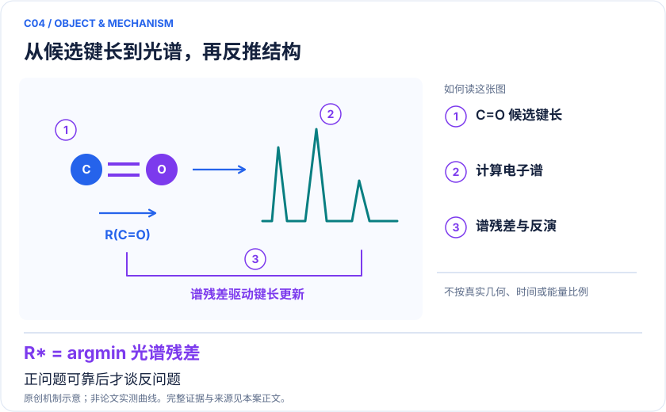
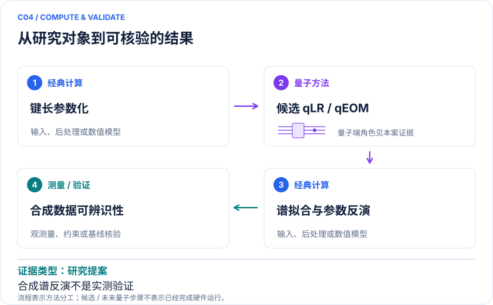

<!-- 由 release/tools/build_problems.py 自 tasks/C04-formaldehyde-spectral-inverse/README.md 与 tasks/catalog.json 生成，勿手改 -->

# C04 · 甲醛电子谱与键长反演：可验收的光谱求解器原型

> 开放题 · 交叉方向与算法 · 光谱与模型反演

## 题面

| 环节 | 内容 |
|---|---|
| 研究体系 | H₂CO有限活性空间，理想化C₂v几何族 |
| 可观测量 | 前三个激发单重态的能隙、取向平均偶极强度、C=O键长区间 |
| 经典基线 | 同模型多态CASCI+偶极矩阵元；经典网格/贝叶斯参数推断 |
| 量子方法的角色 | qLR、qEOM、多态VQE或相关函数计算谱，经典外层反演 |
| 研发决策 | 检验量子前向模拟能否给参数反演提供可信信息，再迁移至复杂分子。 |

## 基准输入

原文输入没有完全公开。下表是参照运行实际使用的替代输入，解法可以沿用以便直接比较；取得原文输入或改用其他输入时请说明理由。「原文」指作者或原论文公开的材料，「参照」指本项目参照运行自行冻结的选择。

| 项目 | 内容 | 出处 |
|---|---|---|
| 参照所用模型 | 甲醛 def2-SVP、CAS(6,5)（题库原始问题单拟定），理想化 C₂v 几何上的 11 个键长点 | 参照 |
| 方法来源 | 量子线性响应计算分子响应性质 | [原文](https://arxiv.org/abs/2301.06260) |

**尚未公开或需注意：**键长网格之外的几何参数需在解法中写明。

## 什么算解

一份解法满足以下五点即可提交审核。负结果同样接受，只要过程可复现、结论有依据。

1. **模型对应**：说明所用模型或数据如何对应「H₂CO有限活性空间，理想化C₂v几何族」，列出简化与近似。
2. **可观测量**：报告「前三个激发单重态的能隙、取向平均偶极强度、C=O键长区间」，附单位与不确定度。
3. **经典对照**：在同一模型或数据上，与「同模型多态CASCI+偶极矩阵元；经典网格/贝叶斯参数推断」中至少一种方法比较。
4. **可复现**：提供代码、环境、随机种子、输入来源与哈希，以及计算资源和成本；用到 QPU 时注明设备与 shots。
5. **研发决策**：说明结果能否支撑「检验量子前向模拟能否给参数反演提供可信信息，再迁移至复杂分子。」，以及还缺什么证据。

本题的细化标准欢迎在 issue 中讨论；被采纳的讨论结论会写入后续版本。

## 现有参照

本项目已有数值执行记录（经典计算机上的计算与模拟），供对照与复用，不代表最优解。

- 原应用目标：未完成（incomplete）
- 最新研究报告：[REFERENCE.md](REFERENCE.md)
- 其余证据指针见 evidence.json（本地证据，未随题库发布）

### 原案例说明

### C04 · 甲醛电子谱与键长反演：可验收的光谱求解器原型

<!-- VISUALS:START -->
#### 可视化导读

**图 1 · 从候选键长到光谱，再反推结构。** 正问题可靠后才谈反问题。前三个激发单重态的能隙、取向平均偶极强度、C=O键长区间。图形为依据本案文献重绘的概念关系，不表示实际原子坐标、实测曲线或数值比例。

**图 2 · 计算与验证路径。** qLR、qEOM、多态VQE或相关函数计算谱，经典外层反演。**证据边界：** 合成谱上的可辨识性不等于真实光谱可反演，更不能自动迁移到复杂分子。

图解依据：[R1 · Quantum simulation of molecular response properties](https://arxiv.org/abs/2301.06260)；[R2 · Reduced density matrix formulation of quantum linear response](https://arxiv.org/abs/2404.16586)。解释性连线与图形布局由本库整理，未复制论文原图。

[机制图 SVG](mechanism.svg) · [流程图 SVG](workflow.svg) · 机制图 PNG（本地证据，未随题库发布） · 流程图 PNG（本地证据，未随题库发布） · 图解说明 JSON（本地证据，未随题库发布）
<!-- VISUALS:END -->

更新：2026-10-04｜领域：材料计算｜证据类型：研究提案｜建议优先级：近期验证

> 适合作为谱计算和不确定性验证任务；甲醛本身不是已证实的高商业价值量子应用。

#### 研究对象与范围

H₂CO有限活性空间，理想化C₂v几何族。PDF拟定CAS(4,3)/CAS(6,5)，6/10系统比特；非已完成硬件规模。

#### 来源与文档关系

晓梦_Quantum_Science_Challenge_六方向赛题说明书.pdf: 14–16页 SPEC-H2CO。原文档的任务阈值按提案保留，不视为论文结果。

#### 问题定义与研发价值

把方法验证和产业价值分开：甲醛用于构建可信裁判，实际需求是从谱学识别结构或反应中间体。前向谱中能量与跃迁矩都正确，反演仍可能存在多解，因此本案尤其适合检验“量子结果是否改变决策”。

#### 计算目标与分工

按PDF取w_k=(|μ_x|²+|μ_y|²+|μ_z|²)/3，使用固定展宽叠加Lorentzian；w_k不是无量纲振子强度。反演模型y=K[S(r)]+ε中显式给出仪器响应K与噪声。量子求解前向谱，经典推断键长及区间。

#### 文献证据解读

[R1]研究qLR/qEOM与响应性质的无噪模拟；[R2]把RDM驱动qLR扩展到较大基组的分子谱。这两篇支持方法选择，不支持“甲醛隐藏键长在QPU上已经准确恢复”。本库将它单列为提案，防止混淆。

#### 试点输入与执行建议

保存每个几何的电子积分、常数、轨道顺序和三个偶极算符；提供可受控生成网格间几何的前向接口。先核对暗态与强度归一化，再在固定预算下比较固定采样与自适应时间/频率采样。留出网格间键长而不是仅记忆11个公开点。

#### 验收与停止条件

PDF建议激发能≤0.03 eV、非暗峰谱重相对误差≤5%、可辨识实例键长误差≤0.02 Å；均为任务拟定阈值。不可分辨实例评价区间覆盖率和拒判。出现模型失配仍给极窄区间应判失败。

#### 资源与可迁移边界

CAS(6,5)的M_s=0扇区仅100维；适合建立软件基准，不适合宣称算力优势。迁移到真实光谱时需补溶剂、振动、Rydberg态与实验校准，且不应沿用未经确认的误差门槛。

#### 核心判断与下一步

**已报告结果：**量子线性响应与RDM方法已有论文支持，但PDF定义的H₂CO谱→键长任务本轮未找到直接完成证据。[R1][R2]

**边界：**合成谱上的可辨识性不等于真实光谱可反演，更不能自动迁移到复杂分子。

**下一步建议：**先生成含仪器响应和失配压力测试的独立合成数据。

本轮完成的是文献整理；没有执行本案例的数值、硬件或湿实验复现。

#### 文献与访问深度

- [R1] [Quantum simulation of molecular response properties](https://arxiv.org/abs/2301.06260)，2023，预印本。访问：`abstract`。支持：qLR/qEOM 响应方法及无噪模拟；不支持本题甲醛反演已在硬件完成。

- [R2] [Reduced density matrix formulation of quantum linear response](https://arxiv.org/abs/2404.16586)，2024，预印本。访问：`abstract`。支持：RDM 路线计算分子谱，示例苯、R-methyloxirane、水；不把这些对象冒充甲醛。

## 如何提交

按 [CONTRIBUTING.md](../../../CONTRIBUTING.md) 把解法放在 `solutions/C04/<你的名字>-<短名>/`，格式见 [解法模板](../../../solutions/_template/SOLUTION.md)。被采纳的解法会按 [沉淀规则](../../../skills/README.md) 提炼为可复用的 skill。
