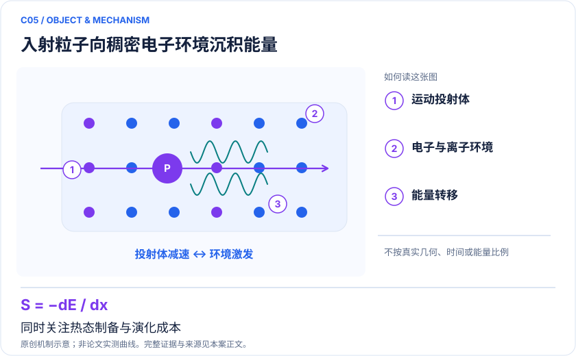
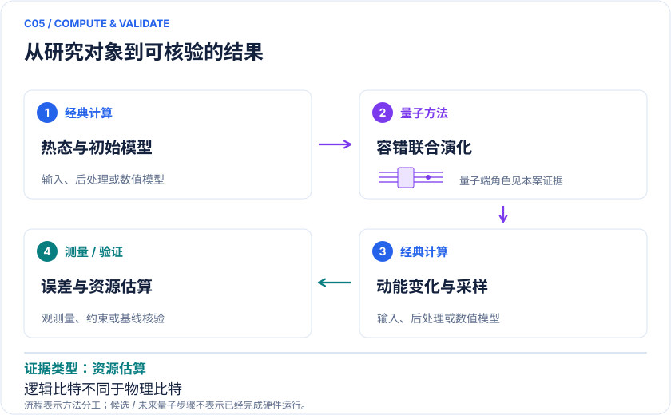

<!-- 由 release/tools/build_problems.py 自 tasks/C05-warm-dense-stopping/README.md 与 tasks/catalog.json 生成，勿手改 -->

# C05 · 温稠密物质阻止本领：聚变靶材的能量沉积

> 开放题 · 交叉方向与算法 · 极端条件材料

## 题面

| 环节 | 内容 |
|---|---|
| 研究体系 | 有限温度电子与带电入射粒子的第一量子化模型 |
| 可观测量 | S(v)=−dE_projectile/dx，速度/温度/密度依赖及统计误差 |
| 经典基线 | 实时TDDFT、模型势与有限尺寸/时间步收敛；可解小模型精确传播 |
| 量子方法的角色 | 非Born–Oppenheimer联合演化，qubitization/Trotter与动能测量 |
| 研发决策 | 降低聚变靶模拟中粒子能量沉积的不确定性，约束靶设计模型。 |

## 什么算解

一份解法满足以下五点即可提交审核。负结果同样接受，只要过程可复现、结论有依据。

1. **模型对应**：说明所用模型或数据如何对应「有限温度电子与带电入射粒子的第一量子化模型」，列出简化与近似。
2. **可观测量**：报告「S(v)=−dE_projectile/dx，速度/温度/密度依赖及统计误差」，附单位与不确定度。
3. **经典对照**：在同一模型或数据上，与「实时TDDFT、模型势与有限尺寸/时间步收敛；可解小模型精确传播」中至少一种方法比较。
4. **可复现**：提供代码、环境、随机种子、输入来源与哈希，以及计算资源和成本；用到 QPU 时注明设备与 shots。
5. **研发决策**：说明结果能否支撑「降低聚变靶模拟中粒子能量沉积的不确定性，约束靶设计模型。」，以及还缺什么证据。

本题的细化标准欢迎在 issue 中讨论；被采纳的讨论结论会写入后续版本。

## 现有参照

本项目已有数值执行记录（经典计算机上的计算与模拟），供对照与复用，不代表最优解。

- 原应用目标：未完成（incomplete）
- 最新研究报告：[REFERENCE.md](REFERENCE.md)
- 其余证据指针见 evidence.json（本地证据，未随题库发布）

### 原案例说明

### C05 · 温稠密物质阻止本领：聚变靶材的能量沉积

<!-- VISUALS:START -->
#### 可视化导读

**图 1 · 入射粒子向稠密电子环境沉积能量。** 同时关注热态制备与演化成本。S(v)=−dE_projectile/dx，速度/温度/密度依赖及统计误差。图形为依据本案文献重绘的概念关系，不表示实际原子坐标、实测曲线或数值比例。

**图 2 · 计算与验证路径。** 非Born–Oppenheimer联合演化，qubitization/Trotter与动能测量。**证据边界：** 依赖初始热态近似、时间演化和大量采样；不得把逻辑比特需求直接当物理比特需求。

图解依据：[R1 · Quantum computation of stopping power for inertial fusion target design](https://arxiv.org/abs/2308.12352)；[R2 · Quantum computation of stopping power for inertial fusion target design — published full text](https://pmc.ncbi.nlm.nih.gov/articles/PMC11161767/)。解释性连线与图形布局由本库整理，未复制论文原图。

[机制图 SVG](mechanism.svg) · [流程图 SVG](workflow.svg) · 机制图 PNG（本地证据，未随题库发布） · 流程图 PNG（本地证据，未随题库发布） · 图解说明 JSON（本地证据，未随题库发布）
<!-- VISUALS:END -->

更新：2026-10-04｜领域：材料计算｜证据类型：资源估算｜建议优先级：重点储备

> 论文给出容错量子算法与资源估算，目标是电子—入射粒子非平衡能量交换。

#### 研究对象与范围

有限温度电子与带电入射粒子的第一量子化模型。逻辑量子比特和Toffoli估算依目标密度、基组、时间与精度变化；无当前硬件完成证明。

#### 来源与文档关系

量子计算问题库_飞书多维表格导入版.xlsx: M42–M44、S17。原文档的任务阈值按提案保留，不视为论文结果。

#### 问题定义与研发价值

阻止本领影响带电粒子在介质中沉积多少能量。对于温稠密区，电子关联与强非平衡同时出现，单纯常温材料数据库无法代替。高价值来自其对多尺度聚变计算输入的影响，而非孤立求取一个难哈密顿量的基态。

#### 计算目标与分工

经典侧冻结成分、体积、温度、粒子速度与初态约定；量子侧对电子与粒子联合传播并估计粒子动能；经典侧在合适位移窗口拟合能量损失斜率。不同速度对应不同任务，不能只报单条轨迹的能量。

#### 文献证据解读

[R1]是资源研究。论文比较QPE化学参照与动力学成本，说明“同量级逻辑比特”不意味着同运行时间。PMC检索可见的正文方法段强调可观测量选择改变测量开销；本次直接PMC访问受限，细节以公开摘要和可见段落为边界。[R2]

#### 试点输入与执行建议

先取可精确传播的小电子—粒子格点/平面波模型，验证粒子损失与电子吸收的能量账本。复现论文资源脚本前记录版本和许可；统一Trotter/qubitization在相同总误差上的门计数。扫描窗口、速度、有限尺寸与热态近似。

#### 验收与停止条件

建议要求守恒量、斜率拟合与有限尺寸均收敛到预设容差；资源估算表需可由参数重新生成。若初态误差已大于待分辨的材料差异，先改善模型；没有容错门错误预算时不输出物理设备报价或完工年份。

#### 资源与可迁移边界

本案不等同于温稠密态方程、全输运张量或宏观点火模拟。后续价值验证需要说明阻止本领改善如何改变宏观误差条，并与实时TDDFT在同精度、同条件下比较。

#### 核心判断与下一步

**已报告结果：**2023预印本、2024 PNAS工作建立计算阻止本领的容错协议，并比较逻辑比特和Toffoli资源；不是聚变靶QPU实验。[R1]

**边界：**依赖初始热态近似、时间演化和大量采样；不得把逻辑比特需求直接当物理比特需求。

**下一步建议：**复算一个论文资源表项，并把初态与测量成本纳入完整误差预算。

本轮完成的是文献整理；没有执行本案例的数值、硬件或湿实验复现。

#### 文献与访问深度

- [R1] [Quantum computation of stopping power for inertial fusion target design](https://arxiv.org/abs/2308.12352)，2024，期刊论文。访问：`abstract`。支持：容错算法、有限温度多粒子动力学与资源估算；PNAS DOI 10.1073/pnas.2317772121。

- [R2] [Quantum computation of stopping power for inertial fusion target design — published full text](https://pmc.ncbi.nlm.nih.gov/articles/PMC11161767/)，2024，期刊论文。访问：`search_excerpt`。支持：检索返回方法段关于动能测量与初态；直接打开遇验证码，未宣称通读。

## 如何提交

按 [CONTRIBUTING.md](../../../CONTRIBUTING.md) 把解法放在 `solutions/C05/<你的名字>-<短名>/`，格式见 [解法模板](../../../solutions/_template/SOLUTION.md)。被采纳的解法会按 [沉淀规则](../../../skills/README.md) 提炼为可复用的 skill。
