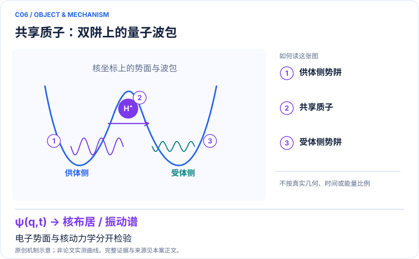
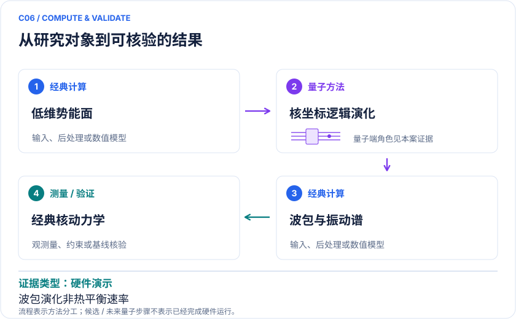

<!-- 由 release/tools/build_problems.py 自 tasks/C06-hydrogen-bond-wavepacket/README.md 与 tasks/catalog.json 生成，勿手改 -->

# C06 · 共享质子波包与非谐振动谱：核量子效应的硬件原型

> 开放题 · 交叉方向与算法 · 核量子与跨尺度

## 题面

| 环节 | 内容 |
|---|---|
| 研究体系 | 固定核骨架下的约化维数共享质子势能模型 |
| 可观测量 | 质子空间概率、时间相关函数、非谐振动峰 |
| 经典基线 | DVR、split-operator/FFT、Krylov、MCTDH；热效应用路径积分 |
| 量子方法的角色 | 离散核坐标映射与量子逻辑演化；与电子结构计算串接 |
| 研发决策 | 识别何时必须显式处理核量子运动，为氢键材料与质子转移模型提供校验。 |

## 基准输入

解法默认使用下列输入，以便与现有参照和其他解法直接比较；改用其他输入时请说明理由。「原文」指作者或原论文公开的材料，「参照」指本项目参照运行自行冻结的选择。

| 项目 | 内容 | 出处 |
|---|---|---|
| 哈密顿量 | 作者公开 8×8 数值 Hamiltonian（arXiv v2） | [原文](https://arxiv.org/abs/2204.08571v2) |

**尚未公开或需注意：**128 点势能面、DAF 与精确坐标未公开；公开矩阵与出版版约 800 cm⁻¹ 的叙述不一致。

## 什么算解

一份解法满足以下五点即可提交审核。负结果同样接受，只要过程可复现、结论有依据。

1. **模型对应**：说明所用模型或数据如何对应「固定核骨架下的约化维数共享质子势能模型」，列出简化与近似。
2. **可观测量**：报告「质子空间概率、时间相关函数、非谐振动峰」，附单位与不确定度。
3. **经典对照**：在同一模型或数据上，与「DVR、split-operator/FFT、Krylov、MCTDH；热效应用路径积分」中至少一种方法比较。
4. **可复现**：提供代码、环境、随机种子、输入来源与哈希，以及计算资源和成本；用到 QPU 时注明设备与 shots。
5. **研发决策**：说明结果能否支撑「识别何时必须显式处理核量子运动，为氢键材料与质子转移模型提供校验。」，以及还缺什么证据。

本题的细化标准欢迎在 issue 中讨论；被采纳的讨论结论会写入后续版本。

## 现有参照

本项目已有数值执行记录（经典计算机上的计算与模拟），供对照与复用，不代表最优解。

- 原应用目标：未完成（incomplete）
- 最新研究报告：[REFERENCE.md](REFERENCE.md)
- 其余证据指针见 evidence.json（本地证据，未随题库发布）

### 原案例说明

### C06 · 共享质子波包与非谐振动谱：核量子效应的硬件原型

<!-- VISUALS:START -->
#### 可视化导读

**图 1 · 共享质子：双阱上的量子波包。** 电子势面与核动力学分开检验。质子空间概率、时间相关函数、非谐振动峰。图形为依据本案文献重绘的概念关系，不表示实际原子坐标、实测曲线或数值比例。

**图 2 · 计算与验证路径。** 离散核坐标映射与量子逻辑演化；与电子结构计算串接。**证据边界：** 时间依赖波包不直接给出热平衡反应速率；小维数势面可由经典方法高精度处理。

图解依据：[R1 · Quantum Computation of Hydrogen Bond Dynamics and Vibrational Spectra](https://arxiv.org/abs/2204.08571)；[R2 · Nonadiabatic nuclear-electron dynamics: a quantum computing approach](https://arxiv.org/abs/2306.01671)。解释性连线与图形布局由本库整理，未复制论文原图。

[机制图 SVG](mechanism.svg) · [流程图 SVG](workflow.svg) · 机制图 PNG（本地证据，未随题库发布） · 流程图 PNG（本地证据，未随题库发布） · 图解说明 JSON（本地证据，未随题库发布）
<!-- VISUALS:END -->

更新：2026-10-04｜领域：材料计算｜证据类型：硬件演示｜建议优先级：近期验证

> 离子阱实验模拟低维氢键中的共享质子波包，并提取振动频率。

#### 研究对象与范围

固定核骨架下的约化维数共享质子势能模型。少量逻辑自由度映射至离子阱；不是完整氢键网络与电子共同从头模拟。

#### 来源与文档关系

量子计算问题库_飞书多维表格导入版.xlsx: M22/M39/M41、S16。原文档的任务阈值按提案保留，不视为论文结果。

#### 问题定义与研发价值

氢键质子的离域、零点运动和非谐性可能影响光谱与迁移。本案的首要用途是区分“电子能量算准”和“核运动算准”：前者提供势能，后者决定波包传播。用于真实质子导体或酶时，还需温度、环境及多维反应坐标。

#### 计算目标与分工

在冻结势面V(x)上使用H_n=−ℏ²∂²/(2m∂x²)+V(x)，传播初始波包。量子位编码离散位置或核基函数，经典侧处理势面和FFT谱。若更换H为D，同位素质量改变核哈密顿量，而不是任意调节电子势垒。

#### 文献证据解读

[R1]支持硬件上的约化核动力学演示。[R2]是电子与质子联合处理的另一条路线，应用于丙二醛原型；两者针对不同近似层次。本案仅把已读取摘要支持的尺度与方法写成事实。

#### 试点输入与执行建议

准备势能表、长度与能量单位、边界条件、质量、初态、采样时间和谱窗。检查空间网格与时间截断收敛，保存原始P(x,t)和自相关函数。等预算比较直接编译、Trotter与经典Krylov；另设非对称双阱以测试迁移性。

#### 验收与停止条件

建议要求概率守恒、对称极限与可解谐振子极限正确；峰位与参考的误差门槛由具体谱学任务预先定义。低维结果稳定后才增加维数。若谱峰依窗口变化超过候选间差异，不进入材料排序。

#### 资源与可迁移边界

论文3.3 cm⁻¹不能作为所有体系默认阈值。振动能级、隧穿劈裂、热速率与KIE是不同输出。速率要热平均或相关函数理论，KIE要匹配同位素模型；本轮不报告计算完成。

#### 核心判断与下一步

**已报告结果：**Richerme等在QSCOUT上进行概念实验，报告振动频率达到3.3 cm⁻¹量级谱学精度；该数字限于论文模型和比较。[R1]

**边界：**时间依赖波包不直接给出热平衡反应速率；小维数势面可由经典方法高精度处理。

**下一步建议：**冻结势能网格与质量，先独立DVR核验，再比较线路演化误差。

本轮完成的是文献整理；没有执行本案例的数值、硬件或湿实验复现。

#### 文献与访问深度

- [R1] [Quantum Computation of Hydrogen Bond Dynamics and Vibrational Spectra](https://arxiv.org/abs/2204.08571)，2023，期刊论文。访问：`abstract`。支持：QSCOUT共享质子与振动频率；预印本2022、期刊2023。

- [R2] [Nonadiabatic nuclear-electron dynamics: a quantum computing approach](https://arxiv.org/abs/2306.01671)，2023，预印本。访问：`abstract`。支持：多组分电子—核耦合扩展，不能与单核波包混为一谈。

## 如何提交

按 [CONTRIBUTING.md](../../../CONTRIBUTING.md) 把解法放在 `solutions/C06/<你的名字>-<短名>/`，格式见 [解法模板](../../../solutions/_template/SOLUTION.md)。被采纳的解法会按 [沉淀规则](../../../skills/README.md) 提炼为可复用的 skill。
