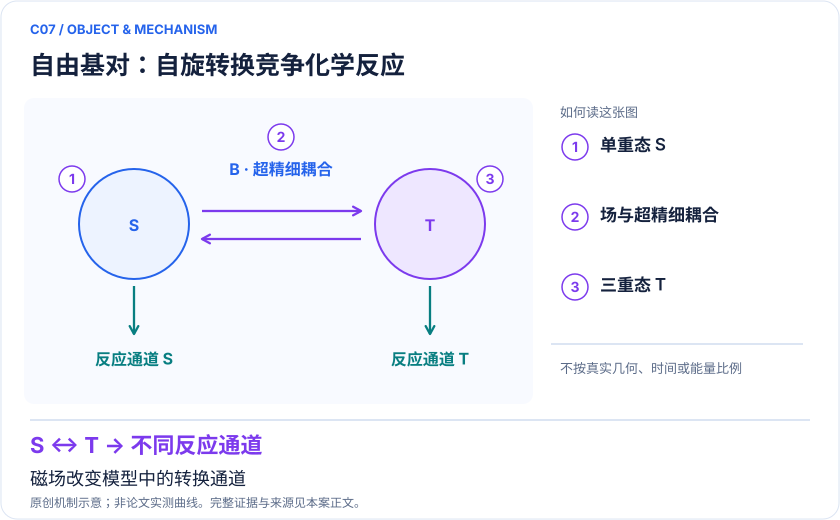
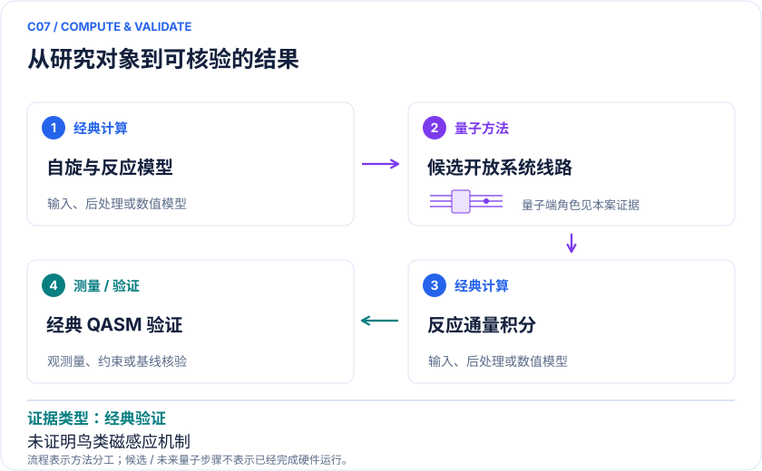

# C07 · 自由基对自旋化学：磁场方向与化学产率的模型连接

<!-- VISUALS:START -->
## 可视化导读

**图 1 · 自由基对：自旋转换竞争化学反应。** 磁场改变模型中的转换通道。单重/三重态概率、积分反应产率、角向各向异性。图形为依据本案文献重绘的概念关系，不表示实际原子坐标、实测曲线或数值比例。

**图 2 · 计算与验证路径。** 酉扩张编码开放系统通道并测反应通量。**证据边界：** 模型结果不能证明某种鸟类磁感应机制，也不直接形成药效或诊疗应用。

图解依据：[R1 · Quantum Simulation of the Radical Pair Dynamics of the Avian Compass](https://arxiv.org/abs/2211.15427)；[R2 · Introduction to modelling radical pair quantum spin dynamics with tensor networks](https://arxiv.org/abs/2509.22104)。解释性连线与图形布局由本库整理，未复制论文原图。

[机制图 SVG](mechanism.svg) · [流程图 SVG](workflow.svg)
<!-- VISUALS:END -->

更新：2026-10-04｜领域：生物医药｜证据类型：经典验证｜建议优先级：重点储备

> 量子线路已在QASM模拟器上模拟鸟类磁感应自由基对模型；需要强经典自旋基线。

## 研究对象与范围

自由基对电子自旋及少量核自旋，简化生物罗盘模型。2023文献在IBM QASM模拟器演示；QASM不是实机。

## 来源与文档关系

量子计算问题库_飞书多维表格导入版.xlsx: B28、S26。原文档的任务阈值按提案保留，不视为论文结果。

## 问题定义与研发价值

把磁场对自旋演化的作用与化学产率联系，是一个可计算的机制问题。本案价值主要在生物物理模型判别和自旋化学组件；对药物研发的迁移仍间接，不能因属于量子生物学就认定QPU已必需。

## 计算目标与分工

模型含电子Zeeman项、核自旋超精细张量、可能的交换/偶极项与单重/三重复合。目标Φ_S=∫k_S Tr[P_Sρ(t)]dt；传播时应同时检查反应通量和存活概率。经典侧冻结参数，量子侧实现通道，经典积分得到产率。

## 文献证据解读

[R1]明确设备为IBM QASM simulator，故本库列“经典验证”。[R2]提示经典张量网络已经能针对这类结构优化，不能只与指数维数的稠密矩阵比较。尚无本案端到端速度或生物预测优势结论。

## 试点输入与执行建议

从一个核自旋与两个电子自旋开始，记录磁场单位和超精细张量坐标系。用同一复合模型生成精确参考，扫描磁场极角和复合率。比较酉扩张、轨迹采样与直接主方程；加入更多核时使用张量网络比较内存和误差。

## 验收与停止条件

建议检查零场和各向同性耦合极限、通道完全正性、概率账本以及时间积分收敛。若模型参数的不确定性掩盖量子线路误差，优先做参数敏感性而不是加比特。与实验拟合必须留出磁场/取向条件。

## 资源与可迁移边界

酉扩张需要环境/辅助比特或后选择，成功概率和重试应计费。大量不同角度与速率是多实例吞吐任务，不能只报单条线路深度。高价值取决于能否排除机制，不能只看演化曲线相似。

## 核心判断与下一步

**已报告结果：**Zhang等将酉扩张算法应用于自由基对开放动力学，在模拟器验证。[R1]

**边界：**模型结果不能证明某种鸟类磁感应机制，也不直接形成药效或诊疗应用。

**下一步建议：**建立同一超精细张量与复合率的量子/经典对照。

本轮完成的是文献整理；没有执行本案例的数值、硬件或湿实验复现。

## 文献与访问深度

- [R1] [Quantum Simulation of the Radical Pair Dynamics of the Avian Compass](https://arxiv.org/abs/2211.15427)，2023，期刊论文。访问：`abstract`。支持：QASM模拟器而非真实QPU；酉扩张开放动力学。

- [R2] [Introduction to modelling radical pair quantum spin dynamics with tensor networks](https://arxiv.org/abs/2509.22104)，2025，预印本。访问：`abstract`。支持：经典张量网络是应纳入的竞争路线。
