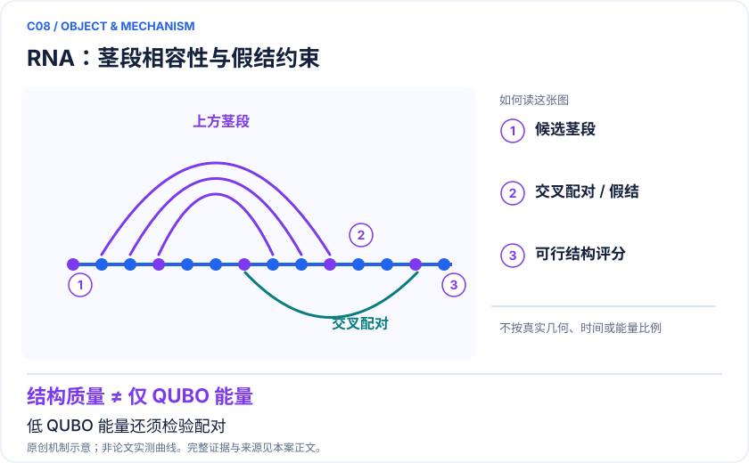

<!-- 由 release/tools/build_problems.py 自 tasks/C08-rna-annealing/README.md 与 tasks/catalog.json 生成，勿手改 -->

# C08 · RNA 二级结构与假结：退火编码的成功与规模失效

> 开放题 · 交叉方向与算法 · RNA与离散优化

## 题面

| 环节 | 内容 |
|---|---|
| 研究体系 | 茎选择的BQM/QUBO RNA二级结构与假结模型 |
| 可观测量 | 碱基配对F1、假结正确率、物理可行率、达到指定质量的总时间 |
| 经典基线 | 同BQM的REMC/模拟退火；专门RNA结构预测软件与实验结构 |
| 量子方法的角色 | 量子退火抽样茎组合，经典前处理/后处理负责编码和约束 |
| 研发决策 | 判断量子退火是否能为RNA构象候选提供有效增量，避免投资错误的能量模型。 |

## 基准输入

解法默认使用下列输入，以便与现有参照和其他解法直接比较；改用其他输入时请说明理由。「原文」指作者或原论文公开的材料，「参照」指本项目参照运行自行冻结的选择。

| 项目 | 内容 | 出处 |
|---|---|---|
| 序列与参考结构 | biotin-PK-AN69.1（PseudoBase PKB00176）33 nt 序列及 11 对带假结的参考配对 | [原文](https://www.ekevanbatenburg.nl/PKBASE/PKB00176.HTML) |
| 论文与代码 | PLOS Comput Biol 2022 SI Table A/D（18 茎、Hybrid 分 −117）；作者代码固定 commit | [原文](https://github.com/dillionfox/quantum_rna_folding/tree/87226da5acbc5e5f67bb121573f8896b179900f9) |

**尚未公开或需注意：**作者代码引用的 test_sets/pseudobase_data_clean.csv 未随仓库公开。

## 什么算解

一份解法满足以下五点即可提交审核。负结果同样接受，只要过程可复现、结论有依据。

1. **模型对应**：说明所用模型或数据如何对应「茎选择的BQM/QUBO RNA二级结构与假结模型」，列出简化与近似。
2. **可观测量**：报告「碱基配对F1、假结正确率、物理可行率、达到指定质量的总时间」，附单位与不确定度。
3. **经典对照**：在同一模型或数据上，与「同BQM的REMC/模拟退火；专门RNA结构预测软件与实验结构」中至少一种方法比较。
4. **可复现**：提供代码、环境、随机种子、输入来源与哈希，以及计算资源和成本；用到 QPU 时注明设备与 shots。
5. **研发决策**：说明结果能否支撑「判断量子退火是否能为RNA构象候选提供有效增量，避免投资错误的能量模型。」，以及还缺什么证据。

本题的细化标准欢迎在 issue 中讨论；被采纳的讨论结论会写入后续版本。

## 现有参照

本项目已有数值执行记录（经典计算机上的计算与模拟），供对照与复用，不代表最优解。

- 原应用目标：未完成（incomplete）
- 最新研究报告：[REFERENCE.md](REFERENCE.md)
- 其余证据指针见 evidence.json（本地证据，未随题库发布）

### 原案例说明

### C08 · RNA 二级结构与假结：退火编码的成功与规模失效

<!-- VISUALS:START -->
#### 可视化导读

**图 1 · RNA：茎段相容性与假结约束。** 低 QUBO 能量还须检验配对。碱基配对F1、假结正确率、物理可行率、达到指定质量的总时间。图形为依据本案文献重绘的概念关系，不表示实际原子坐标、实测曲线或数值比例。

**图 2 · 计算与验证路径。** 量子退火抽样茎组合，经典前处理/后处理负责编码和约束。**证据边界：** 找到QUBO低能解不代表RNA真实构象正确；特定编码失败也不证明所有带辅助变量的QUBO都不可能。

图解依据：[R1 · RNA folding using quantum computers](https://journals.plos.org/ploscompbiol/article?id=10.1371/journal.pcbi.1010032)；[R2 · Exploring the Boundaries of Modern Quantum Annealers with RNA Structure Prediction](https://pubs.acs.org/doi/10.1021/acs.jpcb.5c07902)。解释性连线与图形布局由本库整理，未复制论文原图。

[机制图 SVG](mechanism.svg) · [流程图 SVG](workflow.svg) · 机制图 PNG（本地证据，未随题库发布） · 流程图 PNG（本地证据，未随题库发布） · 图解说明 JSON（本地证据，未随题库发布）
<!-- VISUALS:END -->

更新：2026-10-04｜领域：生物医药｜证据类型：硬件演示｜建议优先级：探索观察

> 短RNA退火演示与较长序列模型失败证据并存；先验证目标函数，再比较求解器。

#### 研究对象与范围

茎选择的BQM/QUBO RNA二级结构与假结模型。2022硬件小实例；2026再评估研究用经典模拟退火分析较长序列。

#### 来源与文档关系

量子计算问题库_飞书多维表格导入版.xlsx: X04、S29。原文档的任务阈值按提案保留，不视为论文结果。

#### 问题定义与研发价值

RNA二级结构能为设计提供线索，但RNA功能还受动力学、修饰和细胞环境影响。此案例价值在于建立一个能及时停止错误路线的基准：当优化器更会找低能而生物结构更差时，瓶颈在目标模型。

#### 计算目标与分工

将候选茎是否出现编码为二元变量，包含茎奖励、冲突和假结相关项；最小化xᵀQx。前处理枚举候选茎可能已昂贵，退火机只求编码目标；后处理解码并与参考碱基配对比较。无假结的经典动态规划与含假结模型复杂度不同，不能统一声称所有RNA折叠都指数困难。

#### 文献证据解读

[R1]有真实退火与同目标REMC对照。[R2]使用dwave模拟退火程序检查较长序列的模型，不应被写成最新QPU速度实验。其方法/结果段以2783条、≤300碱基为数据口径，导言摘要片段出现2738，故精确样本数正式复现应以数据文件确认。

#### 试点输入与执行建议

取得公开代码、序列、参考配对与许可，按RNA家族留出而非仅随机切分。记录茎枚举、QUBO构造、嵌入、QPU队列、采样和后处理时间。对照同目标模拟退火以及物理/学习型RNA方法，分别画目标能量与生物F1曲线。

#### 验收与停止条件

建议接受条件是外部序列上的配对/假结质量在等预算下有稳定增量，而非只降低编码能量。若更低能持续对应更多错误配对，停止硬件规模扩展，优先重构目标函数。增加高阶物理项转为二次形式时，必须计入辅助变量与嵌入成本。

#### 资源与可迁移边界

量子退火物理比特数与逻辑变量数不同；致密茎冲突关系会增加嵌入负担。现有结果没有建立mRNA疫苗设计的端到端效益。本案既保留积极演示，也保留反例，优先级为探索观察。

#### 核心判断与下一步

**已报告结果：**2022论文报告量子退火在其目标函数下竞争性结果；2026研究指出所考察QUBO随长度增长准确性下降、结构过密等问题。[R1][R2]

**边界：**找到QUBO低能解不代表RNA真实构象正确；特定编码失败也不证明所有带辅助变量的QUBO都不可能。

**下一步建议：**复核2022公开代码，并对固定外部测试集同时评估能量与配对质量。

本轮完成的是文献整理；没有执行本案例的数值、硬件或湿实验复现。

#### 文献与访问深度

- [R1] [RNA folding using quantum computers](https://journals.plos.org/ploscompbiol/article?id=10.1371/journal.pcbi.1010032)，2022，期刊论文。访问：`full_text`。支持：BQM、QA/REMC对照、代码和数据入口。

- [R2] [Exploring the Boundaries of Modern Quantum Annealers with RNA Structure Prediction](https://pubs.acs.org/doi/10.1021/acs.jpcb.5c07902)，2026，期刊论文。访问：`search_excerpt`。支持：2026对该类编码的经典模拟退火负面评估；搜索可读方法段，直接打开403。

## 如何提交

按 [CONTRIBUTING.md](../../../CONTRIBUTING.md) 把解法放在 `solutions/C08/<你的名字>-<短名>/`，格式见 [解法模板](../../../solutions/_template/SOLUTION.md)。被采纳的解法会按 [沉淀规则](../../../skills/README.md) 提炼为可复用的 skill。
