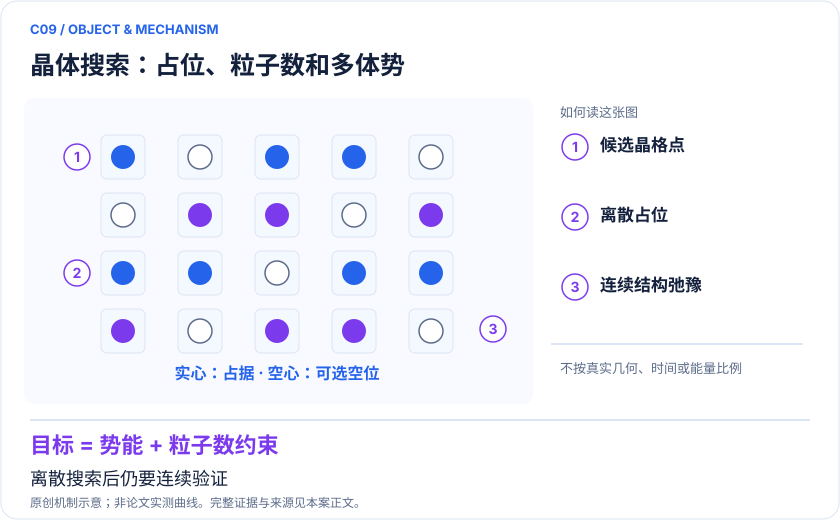

<!-- 由 release/tools/build_problems.py 自 tasks/C09-crystal-annealing/README.md 与 tasks/catalog.json 生成，勿手改 -->

# C09 · 晶体结构与粒子数联合搜索：多体势的退火编码

> 开放题 · 交叉方向与算法 · 结构搜索与优化

## 题面

| 环节 | 内容 |
|---|---|
| 研究体系 | 离散晶胞中的粒子占据；Lennard–Jones团簇与共价单层MoS₂ |
| 可观测量 | 低能结构命中率、势函数能、密度、连续弛豫后结构身份 |
| 经典基线 | 同势的模拟退火、basin hopping、遗传/随机搜索及连续弛豫 |
| 量子方法的角色 | QUBO/HUBO编码与退火；可接因子分解机代理模型 |
| 研发决策 | 寻找预设势函数下低能结构与粒子密度，为结构搜索提出候选。 |

## 什么算解

一份解法满足以下五点即可提交审核。负结果同样接受，只要过程可复现、结论有依据。

1. **模型对应**：说明所用模型或数据如何对应「离散晶胞中的粒子占据；Lennard–Jones团簇与共价单层MoS₂」，列出简化与近似。
2. **可观测量**：报告「低能结构命中率、势函数能、密度、连续弛豫后结构身份」，附单位与不确定度。
3. **经典对照**：在同一模型或数据上，与「同势的模拟退火、basin hopping、遗传/随机搜索及连续弛豫」中至少一种方法比较。
4. **可复现**：提供代码、环境、随机种子、输入来源与哈希，以及计算资源和成本；用到 QPU 时注明设备与 shots。
5. **研发决策**：说明结果能否支撑「寻找预设势函数下低能结构与粒子密度，为结构搜索提出候选。」，以及还缺什么证据。

本题的细化标准欢迎在 issue 中讨论；被采纳的讨论结论会写入后续版本。

## 现有参照

本项目已有数值执行记录（经典计算机上的计算与模拟），供对照与复用，不代表最优解。

- 原应用目标：未完成（incomplete）
- 最新研究报告：[REFERENCE.md](REFERENCE.md)
- 其余证据指针见 evidence.json（本地证据，未随题库发布）

### 原案例说明

### C09 · 晶体结构与粒子数联合搜索：多体势的退火编码

<!-- VISUALS:START -->
#### 可视化导读

**图 1 · 晶体搜索：占位、粒子数和多体势。** 离散搜索后仍要连续验证。低能结构命中率、势函数能、密度、连续弛豫后结构身份。图形为依据本案文献重绘的概念关系，不表示实际原子坐标、实测曲线或数值比例。

**图 2 · 计算与验证路径。** QUBO/HUBO编码与退火；可接因子分解机代理模型。**证据边界：** 既定经验势最低能不等于第一性原理稳定，更不等于实验可合成。

图解依据：[R1 · Annealing for prediction of grand canonical crystal structures: Efficient implementation of n-body atomic interactions](https://arxiv.org/abs/2307.03123)；[R2 · Machine learning supported annealing for prediction of grand canonical crystal structures](https://arxiv.org/abs/2408.03556)。解释性连线与图形布局由本库整理，未复制论文原图。

[机制图 SVG](mechanism.svg) · [流程图 SVG](workflow.svg) · 机制图 PNG（本地证据，未随题库发布） · 流程图 PNG（本地证据，未随题库发布） · 图解说明 JSON（本地证据，未随题库发布）
<!-- VISUALS:END -->

更新：2026-10-04｜领域：材料计算｜证据类型：经典验证｜建议优先级：探索观察

> 已有Lennard–Jones和单层MoS₂模型研究；MoS₂结果使用模拟退火，不能写成QPU发现材料。

#### 研究对象与范围

离散晶胞中的粒子占据；Lennard–Jones团簇与共价单层MoS₂。逻辑变量随网格/元素数增长；三体势降阶需辅助变量。

#### 来源与文档关系

量子计算问题库_飞书多维表格导入版.xlsx: X06、S28。原文档的任务阈值按提案保留，不视为论文结果。

#### 问题定义与研发价值

材料结构搜索需要候选产生、能量评估和连续弛豫。量子退火在这里承担组合候选选择，并不直接求电子相关。价值判断应落到单位计算预算能否找到更多独立且高质量的结构，而不是二元变量数量。

#### 计算目标与分工

用占据变量表示离散晶胞位置；化学势使粒子数可变化，二体/三体项近似势函数。高阶项降为二次项后验证惩罚和辅助变量是否保持原最优解。经典侧执行势函数、网格细化和连续弛豫，退火侧搜索离散组合。

#### 文献证据解读

[R1]包含模拟退火和量子退火研究，但不能将不同子实验的平台互换；MoS₂结论明确属于模拟退火。[R2]的因子分解机既改变采样也引入预测误差，应分解代理模型改进与量子采样贡献。

#### 试点输入与执行建议

冻结晶胞、势函数版本、元素集合、化学势与最小距离约束。在可枚举的小网格上验证QUBO/HUBO解码，再比较退火、经典多起点与FMQA。所有候选统一做连续弛豫并按结构去重；报告失败和违反约束的解。

#### 验收与停止条件

建议以固定总能量评估次数下找到参考基态的概率、独立低能结构数及弛豫后能量为准。若代理模型误差超过待区分能隙或网格改变最优结构，停止优势宣称，先提高表示准确性。

#### 资源与可迁移边界

网格越密变量越多，但这不是量子方法自然占优的证据。进一步工业应用需要更可信势、压力/温度与合成约束；即使量子子模块加速，也应与整体材料工作流的主要耗时比较。

#### 核心判断与下一步

**已报告结果：**2024 PRA工作构造多体相互作用退火方案，MoS₂结构与密度联合优化由模拟退火展示；后续FMQA研究代理模型采样。[R1][R2]

**边界：**既定经验势最低能不等于第一性原理稳定，更不等于实验可合成。

**下一步建议：**选一个小晶胞，保留连续弛豫和经典搜索，检查编码误差。

本轮完成的是文献整理；没有执行本案例的数值、硬件或湿实验复现。

#### 文献与访问深度

- [R1] [Annealing for prediction of grand canonical crystal structures: Efficient implementation of n-body atomic interactions](https://arxiv.org/abs/2307.03123)，2024，期刊论文。访问：`abstract`。支持：预印本标题；正式PRA标题略删Efficient；LJ与MoS₂退火，MoS₂为模拟退火。

- [R2] [Machine learning supported annealing for prediction of grand canonical crystal structures](https://arxiv.org/abs/2408.03556)，2024，预印本。访问：`abstract`。支持：FMQA代理模型与预设势函数下结构搜索。

## 如何提交

按 [CONTRIBUTING.md](../../../CONTRIBUTING.md) 把解法放在 `solutions/C09/<你的名字>-<短名>/`，格式见 [解法模板](../../../solutions/_template/SOLUTION.md)。被采纳的解法会按 [沉淀规则](../../../skills/README.md) 提炼为可复用的 skill。
