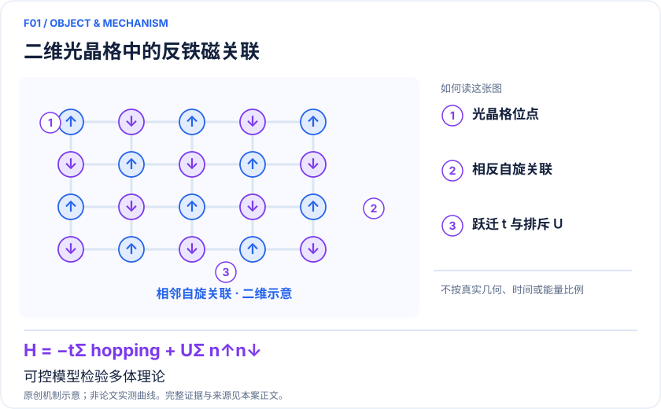

<!-- 由 release/tools/build_problems.py 自 tasks/F01-hubbard-antiferromagnet/README.md 与 tasks/catalog.json 生成，勿手改 -->

# F01 · 二维 Hubbard 反铁磁关联：为铜氧化物机制提供可控基准

> 开放题 · 材料模型与动力学 · 强关联模型与磁性
> 难度：进阶（[分级说明](../../../starters/README.md#难度分级)） · 背景：凝聚态与动力学

## 题面

| 环节 | 内容 |
|---|---|
| 研究体系 | 二维正方晶格排斥 Fermi–Hubbard 模型 |
| 可观测量 | 自旋结构因子、关联长度、交错磁化 |
| 经典基线 | 半填充 DQMC；有限簇 ED；掺杂区 DMRG、DMET、DCA |
| 量子方法的角色 | 超冷费米原子在光晶格中直接实现 Hubbard 哈密顿量。 |
| 研发决策 | 判定某组 U/t、温度、掺杂是否保留强磁关联，筛选值得投入的多体理论。 |

## 基准输入

原文输入没有完全公开。下表是参照运行实际使用的替代输入，解法可以沿用以便直接比较；取得原文输入或改用其他输入时请说明理由。「原文」指作者或原论文公开的材料，「参照」指本项目参照运行自行冻结的选择。

| 项目 | 内容 | 出处 |
|---|---|---|
| 数据 | 原文 Figure 3b 的作者 XLS 数据（实验观测与 QMC 分箱权重） | [原文](https://www.nature.com/articles/nature22362) |
| 经典基线 | 二维 Hubbard 模型基准 | [原文](https://doi.org/10.1103/PhysRevX.5.041041) |

**尚未公开或需注意：**逐点位串、shot 身份与探测校准未公开；QMC 权重的归一化含义未经作者确认。

## 什么算解

一份解法满足以下五点即可提交审核。负结果同样接受，只要过程可复现、结论有依据。

1. **模型对应**：说明所用模型或数据如何对应「二维正方晶格排斥 Fermi–Hubbard 模型」，列出简化与近似。
2. **可观测量**：报告「自旋结构因子、关联长度、交错磁化」，附单位与不确定度。
3. **经典对照**：在同一模型或数据上，与「半填充 DQMC；有限簇 ED；掺杂区 DMRG、DMET、DCA」中至少一种方法比较。
4. **可复现**：提供代码、环境、随机种子、输入来源与哈希，以及计算资源和成本；用到 QPU 时注明设备与 shots。
5. **研发决策**：说明结果能否支撑「判定某组 U/t、温度、掺杂是否保留强磁关联，筛选值得投入的多体理论。」，以及还缺什么证据。

本题的细化标准欢迎在 issue 中讨论；被采纳的讨论结论会写入后续版本。

## 现有参照

本项目已有数值执行记录（经典计算机上的计算与模拟），供对照与复用，不代表最优解。

- 原应用目标：状态未记录
- 最新研究报告：[REFERENCE.md](REFERENCE.md)
- 其余证据指针见 evidence.json（本地证据，未随题库发布）

### 原案例说明

### F01｜二维 Hubbard 反铁磁关联：为铜氧化物机制提供可控基准

<!-- VISUALS:START -->
#### 可视化导读

**图 1 · 二维光晶格中的反铁磁关联。** 可控模型检验多体理论。自旋结构因子、关联长度、交错磁化。图形为依据本案文献重绘的概念关系，不表示实际原子坐标、实测曲线或数值比例。

**图 2 · 计算与验证路径。** 超冷费米原子在光晶格中直接实现 Hubbard 哈密顿量。。**证据边界：** 有限二维体系与单带模型不能等同无限晶体超导相或材料发现。

图解依据：[R1 · A cold-atom Fermi–Hubbard antiferromagnet](https://www.nature.com/articles/nature22362)；[R2 · Solutions of the Two-Dimensional Hubbard Model: Benchmarks and Results from a Wide Range of Numerical Algorithms](https://doi.org/10.1103/PhysRevX.5.041041)；[R3 · A neutral-atom Hubbard quantum simulator in the cryogenic regime](https://www.nature.com/articles/s41586-025-09112-w)。解释性连线与图形布局由本库整理，未复制论文原图。

[机制图 SVG](mechanism.svg) · [流程图 SVG](workflow.svg) · 机制图 PNG（本地证据，未随题库发布） · 流程图 PNG（本地证据，未随题库发布） · 图解说明 JSON（本地证据，未随题库发布）
<!-- VISUALS:END -->

> 文献核查截至 2026-10-04。优先级：重点储备（编辑判断）；证据：硬件演示。本档案是文献研究和试点设计，未运行复现实验。

#### 研发决策与价值

本例适合研究铜氧化物母体中磁关联与电荷运动的关系。研发交付物应是特定模型的关联函数和误差条，而不是“找到高温超导材料”。对于依赖某种交换关联机制的材料假说，实验基准能帮助决定是否值得升级到多轨道、长程跃迁或声子耦合模型。本档案将其列为重点储备：科学价值明确，普通软件团队却不能通过调用通用 QPU 自动取得同样能力。

#### 体系、模型与目标量

模型为 H=−tΣ⟨ij⟩σ(c†ᵢσcⱼσ+h.c.)+UΣᵢnᵢ↑nᵢ↓−μΣᵢnᵢ。原子跃迁模拟电子动能，局域碰撞模拟排斥作用。目标 S(q)=Σᵢⱼe^{iq·(rᵢ−rⱼ)}〈Sᵢ·Sⱼ〉/N 与实空间关联互相验证；温度使用 kBT/t，而不能直接将冷原子纳开尔文换算成真实晶体工作温度。[R1]

#### 量子与经典工作流

建议依次完成：定义格点、边界、填充和 t、U；用经典求解器标定半填充温度窗口；实验制备低熵原子体系；单格点成像重建自旋快照；将同一成像损失和空间选区施加到经典预测上。量子部分是受控的多体模拟与采样，经典部分负责标定、统计及模型比较。原子数、总格点数、有效观测区域应分别记录，不能用设备宣传尺度替代论文有效尺度。

#### 原始文献与实际结果

Mazurenko 等 2017 年报告约 80 格点体系，温度约 kBT/t=0.25，关联长度达到样品尺度，并测量结构因子峰和交错磁化；约 15% 空穴掺杂时仍见强磁关联。本次读取期刊摘要和图题，未逐项复核补充材料中的校准细节。[R1]

LeBlanc 等多方法基准提供能量、双占据与自能的比较框架。它提醒本例不能以单一经典近似的偏差宣称量子优势，更不能把某个格点结果当作已收敛的热力学极限。[R2]

#### 经典比较、资源与证据边界

推荐半填充优先采用无相应符号困难的 DQMC，掺杂时比较多种有限温度与圆柱几何方法。必须对齐温度、U/t、粒子数分布、边界和可观测量；零温无限系统 DMRG 曲线不是有限温原子样品的直接真值。二维有限样品的长程关联描述不应被扩大成有限温无限二维各向同性系统的磁有序断言。实际资源集中在低熵制备、相机读出、温度计和重复实验，门深度并非本平台的正确主指标。

#### 可复现试点：建议输入、步骤与验收

输入：R1 配套数据、格点掩模、U/t 与温度置信区间、成像效率、空穴定义和原始快照（如可获取）。先在相同尺寸下跑半填充基准，再选一个低掺杂点；输出 C(r)、S(π,π)、关联长度拟合区间与 bootstrap 误差。验收建议：多种温度估计相容；关联信号大于系统校准误差；经典差异在同一观测模型下仍成立。若缺少温度/掩模数据，停在文献复核，不宣称重现；若体系尺度主导关联长度，停止热力学相变推断。

#### 判断与下一步

近期可执行成果是“同模型、同观测的可信基准包”。进一步研究应由具体材料需要触发：例如新增次近邻跃迁是否改变掺杂磁关联。只有模型对实材料谱学具有独立解释力之后，才值得将其纳入材料筛选闭环。

#### 2025 进展：进入更低温区间

Xu 等2025年的二维中性原子Hubbard实验利用低熵初态与动态参数控制，进一步降低有效温度。论文半填充U/t=8.3(2)处，以与DQMC自旋关联的比较反演kBT/t=0.05，其不对称误差为−0.05/+0.06；因此不能把0.05写成无误差、独立测得的精确温度。掺杂样品的密度和温度推断还依赖不同校准，不能把半填充误差直接套用。该工作扩展了研究磁关联的窗口，但没有因此证明超导。本次Nature直接打开受重定向限制，事实依据搜索返回的原论文摘要及方法段落，未完成补充材料审读。[R3]

#### docs 来源

- 量子计算如何研究材料问题与药物研发_研究方法与应用综述.md：二维费米–Hubbard 模型案例
- 量子计算问题库_飞书多维表格导入版.xlsx：问题库 M02、M05

- 量子计算在材料计算与药物研发中的具体案例库.html：原案例M03 / s41586-025-09112-w

文档用于定位问题与初始引文；证据等级依据本次原始来源核查。

#### 参考文献与访问深度

- **[R1]** [A cold-atom Fermi–Hubbard antiferromagnet](https://www.nature.com/articles/nature22362)，2017；期刊论文；访问：`abstract`。支持：约 80 格点、kBT/t≈0.25、磁结构因子与掺杂关联。
- **[R2]** [Solutions of the Two-Dimensional Hubbard Model: Benchmarks and Results from a Wide Range of Numerical Algorithms](https://doi.org/10.1103/PhysRevX.5.041041)，2015；期刊论文；访问：`abstract`。支持：多种经典求解器交叉比较及有限尺寸外推；摘要另经 arXiv:1505.02290 核查。
- **[R3]** [A neutral-atom Hubbard quantum simulator in the cryogenic regime](https://www.nature.com/articles/s41586-025-09112-w)，2025；期刊论文；访问：`search_excerpt`。支持：原论文搜索返回的摘要与方法正文：低熵制备、二维Hubbard和半填充温度反演；直接全文访问受重定向限制。

## 如何提交

按 [CONTRIBUTING.md](../../../CONTRIBUTING.md) 把解法放在 `solutions/F01/<你的名字>-<短名>/`，格式见 [解法模板](../../../solutions/_template/SOLUTION.md)。被采纳的解法会按 [沉淀规则](../../../skills/README.md) 提炼为可复用的 skill。
