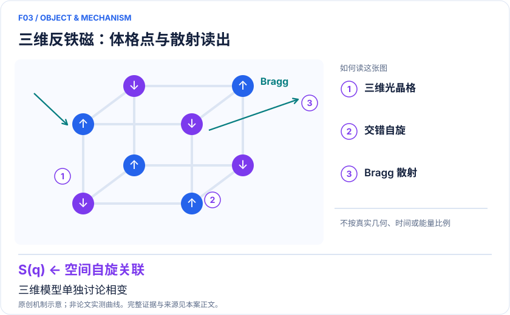
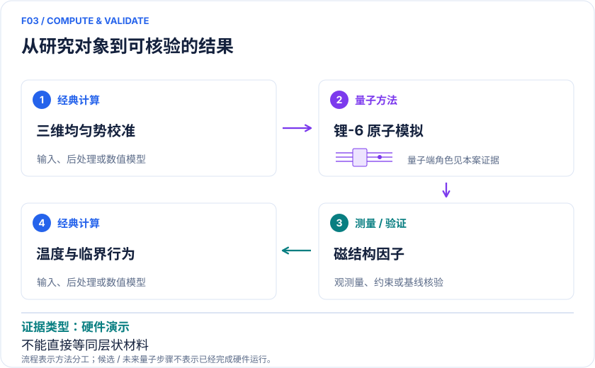

<!-- 由 release/tools/build_problems.py 自 tasks/F03-hubbard-3d-transition/README.md 与 tasks/catalog.json 生成，勿手改 -->

# F03 · 三维 Hubbard 反铁磁相变：宏观均匀格点的临界行为

> 开放题 · 材料模型与动力学 · 强关联模型与相变

## 题面

| 环节 | 内容 |
|---|---|
| 研究体系 | 三维排斥费米 Hubbard 模型 |
| 可观测量 | 自旋结构因子、临界温度/掺杂趋势 |
| 经典基线 | 半填充 QMC、临界标度拟合、不同均匀性模型 |
| 量子方法的角色 | 锂-6 原子构成模拟量子实验，Bragg 散射读取磁结构因子。 |
| 研发决策 | 检验温度、相互作用和掺杂对反铁磁有序的临界约束。 |

## 什么算解

一份解法满足以下五点即可提交审核。负结果同样接受，只要过程可复现、结论有依据。

1. **模型对应**：说明所用模型或数据如何对应「三维排斥费米 Hubbard 模型」，列出简化与近似。
2. **可观测量**：报告「自旋结构因子、临界温度/掺杂趋势」，附单位与不确定度。
3. **经典对照**：在同一模型或数据上，与「半填充 QMC、临界标度拟合、不同均匀性模型」中至少一种方法比较。
4. **可复现**：提供代码、环境、随机种子、输入来源与哈希，以及计算资源和成本；用到 QPU 时注明设备与 shots。
5. **研发决策**：说明结果能否支撑「检验温度、相互作用和掺杂对反铁磁有序的临界约束。」，以及还缺什么证据。

本题的细化标准欢迎在 issue 中讨论；被采纳的讨论结论会写入后续版本。

## 现有参照

本项目已有数值执行记录（经典计算机上的计算与模拟），供对照与复用，不代表最优解。

- 原应用目标：未完成（incomplete）
- 最新研究报告：[REFERENCE.md](REFERENCE.md)
- 其余证据指针见 evidence.json（本地证据，未随题库发布）

### 原案例说明

### F03｜三维 Hubbard 反铁磁相变：宏观均匀格点的临界行为

<!-- VISUALS:START -->
#### 可视化导读

**图 1 · 三维反铁磁：体格点与散射读出。** 三维模型单独讨论相变。自旋结构因子、临界温度/掺杂趋势。图形为依据本案文献重绘的概念关系，不表示实际原子坐标、实测曲线或数值比例。

**图 2 · 计算与验证路径。** 锂-6 原子构成模拟量子实验，Bragg 散射读取磁结构因子。。**证据边界：** 单带三维模型与层状铜氧化物不同；大尺度不等同工业模拟优势。

图解依据：[R1 · Antiferromagnetic phase transition in a 3D fermionic Hubbard model](https://www.nature.com/articles/s41586-024-07689-2)；[R2 · Observation of the antiferromagnetic phase transition in the fermionic Hubbard model](https://arxiv.org/abs/2402.14605)；[R3 · Observation of antiferromagnetic correlations in the Hubbard model with ultracold atoms](https://www.nature.com/articles/nature14223)。解释性连线与图形布局由本库整理，未复制论文原图。

[机制图 SVG](mechanism.svg) · [流程图 SVG](workflow.svg) · 机制图 PNG（本地证据，未随题库发布） · 流程图 PNG（本地证据，未随题库发布） · 图解说明 JSON（本地证据，未随题库发布）
<!-- VISUALS:END -->

> 文献核查截至 2026-10-04。优先级：重点储备（编辑判断）；证据：硬件演示。本档案是文献研究和试点设计，未运行复现实验。

#### 决策与高价值用途

这个例子用来校准多体磁性理论：模型参数被单独调节时，有序如何出现、在掺杂下如何被破坏。其价值是获得真实晶体难以独立控制的变量关系，服务关联绝缘体与量子磁性机制研究。它与二维冷原子实验并非重复，因为维数、有限温相变性质和读出方式不同。

#### 体系与数学目标

哈密顿量仍是单带 Fermi–Hubbard，但格点具有三维连接。主要量为反铁磁波矢处的 S(Q)，以及 S(Q) 随温度、U/t 和填充的变化。应将格点数、原子数、有效均匀区域和测量体积明确分开。体平均散射可能受不同密度区域影响，不能仅依靠总数判断达到热力学极限。[R2]

#### 经典—量子流程

建议工作链：均匀势设计和低熵制备→调节相互作用/密度→测温→测量磁结构因子→剔除探测背景并传播误差→对临界区和非临界区分别拟合→与 QMC 比较。处理器是冷原子实验系统，经典计算参与势场重建、热力学标定和标度分析。测量可观测量比保存完整多体波函数更接近本任务需求。

#### 文献结果和实际读取范围

Shao 等 2024 年原始摘要报告约 800,000 位点均匀锂-6 系统。研究对温度、相互作用和掺杂扫描，结构因子出现临界增强；半填充最优相互作用处 SSF=123(8)。文中使用 Heisenberg 普适类指数 1.396 描述幂律行为。本档案不会把该指数写作独立无假设拟合出的新测量值。[R1][R2]

Hart 等 2015 年工作提供更早的反铁磁关联和接近相变温度的实验背景，强调降温与可靠测温的重要性。两篇代表从相关信号到相变研究的进展，不能合并成同一实验的重复确认。[R3]

#### 经典对照和不应外推的结论

建议比较同一维数、同一填充的 QMC，不应以二维圆柱 DMRG 作为三维结果唯一真值。半填充和掺杂下数值困难不同，需要分区报告。均匀性、散射校准、有限温标度区间和非绝热加热都影响“临界”的判断。此案例没有给出具体商业材料性能，也未证明发现超导体；三维模型不能直接代替层状多轨道铜氧化物。

#### 复核试点与完成条件（建议）

输入：R1 正文补充材料、原始 Bragg 信号、无关联背景、探测几何、温度和势场不均匀性估计。步骤一，复算 S(Q) 的归一化及统计误差；步骤二，更换临界拟合窗口，比较固定指数、自由指数与平滑 crossover 模型；步骤三，用留出点验证临界参数；步骤四，评估有限密度分布会否造成同样增强。验收要求参数在预先规定窗口内稳定且背景处理不改变定性结论。若拿不到原始散射或温度数据，只交付可审计方法复核；若拟合严重依赖窗口，停止精确临界点主张。

#### 资源判断与下一步

资源表应列低温制备成功率、每个参数点重复次数、散射标定和实验日程。当前软件团队可先做公开数据复核与三维 QMC 对照，实验合作再以低掺杂、低温且数值误差大的参数区为目标。采用哪一参数区应来自理论分歧，而非追求更大的原子数。

#### docs 来源

- quantum_applications_roadmap_2021-2026.md：4.3 中国团队 / S24
- 量子计算问题库_飞书多维表格导入版.xlsx：问题库 M02、M05

文档用于定位问题与初始引文；证据等级依据本次原始来源核查。

#### 参考文献与访问深度

- **[R1]** [Antiferromagnetic phase transition in a 3D fermionic Hubbard model](https://www.nature.com/articles/s41586-024-07689-2)，2024；期刊论文；访问：`search_excerpt`。支持：期刊题名与日期；详细实验摘要由同一研究 arXiv:2402.14605 交叉核查。
- **[R2]** [Observation of the antiferromagnetic phase transition in the fermionic Hubbard model](https://arxiv.org/abs/2402.14605)，2024；预印本；访问：`abstract`。支持：锂-6、约 80 万位点、SSF=123(8)、采用 Heisenberg 临界指数。
- **[R3]** [Observation of antiferromagnetic correlations in the Hubbard model with ultracold atoms](https://www.nature.com/articles/nature14223)，2015；期刊论文；访问：`abstract`。支持：早期低温磁关联与光散射测温；不是 2024 实验的独立复现。

## 如何提交

按 [CONTRIBUTING.md](../../../CONTRIBUTING.md) 把解法放在 `solutions/F03/<你的名字>-<短名>/`，格式见 [解法模板](../../../solutions/_template/SOLUTION.md)。被采纳的解法会按 [沉淀规则](../../../skills/README.md) 提炼为可复用的 skill。
