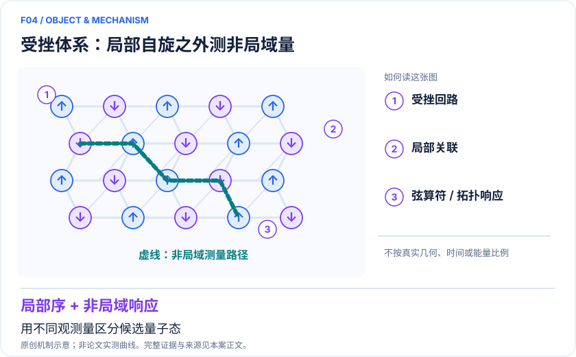
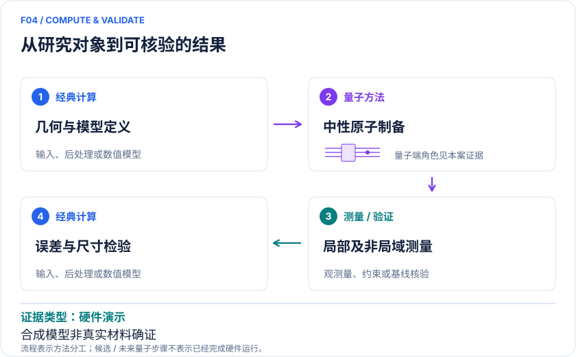

# F04｜受挫磁性与自旋液体：用弦算符及拓扑响应辨识量子态

<!-- VISUALS:START -->
## 可视化导读

**图 1 · 受挫体系：局部自旋之外测非局域量。** 用不同观测量区分候选量子态。非局域弦算符、局域序、拓扑不变量。图形为依据本案文献重绘的概念关系，不表示实际原子坐标、实测曲线或数值比例。

**图 2 · 计算与验证路径。** 2021 原生 Rydberg blockade 模拟；2025 可重排中性原子的门式费米编码。。**证据边界：** 合成模型不是已确认真实候选材料；制备动力学、有限尺寸和误差检测会影响态判定。

图解依据：[R1 · Probing Topological Spin Liquids on a Programmable Quantum Simulator](https://arxiv.org/abs/2104.04119)；[R2 · Probing the Kitaev honeycomb model on a neutral-atom quantum computer](https://arxiv.org/abs/2501.18554)；[R3 · Dynamical preparation of quantum spin liquids in Rydberg atom arrays](https://arxiv.org/abs/2201.04034)。解释性连线与图形布局由本库整理，未复制论文原图。

[机制图 SVG](mechanism.svg) · [流程图 SVG](workflow.svg)
<!-- VISUALS:END -->

> 文献核查截至 2026-10-04。优先级：重点储备（编辑判断）；证据：硬件演示。本档案是文献研究和试点设计，未运行复现实验。

## 决策与价值

真实磁体中的无磁有序可能来自缺陷、玻璃态或有限温效应。高价值目标是找出可以排除这些替代解释的观测组合，并检验有效模型是否允许自旋液体。此例提供对模型的受控研究，不直接给 α-RuCl₃ 或某一种 kagome 材料颁发“自旋液体”结论。

## 体系、模型与尺度

2021 路线把原子放在 kagome 晶格链接，用 blockade 约束形成受挫态；局域密度只是基础读出，关键是非局域弦相关。2025 路线用蜂窝模型把费米统计编码到长程纠缠态，再用门和重排实现演化。Kitaev 目标形如 H=Σα JαΣ⟨ij⟩α σᵢασⱼα；材料推广往往还需 Heisenberg、Γ 交换和外场等项，不能预设理想可解模型就是实际晶体。[R1][R2]

## 量子/经典工作流

建议先从实验散射或第一性原理建立候选交换模型；用 ED/DMRG 确定小尺寸可判定的参量区；再选择原生约束阵列或数字演化。测量同时包括局域序、两点相关、弦算符及可行的拓扑响应。经典后处理要保留原始样本与误差检测筛选前后结果，防止只展示最理想子集。

## 已发表结果与证据链

Semeghini 等 2021 年以 219 原子阵列观察缺乏局域序且具有拓扑弦关联的受挫态，支持 toric-code 型自旋液体证据。[R1] Evered 等 2025 年数字架构用测量反馈及误差检测辅助制备，报告奇 Chern 数所支持的非阿贝尔自旋液体相，并扩展到费米子与 Hubbard 动力学。[R2] 随后的动力学制备理论是解释有限速率演化的重要补充，而不是对所有平衡基态结论的自动确认。[R3]

## 经典比较及证据边界

Kitaev 可解极限本身有强经典方法，价值在验证控制能力和研究偏离可解模型的物理。受挫一般模型需对比有限簇 ED、圆柱 DMRG 和二维张量网络，并报告边界敏感性。非局域观测对读出和原子丢失敏感；有限制备时间可能产生长寿命非平衡态。单纯没有局域序不能证明自旋液体，只有某个拓扑指标也不等同完成实材料模型鉴别。

## 建议试点：输入与验收

输入应包含目标晶格图、所有耦合矩阵、边界、制备时间、误差检测规则和每个弦长度的样本数。先在小尺寸复制全部观测，再构造普通无序态与热混态对照；随后改变系统尺寸和制备速度。验收：预注册的多种观测共同排除至少一个替代态，结论对读出修正和合理参数偏差稳定。若只能复现密度快照而不能复现弦关联，停止“拓扑已验证”主张；若真实材料的额外交换项超出设备能力，只交付理想模型研究。

## 下一步

推荐把该方向作为磁性机制和观测设计能力建设，与真实材料的实验合作者共同确定一个可区分假说。一个明确的模型排除结论往往比增加原子数更具材料研究价值。

## docs 来源

- quantum_applications_roadmap_2021-2026.md：4.2 / S21、S22
- 量子计算问题库_飞书多维表格导入版.xlsx：问题库 M04、M06

文档用于定位问题与初始引文；证据等级依据本次原始来源核查。

## 参考文献与访问深度

- **[R1]** [Probing Topological Spin Liquids on a Programmable Quantum Simulator](https://arxiv.org/abs/2104.04119)，2021；预印本；访问：`abstract`。支持：219 原子、kagome 链接、弦算符；期刊 Science 374 (2021)。
- **[R2]** [Probing the Kitaev honeycomb model on a neutral-atom quantum computer](https://arxiv.org/abs/2501.18554)，2025；预印本；访问：`abstract`。支持：测量反馈、可重排阵列数字模拟、奇 Chern 数；Nature 645,341–347。
- **[R3]** [Dynamical preparation of quantum spin liquids in Rydberg atom arrays](https://arxiv.org/abs/2201.04034)，2022；预印本；访问：`abstract`。支持：用动力学理论分析 Rydberg 制备态；不是追加实机实验。
