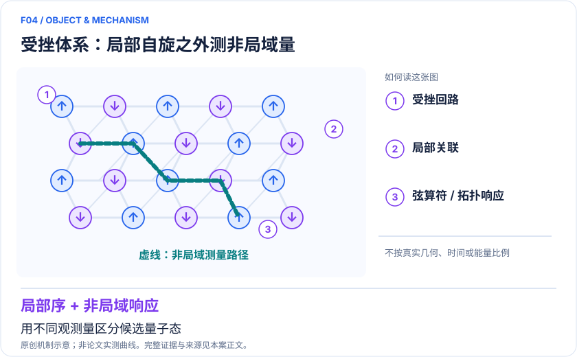
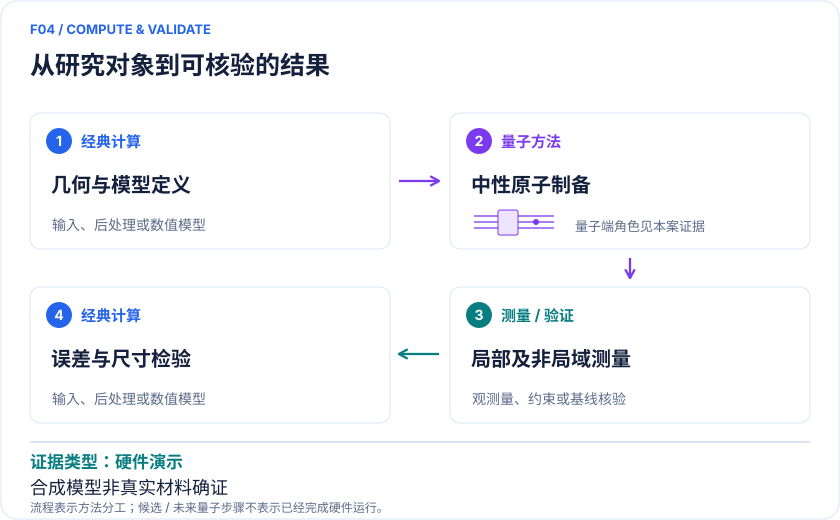

<!-- 由 release/tools/build_problems.py 自 tasks/F04-frustrated-spin-liquid/README.md 与 tasks/catalog.json 生成，勿手改 -->

# F04 · 受挫磁性与自旋液体：用弦算符及拓扑响应辨识量子态

> 开放题 · 材料模型与动力学 · 受挫磁性与拓扑

## 题面

| 环节 | 内容 |
|---|---|
| 研究体系 | kagome 链接阵列的约束模型及 Kitaev 蜂窝模型 |
| 可观测量 | 非局域弦算符、局域序、拓扑不变量 |
| 经典基线 | ED、DMRG、张量网络、可解 Kitaev 极限 |
| 量子方法的角色 | 2021 原生 Rydberg blockade 模拟；2025 可重排中性原子的门式费米编码。 |
| 研发决策 | 排除普通无序态，辨识候选磁体模型是否具备分数量子激发和拓扑结构。 |

## 基准输入

原文输入没有完全公开。下表是参照运行实际使用的替代输入，解法可以沿用以便直接比较；取得原文输入或改用其他输入时请说明理由。「原文」指作者或原论文公开的材料，「参照」指本项目参照运行自行冻结的选择。

| 项目 | 内容 | 出处 |
|---|---|---|
| 模型来源 | 中性原子 Kitaev 模型 | [原文](https://arxiv.org/html/2501.18554v2) |
| 参照所用模型 | 3×3 单元 18 自旋，x 周期、y 开放，24 条键；H = −ΣXX − ΣYY − Jz ΣZZ | 参照 |

**尚未公开或需注意：**原 72 数据比特 + 32 辅助比特硬件反馈实验的线路与数据未公开。

## 什么算解

一份解法满足以下五点即可提交审核。负结果同样接受，只要过程可复现、结论有依据。

1. **模型对应**：说明所用模型或数据如何对应「kagome 链接阵列的约束模型及 Kitaev 蜂窝模型」，列出简化与近似。
2. **可观测量**：报告「非局域弦算符、局域序、拓扑不变量」，附单位与不确定度。
3. **经典对照**：在同一模型或数据上，与「ED、DMRG、张量网络、可解 Kitaev 极限」中至少一种方法比较。
4. **可复现**：提供代码、环境、随机种子、输入来源与哈希，以及计算资源和成本；用到 QPU 时注明设备与 shots。
5. **研发决策**：说明结果能否支撑「排除普通无序态，辨识候选磁体模型是否具备分数量子激发和拓扑结构。」，以及还缺什么证据。

本题的细化标准欢迎在 issue 中讨论；被采纳的讨论结论会写入后续版本。

## 现有参照

本项目已有数值执行记录（经典计算机上的计算与模拟），供对照与复用，不代表最优解。

- 原应用目标：未完成（incomplete）
- 最新研究报告：[REFERENCE.md](REFERENCE.md)
- 其余证据指针见 evidence.json（本地证据，未随题库发布）

### 原案例说明

### F04｜受挫磁性与自旋液体：用弦算符及拓扑响应辨识量子态

<!-- VISUALS:START -->
#### 可视化导读

**图 1 · 受挫体系：局部自旋之外测非局域量。** 用不同观测量区分候选量子态。非局域弦算符、局域序、拓扑不变量。图形为依据本案文献重绘的概念关系，不表示实际原子坐标、实测曲线或数值比例。

**图 2 · 计算与验证路径。** 2021 原生 Rydberg blockade 模拟；2025 可重排中性原子的门式费米编码。。**证据边界：** 合成模型不是已确认真实候选材料；制备动力学、有限尺寸和误差检测会影响态判定。

图解依据：[R1 · Probing Topological Spin Liquids on a Programmable Quantum Simulator](https://arxiv.org/abs/2104.04119)；[R2 · Probing the Kitaev honeycomb model on a neutral-atom quantum computer](https://arxiv.org/abs/2501.18554)；[R3 · Dynamical preparation of quantum spin liquids in Rydberg atom arrays](https://arxiv.org/abs/2201.04034)。解释性连线与图形布局由本库整理，未复制论文原图。

[机制图 SVG](mechanism.svg) · [流程图 SVG](workflow.svg) · 机制图 PNG（本地证据，未随题库发布） · 流程图 PNG（本地证据，未随题库发布） · 图解说明 JSON（本地证据，未随题库发布）
<!-- VISUALS:END -->

> 文献核查截至 2026-10-04。优先级：重点储备（编辑判断）；证据：硬件演示。本档案是文献研究和试点设计，未运行复现实验。

#### 决策与价值

真实磁体中的无磁有序可能来自缺陷、玻璃态或有限温效应。高价值目标是找出可以排除这些替代解释的观测组合，并检验有效模型是否允许自旋液体。此例提供对模型的受控研究，不直接给 α-RuCl₃ 或某一种 kagome 材料颁发“自旋液体”结论。

#### 体系、模型与尺度

2021 路线把原子放在 kagome 晶格链接，用 blockade 约束形成受挫态；局域密度只是基础读出，关键是非局域弦相关。2025 路线用蜂窝模型把费米统计编码到长程纠缠态，再用门和重排实现演化。Kitaev 目标形如 H=Σα JαΣ⟨ij⟩α σᵢασⱼα；材料推广往往还需 Heisenberg、Γ 交换和外场等项，不能预设理想可解模型就是实际晶体。[R1][R2]

#### 量子/经典工作流

建议先从实验散射或第一性原理建立候选交换模型；用 ED/DMRG 确定小尺寸可判定的参量区；再选择原生约束阵列或数字演化。测量同时包括局域序、两点相关、弦算符及可行的拓扑响应。经典后处理要保留原始样本与误差检测筛选前后结果，防止只展示最理想子集。

#### 已发表结果与证据链

Semeghini 等 2021 年以 219 原子阵列观察缺乏局域序且具有拓扑弦关联的受挫态，支持 toric-code 型自旋液体证据。[R1] Evered 等 2025 年数字架构用测量反馈及误差检测辅助制备，报告奇 Chern 数所支持的非阿贝尔自旋液体相，并扩展到费米子与 Hubbard 动力学。[R2] 随后的动力学制备理论是解释有限速率演化的重要补充，而不是对所有平衡基态结论的自动确认。[R3]

#### 经典比较及证据边界

Kitaev 可解极限本身有强经典方法，价值在验证控制能力和研究偏离可解模型的物理。受挫一般模型需对比有限簇 ED、圆柱 DMRG 和二维张量网络，并报告边界敏感性。非局域观测对读出和原子丢失敏感；有限制备时间可能产生长寿命非平衡态。单纯没有局域序不能证明自旋液体，只有某个拓扑指标也不等同完成实材料模型鉴别。

#### 建议试点：输入与验收

输入应包含目标晶格图、所有耦合矩阵、边界、制备时间、误差检测规则和每个弦长度的样本数。先在小尺寸复制全部观测，再构造普通无序态与热混态对照；随后改变系统尺寸和制备速度。验收：预注册的多种观测共同排除至少一个替代态，结论对读出修正和合理参数偏差稳定。若只能复现密度快照而不能复现弦关联，停止“拓扑已验证”主张；若真实材料的额外交换项超出设备能力，只交付理想模型研究。

#### 下一步

推荐把该方向作为磁性机制和观测设计能力建设，与真实材料的实验合作者共同确定一个可区分假说。一个明确的模型排除结论往往比增加原子数更具材料研究价值。

#### docs 来源

- quantum_applications_roadmap_2021-2026.md：4.2 / S21、S22
- 量子计算问题库_飞书多维表格导入版.xlsx：问题库 M04、M06

文档用于定位问题与初始引文；证据等级依据本次原始来源核查。

#### 参考文献与访问深度

- **[R1]** [Probing Topological Spin Liquids on a Programmable Quantum Simulator](https://arxiv.org/abs/2104.04119)，2021；预印本；访问：`abstract`。支持：219 原子、kagome 链接、弦算符；期刊 Science 374 (2021)。
- **[R2]** [Probing the Kitaev honeycomb model on a neutral-atom quantum computer](https://arxiv.org/abs/2501.18554)，2025；预印本；访问：`abstract`。支持：测量反馈、可重排阵列数字模拟、奇 Chern 数；Nature 645,341–347。
- **[R3]** [Dynamical preparation of quantum spin liquids in Rydberg atom arrays](https://arxiv.org/abs/2201.04034)，2022；预印本；访问：`abstract`。支持：用动力学理论分析 Rydberg 制备态；不是追加实机实验。

## 如何提交

按 [CONTRIBUTING.md](../../../CONTRIBUTING.md) 把解法放在 `solutions/F04/<你的名字>-<短名>/`，格式见 [解法模板](../../../solutions/_template/SOLUTION.md)。被采纳的解法会按 [沉淀规则](../../../skills/README.md) 提炼为可复用的 skill。
