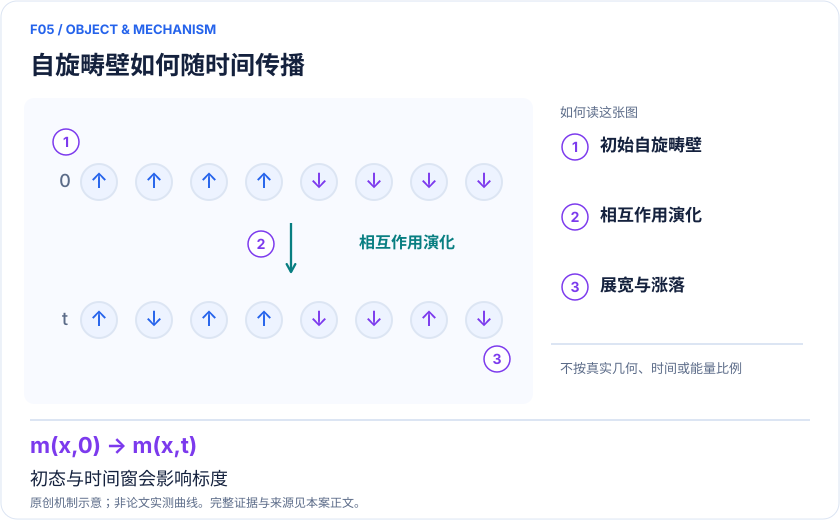
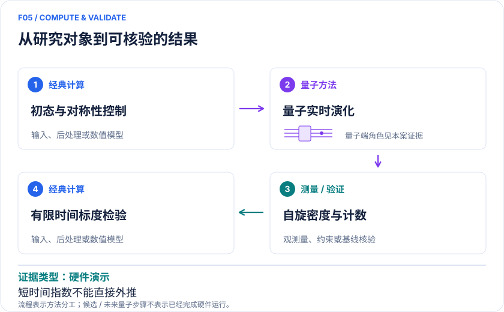

# F05｜非平衡自旋输运：检验扩散、超扩散与初态依赖

<!-- VISUALS:START -->
## 可视化导读

**图 1 · 自旋畴壁如何随时间传播。** 初态与时间窗会影响标度。畴壁松弛、自旋密度、极化转移全计数统计。图形为依据本案文献重绘的概念关系，不表示实际原子坐标、实测曲线或数值比例。

**图 2 · 计算与验证路径。** 冷原子 Heisenberg 链或超导模拟器实现实时自旋演化。。**证据边界：** 有限时间指数、可积性、SU(2) 对称性与初态必须分别控制；非器件输运率预测。

图解依据：[R1 · Quantum gas microscopy of Kardar-Parisi-Zhang superdiffusion](https://arxiv.org/abs/2107.00038)；[R2 · Spin transport in a tunable Heisenberg model realized with ultracold atoms](https://www.nature.com/articles/s41586-020-3033-y)；[R3 · Probing spin hydrodynamics on a superconducting quantum simulator](https://www.nature.com/articles/s41467-024-52082-2)。解释性连线与图形布局由本库整理，未复制论文原图。

[机制图 SVG](mechanism.svg) · [流程图 SVG](workflow.svg)
<!-- VISUALS:END -->

> 文献核查截至 2026-10-04。优先级：重点储备（编辑判断）；证据：硬件演示。本档案是文献研究和试点设计，未运行复现实验。

## 研发价值与决策

磁绝缘体中的信息和热如何传播，涉及相互作用、对称性和维数。可控模拟器能把这些因素逐个改变，从而构建可与中子散射或局域探针比较的机制。近期价值是解释输运为何偏离普通扩散，为候选自旋材料决定应测何种响应；本例未证明可优化现实自旋电子器件功耗。

## 体系与目标量

XXZ 链写作 H=JΣᵢ(SᵢˣSᵢ₊₁ˣ+SᵢʸSᵢ₊₁ʸ+ΔSᵢᶻSᵢ₊₁ᶻ)。从畴壁或自旋螺旋初态出发，记录 C(x,t) 与穿过边界的极化。若长度尺度随时间 t^{1/z} 增长，z=2 对应普通扩散，z=3/2 是本例 KPZ 相关特征；指数相同并不足以证明同一普适类，还应检查分布和对称性扰动。[R1][R2]

## 量子/经典流程

经典先生成同一初态、链长、边界和 Hamiltonian 的实时基准；实验制备自旋纹理、突然改变参数、逐时间点测量密度；后处理用相同时间窗同时拟合宽度、极化转移和高阶统计。建议把能量单位、实验时间换算和传播到边界的时间标出。量子设备承担多体演化，不承担把输运曲线直接换算为真实材料电导率的模型工作。

## 原始研究与实际结论

Wei 等在冷原子显微镜最多约 50 自旋链中观察畴壁松弛，并报告 KPZ 指数与非线性输运统计证据；文章强调可积性和 SU(2) 对称性条件。[R1] Jepsen 等采用自旋螺旋初态和可调 XXZ 模型，报告不同各向异性下的弹道、扩散和异常行为。这些结果不能仅按“相同 Heisenberg 模型”就视为互相矛盾，因为制备和观测区域不同。[R2] 2024 超导工作研究无限温输运及无序/倾斜场造成的异常，提供了不同架构的实现示例。[R3]

## 基线、资源与限制

一维短到中等时间的张量网络是强基线；长时间纠缠增长使计算昂贵，但实验退相干也同步累积。因此需给出可信时间窗的交集。资源表应包括链数或重复 shot 数、采样间隔、单格点误读、耦合标定、原子损失或超导退相干。有限时间幂律很容易把 crossover 误判为渐近规律；无序平均不足也可制造异常扩散。

## 可复现试点（建议，未执行）

输入：R1 原始自旋快照/图数据、初始磁化、J、Δ、链长和边界；另选一个明确破坏可积性或对称性的对照。先以 ED 验证小链，再以 tDMRG 延长时间；统一数据塌缩规则和拟合窗口后才打开实验留出集。验收：指数及全计数统计同时得到描述，对不同拟合窗稳定；对照参数能解释而非隐藏偏离。停止条件：可用时间不足一个清晰标度区间、传播已触边、背景损失与信号同量级。此时交付“有限时间输运现象”，不报告确定普适类。

## 下一步

由材料实验决定最相关的维度、交换各向异性与温区，再确定是否值得上模拟器。对于纯一维短时间问题，先使用成熟经典动力学求解器通常更经济；量子平台的投入理由应是可检验的新物理窗口。

## docs 来源

- 量子计算问题库_飞书多维表格导入版.xlsx：问题库 M34
- 量子计算如何研究材料问题与药物研发_研究方法与应用综述.md：密度与关联、环境耦合动力学

文档用于定位问题与初始引文；证据等级依据本次原始来源核查。

## 参考文献与访问深度

- **[R1]** [Quantum gas microscopy of Kardar-Parisi-Zhang superdiffusion](https://arxiv.org/abs/2107.00038)，2022；预印本；访问：`abstract`。支持：最多 50 自旋畴壁、z=3/2、输运统计；Science 376,716–720。
- **[R2]** [Spin transport in a tunable Heisenberg model realized with ultracold atoms](https://www.nature.com/articles/s41586-020-3033-y)，2020；期刊论文；访问：`abstract`。支持：XXZ 可调各向异性、自旋螺旋初态、扩散至异常输运。
- **[R3]** [Probing spin hydrodynamics on a superconducting quantum simulator](https://www.nature.com/articles/s41467-024-52082-2)，2024；期刊论文；访问：`abstract`。支持：超导梯形模拟器扩散与无序/倾斜场下异常次扩散。
