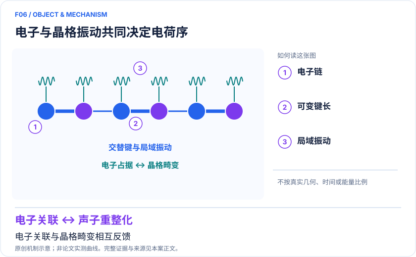
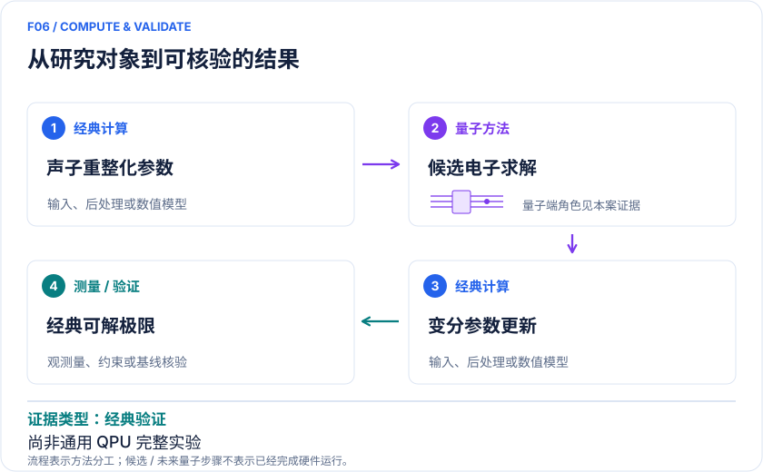

<!-- 由 release/tools/build_problems.py 自 tasks/F06-electron-phonon-peierls/README.md 与 tasks/catalog.json 生成，勿手改 -->

# F06 · 电子—声子竞争与 Peierls 电荷序：混合求解和开放器件提案

> 开放题 · 材料模型与动力学 · 电子—声子与极化子

## 题面

| 环节 | 内容 |
|---|---|
| 研究体系 | Hubbard–Holstein 链与悬空纳米管四量子点开放系统 |
| 可观测量 | 电荷/自旋结构因子、有效跃迁、稳态电流 |
| 经典基线 | 截断声子 ED、DMRG、DQMC、主方程求解 |
| 量子方法的角色 | 量子电路拟表示电子关联；声子重整化经典优化；另一支提案为原生电子—机械振动模拟。 |
| 研发决策 | 判断电子排斥与晶格介导吸引何时改变电荷序和磁序，确定是否必须增加声子自由度。 |

## 基准输入

原文输入没有完全公开。下表是参照运行实际使用的替代输入，解法可以沿用以便直接比较；取得原文输入或改用其他输入时请说明理由。「原文」指作者或原论文公开的材料，「参照」指本项目参照运行自行冻结的选择。

| 项目 | 内容 | 出处 |
|---|---|---|
| 模型来源 | 电子—声子混合量子经典方法 | [原文](https://www.nature.com/articles/s42005-023-01353-3) |
| 参照所用模型 | 4 站半填充 Hubbard–Holstein 链：t=1，U=4，ω=10，g=√15，耦合 g(n−1)(a+a†) | 参照 |

**尚未公开或需注意：**原文 HVA 起态未保存，历史结果无法唯一复现；纳米管四量子点开放系统输入未整理。

## 什么算解

一份解法满足以下五点即可提交审核。负结果同样接受，只要过程可复现、结论有依据。

1. **模型对应**：说明所用模型或数据如何对应「Hubbard–Holstein 链与悬空纳米管四量子点开放系统」，列出简化与近似。
2. **可观测量**：报告「电荷/自旋结构因子、有效跃迁、稳态电流」，附单位与不确定度。
3. **经典对照**：在同一模型或数据上，与「截断声子 ED、DMRG、DQMC、主方程求解」中至少一种方法比较。
4. **可复现**：提供代码、环境、随机种子、输入来源与哈希，以及计算资源和成本；用到 QPU 时注明设备与 shots。
5. **研发决策**：说明结果能否支撑「判断电子排斥与晶格介导吸引何时改变电荷序和磁序，确定是否必须增加声子自由度。」，以及还缺什么证据。

本题的细化标准欢迎在 issue 中讨论；被采纳的讨论结论会写入后续版本。

## 现有参照

本项目已有数值执行记录（经典计算机上的计算与模拟），供对照与复用，不代表最优解。

- 原应用目标：未完成（incomplete）
- 最新研究报告：[REFERENCE.md](REFERENCE.md)
- 其余证据指针见 evidence.json（本地证据，未随题库发布）

### 原案例说明

### F06｜电子—声子竞争与 Peierls 电荷序：混合求解和开放器件提案

<!-- VISUALS:START -->
#### 可视化导读

**图 1 · 电子与晶格振动共同决定电荷序。** 电子关联与晶格畸变相互反馈。电荷/自旋结构因子、有效跃迁、稳态电流。图形为依据本案文献重绘的概念关系，不表示实际原子坐标、实测曲线或数值比例。

**图 2 · 计算与验证路径。** 量子电路拟表示电子关联；声子重整化经典优化；另一支提案为原生电子—机械振动模拟。。**证据边界：** 不是已完成通用 QPU Peierls 实验；基态结果不能直接外推非平衡动力学。

图解依据：[R1 · A hybrid quantum-classical method for electron-phonon systems](https://www.nature.com/articles/s42005-023-01353-3)；[R2 · Steady-state Peierls transition in nanotube quantum simulator](https://www.nature.com/articles/s41534-022-00675-4)。解释性连线与图形布局由本库整理，未复制论文原图。

[机制图 SVG](mechanism.svg) · [流程图 SVG](workflow.svg) · 机制图 PNG（本地证据，未随题库发布） · 流程图 PNG（本地证据，未随题库发布） · 图解说明 JSON（本地证据，未随题库发布）
<!-- VISUALS:END -->

> 文献核查截至 2026-10-04。优先级：探索观察（编辑判断）；证据：经典验证。本档案是文献研究和试点设计，未运行复现实验。

#### 价值与研发决策

电子运动会拖动晶格，晶格又反过来改变电子有效质量和相互作用。面对只用电子模型无法解释的电荷序、极化子或输运现象，本例帮助判断哪些振动必须显式纳入。推荐用于模型路线比较和资源规划；当前证据不支持把它包装为已验证的工业材料预测服务。

#### 模型及范围

H=H_Hubbard+ω₀Σᵢb†ᵢbᵢ+Σᵢⱼgᵢⱼnⱼ(bᵢ+b†ᵢ)。需要区分密度—位移 Holstein 类耦合与调制键跃迁的 SSH/Peierls 类耦合；“出现 Peierls 电荷序”不意味着这两种微观耦合等价。目标至少包括 S_charge(q)、S_spin(q)、有效跃迁和声子占据，而不能仅检查基态能量。[R1][R2]

#### 两条量子—经典路线

路线 A：经典非高斯变换和声子 Gaussian 变分状态生成有效电子 Hamiltonian；VQE 优化电子态；经典/量子变量交替更新。节省显式声子比特的代价是受限变分结构。路线 B：把纳米管量子点中的电子与机械模直接作为模拟自由度，驱动到与引线耦合的稳态，读取电流及占据。第二条路线在引用工作中仍是理论与数值研究，不能报告为已有硬件成功。[R1][R2]

#### 核查到的研究结果

Denner 等 2023 年在 Hubbard–Holstein 半填充模型中以状态矢量电路模拟验证 NGS–VQE，比较 ED 并描述电荷密度波与反铁磁关联的竞争。论文图 1 的 4 位点例子是数值电路，不是 QPU 测量。[R1]

Zhang 等 2023 年研究悬空纳米管四自旋极化量子点与引线耦合，计算稳态电荷序及输运特征。论文提出可实验访问的信号和数值处理方法，而非宣称制造并测量了整套 Peierls 模拟器。[R2]

#### 基线与证据限制

电子—声子空间的困难不允许省略强经典方法。建议比较增加声子截断后的 ED、优化局域玻色基的 DMRG、适用条件下的 QMC。NGS–VQE 的“无需增加声子比特”不等于对任意声子态都无近似，也不保证经典外循环和测量代价小。有限链中电荷结构因子增强应标注为电荷序倾向；无有限尺寸外推不能精确指定热力学相界。基态 variational 验证和开放系统电流是不同任务。

#### 建议试点及验收

输入冻结 t、U、ω₀、gᵢⱼ、边界和粒子数，先做 4 位点基准，覆盖弱耦合、强排斥、强声子和竞争区域。每点分别报告能量、双占据、两类结构因子与声子截断敏感性。先用精确电子求解器替代 VQE 测出 NGS 近似误差，再加入有限采样/设备误差。验收：误差能分解成声子近似、电子变分、采样三项；相竞争趋势不随合理截断翻转。停止条件：不同初值收敛到不同相且未能界定最低能；基线声子空间未收敛；真实材料需非局域耦合但试点仅保留局域项。

#### 下一步

首先输出“电子模型是否足够”的可检验结论。只有数值近似预算明显小于待辨识物理效应时，再讨论硬件测试。若真正目标是极化子非平衡传播，应另立实时演化协议，不能把此基态论文作为已完成动力学验证。

#### docs 来源

- 量子计算问题库_飞书多维表格导入版.xlsx：问题库 M36
- 量子计算如何研究材料问题与药物研发_研究方法与应用综述.md：环境耦合动力学、有效模型

文档用于定位问题与初始引文；证据等级依据本次原始来源核查。

#### 参考文献与访问深度

- **[R1]** [A hybrid quantum-classical method for electron-phonon systems](https://www.nature.com/articles/s42005-023-01353-3)，2023；期刊论文；访问：`full_text`。支持：NGS–VQE、状态矢量模拟、Hubbard–Holstein 半填充基准及声子近似。
- **[R2]** [Steady-state Peierls transition in nanotube quantum simulator](https://www.nature.com/articles/s41534-022-00675-4)，2023；期刊论文；访问：`full_text`。支持：四量子点开放系统数值提案、稳态 CDW 与电流特征，不是实机数据。

## 如何提交

按 [CONTRIBUTING.md](../../../CONTRIBUTING.md) 把解法放在 `solutions/F06/<你的名字>-<短名>/`，格式见 [解法模板](../../../solutions/_template/SOLUTION.md)。被采纳的解法会按 [沉淀规则](../../../skills/README.md) 提炼为可复用的 skill。
