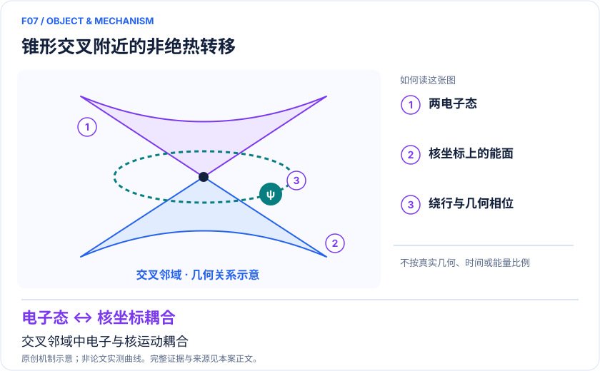
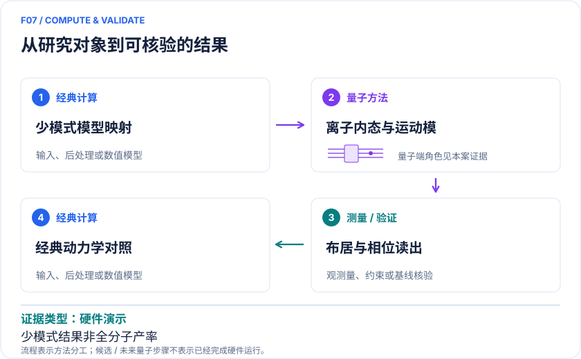

<!-- 由 release/tools/build_problems.py 自 tasks/F07-conical-intersection-dynamics/README.md 与 tasks/catalog.json 生成，勿手改 -->

# F07 · 锥形交叉与分子光化学：几何相位及参数化非绝热动力学

> 开放题 · 材料模型与动力学 · 光化学与非绝热动力学
> 难度：进阶（[分级说明](../../../starters/README.md#难度分级)） · 背景：凝聚态与动力学

## 题面

| 环节 | 内容 |
|---|---|
| 研究体系 | 工程化 Jahn–Teller/线性振电子模型；丙二烯阳离子、丁三烯阳离子、吡嗪 |
| 可观测量 | 波包密度、电子态布居 Pα(t)、几何相位干涉 |
| 经典基线 | 网格传播、MCTDH、截断 Fock 基精确传播 |
| 量子方法的角色 | 离子内部两能级表示电子态，两运动模表示选定核振动。 |
| 研发决策 | 检验分子光激发后的布居转移是否受关键振动和相位干涉控制。 |

## 基准输入

原文输入没有完全公开。下表是参照运行实际使用的替代输入，解法可以沿用以便直接比较；取得原文输入或改用其他输入时请说明理由。「原文」指作者或原论文公开的材料，「参照」指本项目参照运行自行冻结的选择。

| 项目 | 内容 | 出处 |
|---|---|---|
| 模型 | 原文两模振电模型：h = n₁ + n₂ + 1 + 1.5(Z Q₁ + X Q₂) | [原文](https://arxiv.org/html/2211.07320v3) |

**尚未公开或需注意：**丙二烯阳离子、丁三烯阳离子、吡嗪的完整振电参数未整理。

## 什么算解

一份解法满足以下五点即可提交审核。负结果同样接受，只要过程可复现、结论有依据。

1. **模型对应**：说明所用模型或数据如何对应「工程化 Jahn–Teller/线性振电子模型；丙二烯阳离子、丁三烯阳离子、吡嗪」，列出简化与近似。
2. **可观测量**：报告「波包密度、电子态布居 Pα(t)、几何相位干涉」，附单位与不确定度。
3. **经典对照**：在同一模型或数据上，与「网格传播、MCTDH、截断 Fock 基精确传播」中至少一种方法比较。
4. **可复现**：提供代码、环境、随机种子、输入来源与哈希，以及计算资源和成本；用到 QPU 时注明设备与 shots。
5. **研发决策**：说明结果能否支撑「检验分子光激发后的布居转移是否受关键振动和相位干涉控制。」，以及还缺什么证据。

本题的细化标准欢迎在 issue 中讨论；被采纳的讨论结论会写入后续版本。

## 现有参照

本项目已有数值执行记录（经典计算机上的计算与模拟），供对照与复用，不代表最优解。

- 原应用目标：未完成（incomplete）
- 最新研究报告：[REFERENCE.md](REFERENCE.md)
- 其余证据指针见 evidence.json（本地证据，未随题库发布）

### 原案例说明

### F07｜锥形交叉与分子光化学：几何相位及参数化非绝热动力学

<!-- VISUALS:START -->
#### 可视化导读

**图 1 · 锥形交叉附近的非绝热转移。** 交叉邻域中电子与核运动耦合。波包密度、电子态布居 Pα(t)、几何相位干涉。图形为依据本案文献重绘的概念关系，不表示实际原子坐标、实测曲线或数值比例。

**图 2 · 计算与验证路径。** 离子内部两能级表示电子态，两运动模表示选定核振动。。**证据边界：** 不能据少模式布居曲线证明反应产率或真实体系全部自由度准确。

图解依据：[R1 · Direct observation of geometric-phase interference in dynamics around a conical intersection](https://www.nature.com/articles/s41557-023-01300-3)；[R2 · Quantum simulation of conical intersections using trapped ions](https://www.nature.com/articles/s41557-023-01303-0)；[R3 · Experimental Quantum Simulation of Chemical Dynamics](https://arxiv.org/html/2409.04044v2)。解释性连线与图形布局由本库整理，未复制论文原图。

[机制图 SVG](mechanism.svg) · [流程图 SVG](workflow.svg) · 机制图 PNG（本地证据，未随题库发布） · 流程图 PNG（本地证据，未随题库发布） · 图解说明 JSON（本地证据，未随题库发布）
<!-- VISUALS:END -->

> 文献核查截至 2026-10-04。优先级：近期验证（编辑判断）；证据：硬件演示。本档案是文献研究和试点设计，未运行复现实验。

#### 价值与可决策问题

光稳定性、光开关和能量转换材料常需知道激发态如何快速回到另一电子态。本例的高价值输入是经典电子结构导出的少态振电子模型，输出是电子布居与相干核波包。它可检验忽略几何相位或关键振动是否改变机制判断；尚不能直接给出 OLED 寿命或药物光毒性评分。

#### 体系与数学目标

在线性振电子耦合近似中，H=Σₖωₖa†ₖaₖ+Σαβ|α〉〈β|[Eαβ+Σₖgαβ,k(aₖ+a†ₖ)]。两绝热势面在特定核坐标相遇形成锥形交叉；核波包两条路径的相位差会影响干涉。设备中的振动频率与分子频率通过比例缩放对应，模拟器毫秒不能直接作为化学毫秒。应同时存原始单位和无量纲化参数。[R1][R3]

#### 混合工作流

经典计算先确定 diabatic 势、电子态、关键振动和初始光激发；将耦合/频率缩放成离子激光参数；制备初始运动相干态与内部态；实施原生自旋—运动耦合；重复读取电子布居或运动波包。后处理回到分子时间单位并与同一截断模型比较。量子模拟器不会自动提供正确的势面或溶剂环境，模型输入的误差须独立审计。

#### 文献证据和细节

2023 Sydney 等工作直接观察工程化锥形交叉周围运动波包的几何相位干涉；Duke 等的独立论文通过态制备和运动态测量观察几何相位表现。两者是不同实验，不应合成一句“实测分子所有反应”。[R1][R2]

Navickas 等 2025 JACS 工作对丙二烯阳离子、丁三烯阳离子与吡嗪选择两个电子态及两个振动模式，用分子电子结构参数生成可编程演化。不同势面形状带来不同布居动力学；正文给出参数表，公开数据入口另见 Zenodo 13948671。[R3]

#### 经典基线、资源和外推限制

双模模型能被精确数值求解，正适合可信验证，但不支持量子优势结论。推荐同 diabatic 基与相同初态的网格/MCTDH/Fock 传播；不要拿另一势面上的 surface hopping 当唯一基线。扩大模式数后要检查原子运动加热、相干时间、模式串扰、Lamb–Dicke 近似和读出统计。少模模型未包含的核坐标可能改变退相干和产物分支，生物大分子推广尤其需要环境模型。

#### 建议试点：吡嗪双模

输入 R3 表 I 参数、电子态定义、光激发初态和数据集；先对照频率使用 ω 还是 ω/2π，构建截断 Fock Hamiltonian；增大每模截断到 P(t) 稳定后再与实验对照；保留理想、校准误差和退相干三个版本。验收：态布居守恒、时间映射一致、有限截断误差小于实验误差；误差预算不依赖事后调整势面。停止：模型与实验初态不匹配、参数单位不闭合、少模结论随新增重要模式翻转。此试点是建议，当前未下载或执行数据重现。

#### 下一步

从一个已有公开双模基准开始，再由具体光功能材料选择关键模式。最优交付物是“哪些自由度决定目标布居”的可解释结论，以及把它扩展到材料环境所需的输入清单。

#### docs 来源

- quantum_applications_roadmap_2021-2026.md：4.4 / S27、S28
- 量子计算与量子模拟研究生物和化学反应.md：非绝热动力学与量子核效应

文档用于定位问题与初始引文；证据等级依据本次原始来源核查。

#### 参考文献与访问深度

- **[R1]** [Direct observation of geometric-phase interference in dynamics around a conical intersection](https://www.nature.com/articles/s41557-023-01300-3)，2023；期刊论文；访问：`abstract`。支持：动态波包绕锥形交叉的干涉；摘要经 arXiv:2211.07320 核查。
- **[R2]** [Quantum simulation of conical intersections using trapped ions](https://www.nature.com/articles/s41557-023-01303-0)，2023；期刊论文；访问：`abstract`。支持：另一组离子实验的几何相位及运动态测量。
- **[R3]** [Experimental Quantum Simulation of Chemical Dynamics](https://arxiv.org/html/2409.04044v2)，2025；预印本；访问：`full_text`。支持：三种分子的双模非绝热动力学、参数表与实验过程；JACS 2025 DOI 10.1021/jacs.5c03336。

## 如何提交

按 [CONTRIBUTING.md](../../../CONTRIBUTING.md) 把解法放在 `solutions/F07/<你的名字>-<短名>/`，格式见 [解法模板](../../../solutions/_template/SOLUTION.md)。被采纳的解法会按 [沉淀规则](../../../skills/README.md) 提炼为可复用的 skill。
