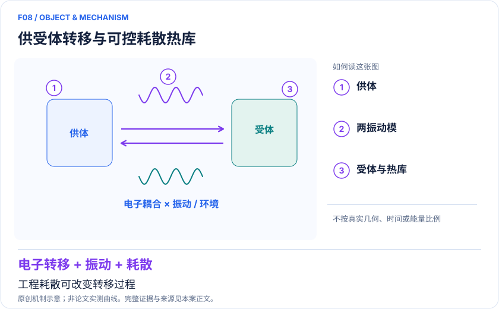
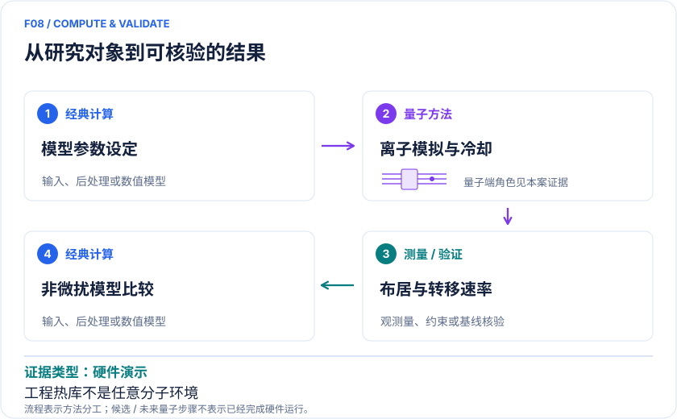

<!-- 由 release/tools/build_problems.py 自 tasks/F08-dissipative-vibronic-transfer/README.md 与 tasks/catalog.json 生成，勿手改 -->

# F08 · 工程化耗散下的电荷与激子转移：多振动通道的非微扰效应

> 开放题 · 材料模型与动力学 · 开放量子系统与能量转移
> 难度：进阶（[分级说明](../../../starters/README.md#难度分级)） · 背景：凝聚态与动力学

## 题面

| 环节 | 内容 |
|---|---|
| 研究体系 | 双态双模线性振电子耦合模型与可调热库 |
| 可观测量 | 供体布居 P_D(t)、积分定义的转移率、能隙依赖 |
| 经典基线 | 截断 Lindblad 求解、HEOM/张量网络；适用区 Marcus/黄金规则 |
| 量子方法的角色 | 两种镱离子共享运动模；一离子编码供受体，两模耗散由另一离子冷却工程化实现。 |
| 研发决策 | 判断有机光伏或分子电子学模型中环境与第二个振动是否改变转移机制。 |

## 基准输入

解法默认使用下列输入，以便与现有参照和其他解法直接比较；改用其他输入时请说明理由。「原文」指作者或原论文公开的材料，「参照」指本项目参照运行自行冻结的选择。

| 项目 | 内容 | 出处 |
|---|---|---|
| 模型与数据 | 作者公开源数据（五个 Mathematica notebook）与 SI 参数 | [原文](https://zenodo.org/records/17539557) |
| 论文 | Nature Communications 2025 | [原文](https://doi.org/10.1038/s41467-025-67116-6) |
| 参照所用模型 | 简并 fixed-λ 单模、热占据 n̄=0.2 的条件模型 | 参照 |

**尚未公开或需注意：**SI 中跳跃算符与耦合基底的对应只能按整体旋转解释，作者内部实现未确认。

## 什么算解

一份解法满足以下五点即可提交审核。负结果同样接受，只要过程可复现、结论有依据。

1. **模型对应**：说明所用模型或数据如何对应「双态双模线性振电子耦合模型与可调热库」，列出简化与近似。
2. **可观测量**：报告「供体布居 P_D(t)、积分定义的转移率、能隙依赖」，附单位与不确定度。
3. **经典对照**：在同一模型或数据上，与「截断 Lindblad 求解、HEOM/张量网络；适用区 Marcus/黄金规则」中至少一种方法比较。
4. **可复现**：提供代码、环境、随机种子、输入来源与哈希，以及计算资源和成本；用到 QPU 时注明设备与 shots。
5. **研发决策**：说明结果能否支撑「判断有机光伏或分子电子学模型中环境与第二个振动是否改变转移机制。」，以及还缺什么证据。

本题的细化标准欢迎在 issue 中讨论；被采纳的讨论结论会写入后续版本。

## 现有参照

本项目已有数值执行记录（经典计算机上的计算与模拟），供对照与复用，不代表最优解。

- 原应用目标：未完成（incomplete）
- 最新研究报告：[REFERENCE.md](REFERENCE.md)
- 其余证据指针见 evidence.json（本地证据，未随题库发布）

### 原案例说明

### F08｜工程化耗散下的电荷与激子转移：多振动通道的非微扰效应

<!-- VISUALS:START -->
#### 可视化导读

**图 1 · 供受体转移与可控耗散热库。** 工程耗散可改变转移过程。供体布居 P_D(t)、积分定义的转移率、能隙依赖。图形为依据本案文献重绘的概念关系，不表示实际原子坐标、实测曲线或数值比例。

**图 2 · 计算与验证路径。** 两种镱离子共享运动模；一离子编码供受体，两模耗散由另一离子冷却工程化实现。。**证据边界：** 模型转移率不是宏观器件效率；工程化 Markov 热库不能默认表示任意分子环境。

图解依据：[R1 · Quantum simulation of charge and exciton transfer in multi-mode models using engineered reservoirs](https://www.nature.com/articles/s41467-025-67116-6)；[R2 · Trapped-Ion Quantum Simulation of Electron Transfer Models with Tunable Dissipation](https://arxiv.org/abs/2405.10368)。解释性连线与图形布局由本库整理，未复制论文原图。

[机制图 SVG](mechanism.svg) · [流程图 SVG](workflow.svg) · 机制图 PNG（本地证据，未随题库发布） · 流程图 PNG（本地证据，未随题库发布） · 图解说明 JSON（本地证据，未随题库发布）
<!-- VISUALS:END -->

> 文献核查截至 2026-10-04。优先级：近期验证（编辑判断）；证据：硬件演示。本档案是文献研究和试点设计，未运行复现实验。

#### 价值与决策

只用一个反应坐标描述电荷转移，可能遗漏不同振动组合共同跨越能隙的通道。本例可用于判断目标体系是否需要多模处理，以及何时弱耦合黄金规则失效。材料价值主要在有机光伏、分子导线和光捕获模型的机制验证；具体器件性能还取决于结构无序、形貌、界面与复合过程。

#### 精确定义体系与目标

R1 的 H=Vσx+ΔEσz/2+Σᵢ[gᵢσz(aᵢ+a†ᵢ)/2+ωᵢa†ᵢaᵢ]，另加入每模 γᵢ、热占据 n̄ᵢ 的 Lindblad 耗散。供体 P_D=(〈σz〉+1)/2。其转移率采用 k_T=∫P_D(t)dt / ∫tP_D(t)dt 的积分定义，不能未说明就换成单指数拟合 k。研究的是两个电子态与两个振动，不是两条完整真实分子反应路径。[R1]

#### 实验与经典协同

经典先定义电子能隙、耦合、振动频率、热库形式与初态；Yb-171 内部态编码供受体，双离子链的运动模承载振动，Yb-172 工程化冷却调节储库。激光标定后测实时供体布居；经典主方程对照同一参数和读出噪声。将目标化学模型缩放到设备时，必须同时保持 V/ω、g/ω、γ/ω、温度等无量纲比值。

#### 文献结果与版本

单模前序工作 2024 年发表于 Science Advances，展示可独立控制供受体能隙、电子/振动耦合及浴弛豫。[R2] 双模工作 2025-12-05 在线、2026 年列卷期，观察简并振动与非简并振动分别改变大能隙转移和可用通道。论文使用含设备噪声的主方程比较，并指出不同模结构不能简单由一个模式调参完全重现。本次读取正文模型、实现、结果和速率定义。[R1]

#### 经典比较与证据边界

小型双模 Lindblad 模型可由经典数值可靠求解，价值在可调开放量子物理而非已实现算力优势。R1 的速率定义包含末态占据影响，因此“更快”必须带上观测窗口、稳态和归一化条件。工程化储库通常近似特定谱密度；要映射到分子溶剂或蛋白质，需独立证明热库近似、温度和非 Markov 效应的适用性。非微扰电子耦合、振动耦合和环境耦合是不同参数轴，不能统称“强耦合”而不说明。

#### 建议最小试点

输入：R1 图 3/4 参数、P_D(t) 原始数据、耗散标定和热占据；先复算一组简并和非简并条件。以逐级升高 Fock 截断验证收敛，并将尾部时间积分误差纳入 k_T。随后比较两种单模对照：保持原论文单模定义，以及保持总重组能的公平对照。验收：趋势在统计及积分尾部误差下稳定，量子/经典使用完全相同初态与速率公式；第二模式效应大于单模调参不确定性。若输入仅有速率图无布居轨迹，停止瞬态机制重建；若真实环境谱密度缺失，停止器件定量预测。

#### 下一步

选择一个有独立振动谱与电子耦合估计的供受体体系，先确定两个模式是否足以保留目标响应。把“多模模型减少了什么解释偏差”作为验收标准，会比直接追求更高模式数更可执行。

#### docs 来源

- quantum_applications_roadmap_2021-2026.md：4.4 / S29
- 量子计算与量子模拟研究生物和化学反应.md：电子—振动转移动力学
- 量子计算问题库_飞书多维表格导入版.xlsx：问题库 M36

文档用于定位问题与初始引文；证据等级依据本次原始来源核查。

#### 参考文献与访问深度

- **[R1]** [Quantum simulation of charge and exciton transfer in multi-mode models using engineered reservoirs](https://www.nature.com/articles/s41467-025-67116-6)，2026；期刊论文；访问：`full_text`。支持：2025-12-05 在线，2026 卷17文章438；双模模型、Lindblad 方程和供体积分转移率。
- **[R2]** [Trapped-Ion Quantum Simulation of Electron Transfer Models with Tunable Dissipation](https://arxiv.org/abs/2405.10368)，2024；预印本；访问：`abstract`。支持：Science Advances 10 eads8011；单模可调供受体能隙、电子/振动耦合和耗散。

## 如何提交

按 [CONTRIBUTING.md](../../../CONTRIBUTING.md) 把解法放在 `solutions/F08/<你的名字>-<短名>/`，格式见 [解法模板](../../../solutions/_template/SOLUTION.md)。被采纳的解法会按 [沉淀规则](../../../skills/README.md) 提炼为可复用的 skill。
