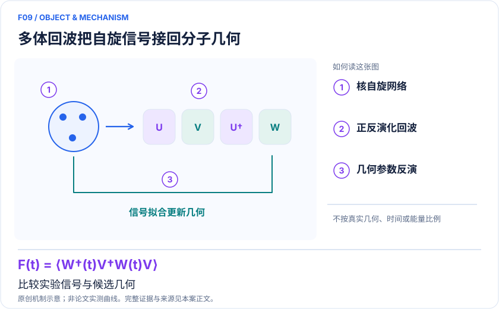
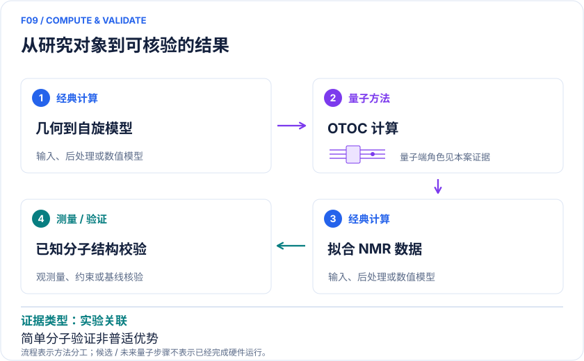

<!-- 由 release/tools/build_problems.py 自 tasks/F09-nmr-structure-echoes/README.md 与 tasks/catalog.json 生成，勿手改 -->

# F09 · NMR 多体回波反演分子几何：把量子信号接回实验结构

> 开放题 · 材料模型与动力学 · 谱学反演与分子结构

## 题面

| 环节 | 内容 |
|---|---|
| 研究体系 | 液晶中部分取向的标记甲苯与 3′,5′-二甲基联苯 |
| 可观测量 | 核自旋 OTOC 曲线、平均 H–H 距离、平均二面角 |
| 经典基线 | 精确自旋动力学、既有 NMR 谱法、经典分子动力学/力场 |
| 量子方法的角色 | 超导 QPU 计算给定核自旋 Hamiltonian 的 OTOC，经典优化几何参数。 |
| 研发决策 | 判断新增多体 NMR 信号能否区分候选构象并改进结构参数置信区间。 |

## 基准输入

原文输入没有完全公开。下表是参照运行实际使用的替代输入，解法可以沿用以便直接比较；取得原文输入或改用其他输入时请说明理由。「原文」指作者或原论文公开的材料，「参照」指本项目参照运行自行冻结的选择。

| 项目 | 内容 | 出处 |
|---|---|---|
| 参数 | 原文 Table 4 的 15Q DMBP MD 计算耦合：DC1=237.27 Hz、DC2=−129.40 Hz、D12=−2753.91 Hz | [原文](https://arxiv.org/html/2510.19550v1) |
| 参照所用模型 | C、H1、H2 三自旋：H = aZ₀Z₁ + bZ₀Z₂ + c(X₁X₂ − Y₁Y₂) | 参照 |

**尚未公开或需注意：**原 9/15 核自旋完整网络与取向映射未整理；单个三自旋 OTOC 不能唯一反演两个 C–H 耦合。

## 什么算解

一份解法满足以下五点即可提交审核。负结果同样接受，只要过程可复现、结论有依据。

1. **模型对应**：说明所用模型或数据如何对应「液晶中部分取向的标记甲苯与 3′,5′-二甲基联苯」，列出简化与近似。
2. **可观测量**：报告「核自旋 OTOC 曲线、平均 H–H 距离、平均二面角」，附单位与不确定度。
3. **经典对照**：在同一模型或数据上，与「精确自旋动力学、既有 NMR 谱法、经典分子动力学/力场」中至少一种方法比较。
4. **可复现**：提供代码、环境、随机种子、输入来源与哈希，以及计算资源和成本；用到 QPU 时注明设备与 shots。
5. **研发决策**：说明结果能否支撑「判断新增多体 NMR 信号能否区分候选构象并改进结构参数置信区间。」，以及还缺什么证据。

本题的细化标准欢迎在 issue 中讨论；被采纳的讨论结论会写入后续版本。

## 现有参照

本项目已有数值执行记录（经典计算机上的计算与模拟），供对照与复用，不代表最优解。

- 原应用目标：未完成（incomplete）
- 最新研究报告：[REFERENCE.md](REFERENCE.md)
- 其余证据指针见 evidence.json（本地证据，未随题库发布）

### 原案例说明

### F09｜NMR 多体回波反演分子几何：把量子信号接回实验结构

<!-- VISUALS:START -->
#### 可视化导读

**图 1 · 多体回波把自旋信号接回分子几何。** 比较实验信号与候选几何。核自旋 OTOC 曲线、平均 H–H 距离、平均二面角。图形为依据本案文献重绘的概念关系，不表示实际原子坐标、实测曲线或数值比例。

**图 2 · 计算与验证路径。** 超导 QPU 计算给定核自旋 Hamiltonian 的 OTOC，经典优化几何参数。。**证据边界：** 已知简单分子验证、误差缓解和液晶取向模型限制；未证明药物结构解析优势。

图解依据：[R1 · Quantum computation of molecular geometry via many-body nuclear spin echoes](https://arxiv.org/html/2510.19550v1)；[R2 · Digital quantum simulation of NMR experiments](https://pmc.ncbi.nlm.nih.gov/articles/PMC10656062/)；[R3 · A verifiable quantum advantage](https://research.google/blog/a-verifiable-quantum-advantage/)。解释性连线与图形布局由本库整理，未复制论文原图。

[机制图 SVG](mechanism.svg) · [流程图 SVG](workflow.svg) · 机制图 PNG（本地证据，未随题库发布） · 流程图 PNG（本地证据，未随题库发布） · 图解说明 JSON（本地证据，未随题库发布）
<!-- VISUALS:END -->

> 文献核查截至 2026-10-04。优先级：近期验证（编辑判断）；证据：实验关联。本档案是文献研究和试点设计，未运行复现实验。

#### 研发决策与价值

结构解析最缺的常是能够排除多个相似构象的独立信号，而非再算一个总能量。此例把“量子可观测量”接到 NMR 实验，让结构模型生成核自旋耦合，再预测回波并反向修正几何。药物与材料研发的合理近端目标是检验信息增量：已有谱学难以区分的距离或扭角，是否被新的多体信号约束。

#### 真实对象与目标

研究对象是部分取向液晶环境中的同位素标记甲苯和 3′,5′-二甲基联苯；目标分别涉及平均邻/间位 H–H 距离与平均二面角。核自旋 Hamiltonian 由化学位移、标量耦合和残余偶极耦合组成；OTOC 由正向演化、局部扰动及逆演化构建，随几何参数改变。平均结构参数不是单一静态构象，取向分布和构象涨落必须保留。[R1]

#### 端到端工作流

独立分子结构/MD 先验→计算自旋耦合与液晶取向模型→设计并采集 NMR 回波→QPU 或经典模拟候选 Hamiltonian 的信号→经典优化和不确定性推断→以未参与拟合的谱学量验证。QPU 承担多体信号预测；样品合成、脉冲设计、几何参数化、拟合与最终结构判断仍由实验与经典计算承担。

#### 已有结果与优势边界

2025 R1 利用两种分子回波估计几何，报告与独立谱学相近的准确度/精度，并以 9 和 15 核自旋的 QPU 电路模拟；全文还给出误差缓解和门序列细节。这是小分子实验关联验证，不能直接外推未知蛋白质结构解析。[R1]

2023 R2 已展示数字 QPU 对 NMR 谱的实验模拟，为这条应用链提供前序研究。[R2] 与此同时，Google 明确写道 Quantum Echoes 超经典结论属于专门基准电路，分子应用初次演示仍可经典处理。任何“倍速”不能从基准移植到分子反演。[R3]

#### 基线、资源与证据限制

同等拟合任务应对比精确小自旋动力学、稀疏或聚类近似、传统 NMR 约束及 MD 先验。必须比较完整优化所需信号调用和统计精度，而不是只比一条电路耗时。逆演化误差、长电路阻尼、ZNE 外推、实验自旋弛豫和液晶取向都会改变 OTOC。应报告未经缓解和缓解后数据，避免让某个外推假设承担全部结构结论。

#### 可执行试点（建议）

从甲苯 9 自旋开始，冻结自旋编号、耦合单位、取向张量、脉冲序列和几何变形自由度。建立经典精确前向模型后，先用合成留出数据测可辨识性，再盲拟合公开真实曲线。至少比较三组：MD 先验、传统谱学、传统谱学加 OTOC。验收：新信号在留出集改善预测，并缩小有覆盖率验证的参数区间；拟合不依赖不合理力场补偿。停止：多个几何产生不可区分曲线、实验与模拟脉冲定义不一致、只用训练数据展示拟合精度。

#### 判断与下一步

这是比较贴近研发实验的量子用例，但近期优先验证信息价值，尚不能把硬件必要性当作前提。应先证明经典信号解释出现真正瓶颈，再评估扩展到更多核自旋的量子成本。

#### docs 来源

- quantum_applications_roadmap_2021-2026.md：Google Quantum Echoes 与 NMR / S01、S07、S08
- 量子计算问题库_飞书多维表格导入版.xlsx：问题库 M38

文档用于定位问题与初始引文；证据等级依据本次原始来源核查。

#### 参考文献与访问深度

- **[R1]** [Quantum computation of molecular geometry via many-body nuclear spin echoes](https://arxiv.org/html/2510.19550v1)，2025；预印本；访问：`full_text`。支持：甲苯/二甲基联苯结构学习、9/15 自旋、QPU 曲线与误差缓解。
- **[R2]** [Digital quantum simulation of NMR experiments](https://pmc.ncbi.nlm.nih.gov/articles/PMC10656062/)，2023；期刊论文；访问：`full_text`。支持：数字量子模拟 NMR 实验的前序原始研究；Science Advances 9 eadh2594。
- **[R3]** [A verifiable quantum advantage](https://research.google/blog/a-verifiable-quantum-advantage/)，2025；机构技术说明；访问：`publisher_summary`。支持：研究团队明确区分 OTOC 随机基准优势与未超经典的分子应用。

## 如何提交

按 [CONTRIBUTING.md](../../../CONTRIBUTING.md) 把解法放在 `solutions/F09/<你的名字>-<短名>/`，格式见 [解法模板](../../../solutions/_template/SOLUTION.md)。被采纳的解法会按 [沉淀规则](../../../skills/README.md) 提炼为可复用的 skill。
