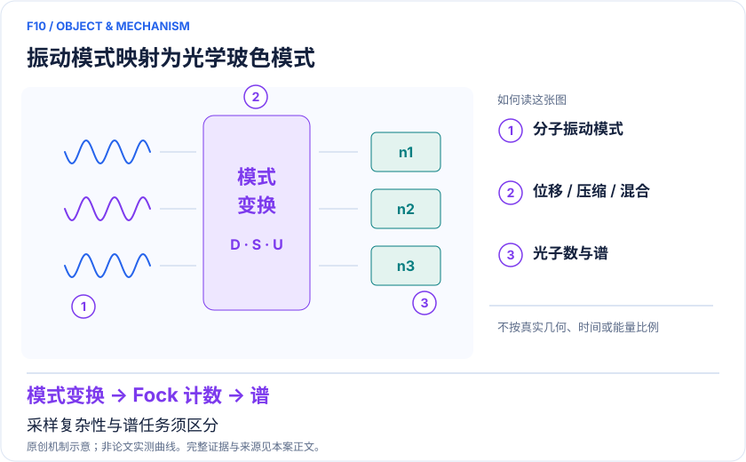
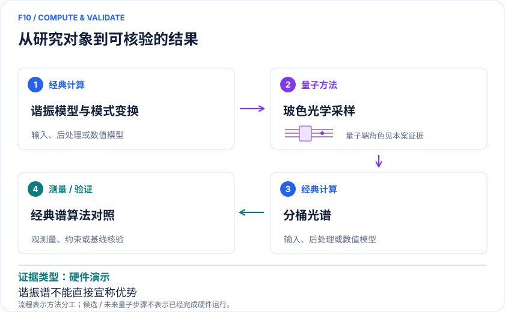

<!-- 由 release/tools/build_problems.py 自 tasks/F10-vibronic-boson-sampling/README.md 与 tasks/catalog.json 生成，勿手改 -->

# F10 · 分子振电子光谱：玻色采样示范与经典可解边界

> 开放题 · 材料模型与动力学 · 振动谱与光功能材料

## 题面

| 环节 | 内容 |
|---|---|
| 研究体系 | H₂O、O₃、NO₂、SO₂ 双模示范；甲酸/胸腺嘧啶光子谱路线 |
| 可观测量 | Franck–Condon 权重、分辨率指定的谱形、振动态分配 |
| 经典基线 | 生成函数/时间相关法、2024 量子启发经典算法、模式简化 |
| 量子方法的角色 | 振动模式映射玻色模式；位移、压缩和线性混合实现谐振态变换。 |
| 研发决策 | 决定目标光谱是否真的需要完整 GBS，或可由成熟经典及简化光子模型完成。 |

## 什么算解

一份解法满足以下五点即可提交审核。负结果同样接受，只要过程可复现、结论有依据。

1. **模型对应**：说明所用模型或数据如何对应「H₂O、O₃、NO₂、SO₂ 双模示范；甲酸/胸腺嘧啶光子谱路线」，列出简化与近似。
2. **可观测量**：报告「Franck–Condon 权重、分辨率指定的谱形、振动态分配」，附单位与不确定度。
3. **经典对照**：在同一模型或数据上，与「生成函数/时间相关法、2024 量子启发经典算法、模式简化」中至少一种方法比较。
4. **可复现**：提供代码、环境、随机种子、输入来源与哈希，以及计算资源和成本；用到 QPU 时注明设备与 shots。
5. **研发决策**：说明结果能否支撑「决定目标光谱是否真的需要完整 GBS，或可由成熟经典及简化光子模型完成。」，以及还缺什么证据。

本题的细化标准欢迎在 issue 中讨论；被采纳的讨论结论会写入后续版本。

## 现有参照

本项目已有数值执行记录（经典计算机上的计算与模拟），供对照与复用，不代表最优解。

- 原应用目标：未完成（incomplete）
- 最新研究报告：[REFERENCE.md](REFERENCE.md)
- 其余证据指针见 evidence.json（本地证据，未随题库发布）

### 原案例说明

### F10｜分子振电子光谱：玻色采样示范与经典可解边界

<!-- VISUALS:START -->
#### 可视化导读

**图 1 · 振动模式映射为光学玻色模式。** 采样复杂性与谱任务须区分。Franck–Condon 权重、分辨率指定的谱形、振动态分配。图形为依据本案文献重绘的概念关系，不表示实际原子坐标、实测曲线或数值比例。

**图 2 · 计算与验证路径。** 振动模式映射玻色模式；位移、压缩和线性混合实现谐振态变换。。**证据边界：** 谐振零温分桶谱不能直接借 GBS 采样复杂性宣称优势；非谐更复杂任务需另证。

图解依据：[R1 · Boson sampling for molecular vibronic spectra](https://www.nature.com/articles/nphoton.2015.153)；[R2 · Efficient Multiphoton Sampling of Molecular Vibronic Spectra on a Superconducting Bosonic Processor](https://journals.aps.org/prx/abstract/10.1103/PhysRevX.10.021060)；[R3 · Quantum-inspired classical algorithms for molecular vibronic spectra](https://www.nature.com/articles/s41567-023-02308-9)；[R4 · Bridging chemistry and Gaussian boson sampling: a photonic hierarchy of approximations for molecular vibronic spectra](https://www.nature.com/articles/s41534-026-01250-x)；[R5 · Large-scale photonic network with squeezed vacuum states for molecular vibronic spectroscopy](https://www.nature.com/articles/s41467-024-50060-2)。解释性连线与图形布局由本库整理，未复制论文原图。

[机制图 SVG](mechanism.svg) · [流程图 SVG](workflow.svg) · 机制图 PNG（本地证据，未随题库发布） · 流程图 PNG（本地证据，未随题库发布） · 图解说明 JSON（本地证据，未随题库发布）
<!-- VISUALS:END -->

> 文献核查截至 2026-10-04。优先级：探索观察（编辑判断）；证据：硬件演示。本档案是文献研究和试点设计，未运行复现实验。

#### 决策与价值

振电子谱可解释光吸收或光电子谱的峰形、模式贡献和几何变化，对发光分子、光敏化学物及分子鉴别有价值。真正应比较的是达到指定实验分辨率和误差的谱形成本。本例特别适合开展“先排除不必要量子资源”的技术审查，因为原始提案与最新经典进展之间已有实质变化。

#### 任务与精确范围

Franck–Condon 近似中，跃迁强度与 |〈v′|v〉|² 相关，两电子态的正规模式通过 Duschinsky 旋转及位移关联。对谐振模型，位移、压缩和模式混合对应光学或微波玻色操作。逐个振动态的联合采样、全部跃迁概率列表，以及有限分辨率的一维谱线，是三个不同输出任务；量子复杂性陈述必须说明具体是哪一个。[R1][R3]

#### 混合工作流

经典电子结构计算平衡构型、Hessian、正规模、电子跃迁能和必要的跃迁偶极；编译玻色变换；硬件采样光子数；将样本按振动能量加权成谱；加入与实验一致的展宽。输入 Hamiltonian 和近似准确性通常先于采样误差成为瓶颈。谐振及 Condon 假设若不足，应先升级物理模型，再估计量子资源。

#### 文献脉络与反证

2015 Huh 等提出振电子谱与玻色采样映射，并给分子例子。[R1] 2020 Wang 等在两个超导玻色模式上实施谱采样，展示 H₂O、O₃、NO₂、SO₂ 的可编程小模型及每模至 15 光子读出。[R2] 2024 光子网络也测试甲酸和胸腺嘧啶谱。[R5]

必须同时纳入 Oh 等 2024 年高效经典谐振谱算法：其结论否定相应零温谱任务作为量子优势候选的泛化说法。[R3] 2026 Eickmann 等进一步展示甲酸可用更简单的线性耦合/相干态方案，并获得优于先前 GBS 演示的相似度。因此不能以“GBS 已有复杂性优势”替代化学任务验证。[R4]

#### 强经典比较及资源

对照至少包括时间相关函数/生成函数、模式预筛选和 R3 所定义算法；不能只用枚举所有组合的低效经典代码。资源需报告模式数、压缩量、损耗、探测效率、截断占据和有效样本率。“15 光子每模”是读出能力，不是 15 个独立分子振动。需要非谐性、非 Condon 或非高斯初态时，重新审核算法适用范围，不能把它们一概视作已证明的优势出口。

#### 建议试点与验收

输入从甲酸开始，包括两电子态构型/频率、Duschinsky 矩阵、位移、展宽和强度归一化。比较线性耦合、parallel approximation、完整谐振模型及量子/经典同任务实现。验收：在固定谱分辨率下报告峰位误差、归一化强度距离、重要峰召回和端到端时间；若简单近似已满足化学误差，结论应是无需 GBS。只有新增物理带来的差异显著超过输入/实验误差才升级任务。停止条件：只比较全振动态枚举成本、忽略损耗后选择、把能量分桶和联合分布混为同一输出。

#### 下一步判断

此路线仍有谱学与硬件控制研究价值，但简单谐振谱的商业加速优先级应降低。下一步应寻找明确的化学精度需求与经典瓶颈，而不是增加光子数后重用原有“指数加速”口号。

#### docs 来源

- 量子计算问题库_飞书多维表格导入版.xlsx：问题库 M39
- 量子计算如何研究材料问题与药物研发_研究方法与应用综述.md：光谱与电子态

文档用于定位问题与初始引文；证据等级依据本次原始来源核查。

#### 参考文献与访问深度

- **[R1]** [Boson sampling for molecular vibronic spectra](https://www.nature.com/articles/nphoton.2015.153)，2015；期刊论文；访问：`abstract`。支持：理论映射及甲酸/胸腺嘧啶示例；不是当年实机应用。
- **[R2]** [Efficient Multiphoton Sampling of Molecular Vibronic Spectra on a Superconducting Bosonic Processor](https://journals.aps.org/prx/abstract/10.1103/PhysRevX.10.021060)，2020；期刊论文；访问：`abstract`。支持：双模硬件、至15光子读出、H₂O/O₃/NO₂/SO₂谱。
- **[R3]** [Quantum-inspired classical algorithms for molecular vibronic spectra](https://www.nature.com/articles/s41567-023-02308-9)，2024；期刊论文；访问：`abstract`。支持：谐振零温谱任务的高效经典方法及优势主张边界。
- **[R4]** [Bridging chemistry and Gaussian boson sampling: a photonic hierarchy of approximations for molecular vibronic spectra](https://www.nature.com/articles/s41534-026-01250-x)，2026；期刊论文；访问：`full_text`。支持：化学近似与光子资源层级、甲酸相干态实验、原始输入计算方法。
- **[R5]** [Large-scale photonic network with squeezed vacuum states for molecular vibronic spectroscopy](https://www.nature.com/articles/s41467-024-50060-2)，2024；期刊论文；访问：`abstract`。支持：光子网络中的甲酸及胸腺嘧啶谱示范。

## 如何提交

按 [CONTRIBUTING.md](../../../CONTRIBUTING.md) 把解法放在 `solutions/F10/<你的名字>-<短名>/`，格式见 [解法模板](../../../solutions/_template/SOLUTION.md)。被采纳的解法会按 [沉淀规则](../../../skills/README.md) 提炼为可复用的 skill。
