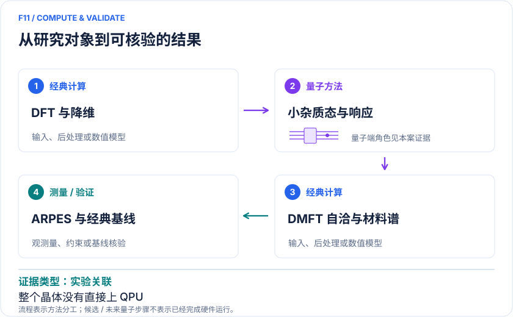

<!-- 由 release/tools/build_problems.py 自 tasks/F11-ccoc-quantum-dmft/README.md 与 tasks/catalog.json 生成，勿手改 -->

# F11 · Ca₂CuO₂Cl₂ 真实晶体的量子 DMFT：杂质谱与 ARPES 对照

> 开放题 · 材料模型与动力学 · 周期强关联材料与嵌入
> 难度：进阶（[分级说明](../../../starters/README.md#难度分级)） · 背景：凝聚态与动力学

## 题面

| 环节 | 内容 |
|---|---|
| 研究体系 | Ca₂CuO₂Cl₂ 铜氧氯化物的有效单带；单杂质加离散浴 |
| 可观测量 | 杂质格林函数、自能、单粒子谱 A(k,ω) |
| 经典基线 | 同 Hamiltonian ED/CT-QMC/DMRG 杂质求解、DFT+DMFT、ARPES |
| 量子方法的角色 | QPU 计算小 Anderson 杂质模型的态与响应；经典 DFT、降维、DMFT 自洽与重建材料谱。 |
| 研发决策 | 判断局域电子关联能否解释 CCOC 低能谱，并量化替换经典杂质求解器的误差。 |

## 基准输入

原文输入没有完全公开。下表是参照运行实际使用的替代输入，解法可以沿用以便直接比较；取得原文输入或改用其他输入时请说明理由。「原文」指作者或原论文公开的材料，「参照」指本项目参照运行自行冻结的选择。

| 项目 | 内容 | 出处 |
|---|---|---|
| 模型 | Ca₂CuO₂Cl₂ 有效单带单杂质 + 离散浴参数（正文与官方 SI） | [原文](https://www.nature.com/articles/s41524-025-01772-6) |
| SI | 官方补充材料 | [原文](https://media.springernature.com/original/springer-static/esm/art%3A10.1038%2Fs41524-025-01772-6/MediaObjects/41524_2025_1772_MOESM1_ESM.pdf) |

**尚未公开或需注意：**未舍入参数、原 qEOM 系数、DFT/Wannier/cRPA 与自洽 DMFT 数据未公开。

## 什么算解

一份解法满足以下五点即可提交审核。负结果同样接受，只要过程可复现、结论有依据。

1. **模型对应**：说明所用模型或数据如何对应「Ca₂CuO₂Cl₂ 铜氧氯化物的有效单带；单杂质加离散浴」，列出简化与近似。
2. **可观测量**：报告「杂质格林函数、自能、单粒子谱 A(k,ω)」，附单位与不确定度。
3. **经典对照**：在同一模型或数据上，与「同 Hamiltonian ED/CT-QMC/DMRG 杂质求解、DFT+DMFT、ARPES」中至少一种方法比较。
4. **可复现**：提供代码、环境、随机种子、输入来源与哈希，以及计算资源和成本；用到 QPU 时注明设备与 shots。
5. **研发决策**：说明结果能否支撑「判断局域电子关联能否解释 CCOC 低能谱，并量化替换经典杂质求解器的误差。」，以及还缺什么证据。

本题的细化标准欢迎在 issue 中讨论；被采纳的讨论结论会写入后续版本。

## 现有参照

本项目已有数值执行记录（经典计算机上的计算与模拟），供对照与复用，不代表最优解。

- 原应用目标：未完成（incomplete）
- 最新研究报告：[REFERENCE.md](REFERENCE.md)
- 其余证据指针见 evidence.json（本地证据，未随题库发布）

### 原案例说明

### F11｜Ca₂CuO₂Cl₂ 真实晶体的量子 DMFT：杂质谱与 ARPES 对照

<!-- VISUALS:START -->
#### 可视化导读

**图 1 · 真实晶体通过杂质模型进入量子端。** 量子处理的是小杂质问题。杂质格林函数、自能、单粒子谱 A(k,ω)。图形为依据本案文献重绘的概念关系，不表示实际原子坐标、实测曲线或数值比例。

**图 2 · 计算与验证路径。** QPU 计算小 Anderson 杂质模型的态与响应；经典 DFT、降维、DMFT 自洽与重建材料谱。。**证据边界：** 整个晶体并未上 QPU；单站单带、浴离散与自洽误差限制；2026非新的CCOC全流程复现。

图解依据：[R1 · Dynamical mean field theory for real materials on a quantum computer](https://www.nature.com/articles/s41524-025-01772-6)；[R2 · Dynamical Mean Field Theory for Real Materials on a Quantum Computer](https://arxiv.org/html/2404.09527v1)；[R3 · Efficient Quantum Implementation of Dynamical Mean Field Theory for Correlated Materials](https://arxiv.org/html/2508.05738v4)。解释性连线与图形布局由本库整理，未复制论文原图。

[机制图 SVG](mechanism.svg) · [流程图 SVG](workflow.svg) · 机制图 PNG（本地证据，未随题库发布） · 流程图 PNG（本地证据，未随题库发布） · 图解说明 JSON（本地证据，未随题库发布）
<!-- VISUALS:END -->

> 文献核查截至 2026-10-04。优先级：近期验证（编辑判断）；证据：实验关联。本档案是文献研究和试点设计，未运行复现实验。

#### 研发决策与价值

CCOC 提供从真实晶体结构出发、最终连接实验谱学的具体材料案例。对本征未掺杂体系应使用关联绝缘母体语境，不能因其属于铜氧化物超导家族就声称计算了超导临界温度。高价值问题是：局域关联使低能谱发生何种重整化，而量子杂质求解是否可靠地保留这一信息。

#### 体系与计算链条

周期 DFT→低能轨道/Wannier 模型→单站 DMFT→Anderson 杂质 H_AIM→格林函数 G→Σ=G₀⁻¹−G⁻¹→更新浴与晶体谱。2025 工作的单杂质轨道加最多六个浴轨道产生十四自旋轨道/比特的表示。浴轨道是有效环境自由度，不是材料内新增十四个原子；原始周期结构与实际量子空间必须分别记录。[R1][R2]

#### 量子/经典职责与目标量

QPU 可以准备杂质基态并测量 qEOM 矩阵，经典经 Lehmann 表示构建响应；另一条路线测实时关联函数后重建 GF。目标包括谱权重、极点、因果性、自能以及 DMFT 残差。单次小 Hamiltonian 求解成功并不意味着噪声下整个自洽循环稳定；最终 A(k,ω) 仍依赖降维、双重计数、相互作用参数和展宽。

#### 核查到的实际研究

Selisko 等 2025 期刊论文以 CCOC 为真实材料案例，报告最多 14 比特硬件计算，采用 qEOM 和校准误差缓解，与 ED 及 ARPES 重整化谱比较。本文同时读取其公开 arXiv 正文和附录，二者算同一研究。[R1][R2]

Hogan 等 2026 独立方法工作利用低秩 Gaussian 子空间和压缩电路；明确把无噪声条件下的 DMFT 收敛，与 IBM 上单杂质加三个浴轨道（8 数据比特、1 辅助）的 GF 提取分开报告。本例把它列作方法更新，不能写成 2026 已在实机复现整个 CCOC 流程。[R3]

#### 经典基线与误差预算

小杂质 ED 是首要真值；扩大浴或多轨道才需 CT-QMC、DMRG 动力学等。应逐层比较 DFT 参数、轨道降维、浴拟合、自洽停止阈值、qEOM 截断、态制备、测量、谱展宽。ED 与 QPU 同模型一致只是求解器验证；与 ARPES 一致是模型加求解器的联合验证。实验谱也有温度、表面、矩阵元及能量零点条件，不应通过任意平移获得“精确一致”。

#### 建议最小复现与验收

输入晶体 CIF、赝势/基组、DFT 泛函、k 网格、局域轨道、U、双重计数、bath 参数、粒子/自旋扇区及原始实验谱。先固定一个 Hamiltonian，用 ED 和理想 qEOM 比较；再加入有限采样/设备；最后独立检查浴数与自洽。验收：G 的谱权重和因果性通过；量子/经典同模型误差可单列；改变浴数和展宽后关键谱结论稳定；真实材料误差不由硬件优劣掩盖。停止：缺少可重建的 Wannier 或 bath 输入；噪声导致非物理谱；自洽误差大于待判别谱差。

#### 下一步与优先级

该例适合近期验证，因为输入和输出接近实际材料工作流，且小杂质有强基线。立项应首先证明“同一问题可公平替换求解器”，再讨论多轨道或非局域关联；不能跳过环境与浴收敛去追求更多比特。

#### docs 来源

- 量子计算问题库_飞书多维表格导入版.xlsx：问题库 M01、M02 / S03、S04
- 量子计算如何研究材料问题与药物研发_研究方法与应用综述.md：DMFT、嵌入不是无损压缩

文档用于定位问题与初始引文；证据等级依据本次原始来源核查。

#### 参考文献与访问深度

- **[R1]** [Dynamical mean field theory for real materials on a quantum computer](https://www.nature.com/articles/s41524-025-01772-6)，2025；期刊论文；访问：`search_excerpt`。支持：期刊CCOC、14比特、qEOM与ARPES；正文细节同时核查作者预印本。
- **[R2]** [Dynamical Mean Field Theory for Real Materials on a Quantum Computer](https://arxiv.org/html/2404.09527v1)，2024；预印本；访问：`full_text`。支持：CCOC杂质模型、浴、qEOM、ZNEC与14比特测量；为R1同一研究不是独立复现。
- **[R3]** [Efficient Quantum Implementation of Dynamical Mean Field Theory for Correlated Materials](https://arxiv.org/html/2508.05738v4)，2026；预印本；访问：`full_text`。支持：2026 npj DOI s41524-026-02289-2；低秩Gaussian子空间、无噪声自洽与实机GF区分。

## 如何提交

按 [CONTRIBUTING.md](../../../CONTRIBUTING.md) 把解法放在 `solutions/F11/<你的名字>-<短名>/`，格式见 [解法模板](../../../solutions/_template/SOLUTION.md)。被采纳的解法会按 [沉淀规则](../../../skills/README.md) 提炼为可复用的 skill。
