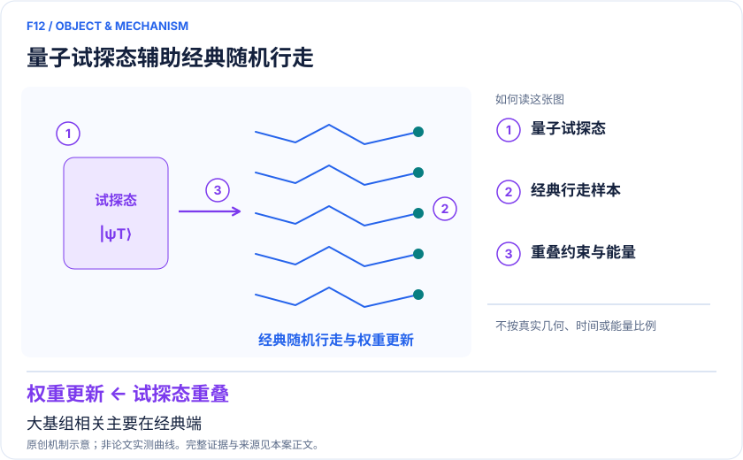
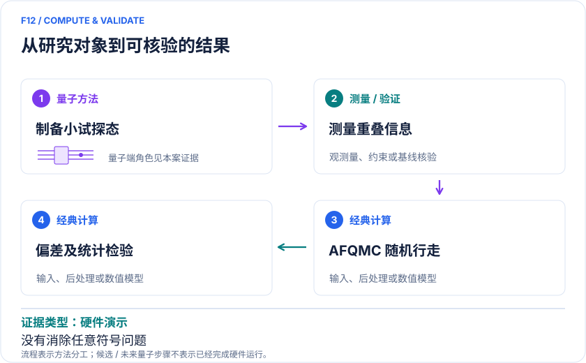

<!-- 由 release/tools/build_problems.py 自 tasks/F12-quantum-assisted-afqmc/README.md 与 tasks/catalog.json 生成，勿手改 -->

# F12 · 量子辅助 AFQMC：用小量子试探态减少大基组约束偏差

> 开放题 · 材料模型与动力学 · 多电子求解与混合算法
> 难度：进阶（[分级说明](../../../starters/README.md#难度分级)） · 背景：凝聚态与动力学

## 题面

| 环节 | 内容 |
|---|---|
| 研究体系 | H₄等分子及周期金刚石小模型的电子结构示范 |
| 可观测量 | 基态/原子化能、试探态约束偏差、重叠估计成本 |
| 经典基线 | HF/CASSCF/selected-CI/DMRG试探态AFQMC、FCI及耦合簇 |
| 量子方法的角色 | 量子电路提供试探波函数重叠信息；随机行走和大空间相关处理主要在经典端。 |
| 研发决策 | 判断复杂关联体系的 AFQMC 偏差是否值得引入量子试探态而非改进经典试探态。 |

## 基准输入

原文输入没有完全公开。下表是参照运行实际使用的替代输入，解法可以沿用以便直接比较；取得原文输入或改用其他输入时请说明理由。「原文」指作者或原论文公开的材料，「参照」指本项目参照运行自行冻结的选择。

| 项目 | 内容 | 出处 |
|---|---|---|
| 模型 | H₄ 正方形，边长 1.23 Å，STO-3G，N=4，Sz=0 | [原文](https://www.nature.com/articles/s41586-021-04351-z) |
| 评估研究 | arXiv:2404.18303v2 | [原文](https://arxiv.org/html/2404.18303v2) |

**尚未公开或需注意：**周期金刚石小模型的输入未整理。

## 什么算解

一份解法满足以下五点即可提交审核。负结果同样接受，只要过程可复现、结论有依据。

1. **模型对应**：说明所用模型或数据如何对应「H₄等分子及周期金刚石小模型的电子结构示范」，列出简化与近似。
2. **可观测量**：报告「基态/原子化能、试探态约束偏差、重叠估计成本」，附单位与不确定度。
3. **经典对照**：在同一模型或数据上，与「HF/CASSCF/selected-CI/DMRG试探态AFQMC、FCI及耦合簇」中至少一种方法比较。
4. **可复现**：提供代码、环境、随机种子、输入来源与哈希，以及计算资源和成本；用到 QPU 时注明设备与 shots。
5. **研发决策**：说明结果能否支撑「判断复杂关联体系的 AFQMC 偏差是否值得引入量子试探态而非改进经典试探态。」，以及还缺什么证据。

本题的细化标准欢迎在 issue 中讨论；被采纳的讨论结论会写入后续版本。

## 现有参照

本项目已有数值执行记录（经典计算机上的计算与模拟），供对照与复用，不代表最优解。

- 原应用目标：未完成（incomplete）
- 最新研究报告：[REFERENCE.md](REFERENCE.md)
- 其余证据指针见 evidence.json（本地证据，未随题库发布）

### 原案例说明

### F12｜量子辅助 AFQMC：用小量子试探态减少大基组约束偏差

<!-- VISUALS:START -->
#### 可视化导读

**图 1 · 量子试探态辅助经典随机行走。** 大基组相关主要在经典端。基态/原子化能、试探态约束偏差、重叠估计成本。图形为依据本案文献重绘的概念关系，不表示实际原子坐标、实测曲线或数值比例。

**图 2 · 计算与验证路径。** 量子电路提供试探波函数重叠信息；随机行走和大空间相关处理主要在经典端。。**证据边界：** 测量与经典影子后处理、微小重叠统计、试探态表示限制；不能称消除任意符号问题。

图解依据：[R1 · Unbiasing fermionic quantum Monte Carlo with a quantum computer](https://www.nature.com/articles/s41586-021-04351-z)；[R2 · Evaluating a quantum-classical quantum Monte Carlo algorithm with Matchgate shadows](https://arxiv.org/html/2404.18303v2)；[R3 · QCQMC](https://quantumai.google/cirq/experiments/qcqmc)。解释性连线与图形布局由本库整理，未复制论文原图。

[机制图 SVG](mechanism.svg) · [流程图 SVG](workflow.svg) · 机制图 PNG（本地证据，未随题库发布） · 流程图 PNG（本地证据，未随题库发布） · 图解说明 JSON（本地证据，未随题库发布）
<!-- VISUALS:END -->

> 文献核查截至 2026-10-04。优先级：重点储备（编辑判断）；证据：硬件演示。本档案是文献研究和试点设计，未运行复现实验。

#### 价值与决策

受约束 AFQMC 是强经典电子结构方法，但其约束可能依赖试探态质量。量子设备的潜在位置是提供经典不易紧凑表示的试探信息，帮助降低偏差；无需把大基组全部映射上 QPU。实际立项要先证明现有误差确由试探态引起，而不是基组、赝势、环境或统计误差。

#### 数学对象与规模说明

经典随机行走用 Slater determinant |φ〉 表示采样态，量子侧提供〈Ψ_T|φ〉等重叠，参与权重更新和局域能估计。虚时间投影主要由经典 AFQMC 完成。论文“最多 120 轨道”是混合大空间电子结构规模，“最多 16 比特”是量子子任务规模；若把二者写成 120 比特全量子计算，将完全误述该方法的价值。[R1]

#### 量子—经典工作流

固定轨道和 Hamiltonian→经典优化可用试探态→制备量子试探电路→采集影子/重叠信息→经典受约束随机传播→计算能量和误差→对照高质量经典试探态。某些影子方案可先测量后重复利用数据，但仍有经典重建及查询开销，不能把离线采集理解成所有后处理免费。

#### 原始文献与关键限制

Huggins 等 2022 年用最多 16 比特辅助较大轨道空间，H₄ 示例中 QC-AFQMC 的能量可明显优于噪声试探态的直接变分能量。论文明确说尚未达到相对可用经典算法的实用量子优势。[R1]

Huang 等 2024 年研究 Matchgate shadows，改善原 Clifford shadows 的指数后处理瓶颈，但指出即便渐近有效，小化学体系的实际经典处理仍可在数千个 CPU 上耗费数小时。这是该路线扩展成本的直接警示，而不是证明所有量子辅助 QMC 不可能。[R2] 研究团队还公开复现 notebook 入口，适合作为数据闭包起点。[R3]

#### 强基线与完整资源账

至少比较相同基组/轨道/冻结核下的 HF、CASSCF、selected-CI 或 MPS 试探态 AFQMC。不能只以单 determinant 基线的偏差宣称量子不可替代。总成本应包含电路优化、QPU shots、校准、影子存储、重叠查询时间、随机行走和统计相关。重叠趋近零时比值估计可能病态，需报告尾部分布与截断规则。改进特定约束偏差不等于普遍解决费米符号问题。

#### 建议复现：从公开 H₄ 开始

输入原几何、基组、电子积分、量子试探态或影子数据、随机传播步长、walker 数和约束规则。先用精确试探态验证 AFQMC 实现，再以论文量子数据替换；随后加入比 HF 更强的经典试探态。验收：原子化能误差与统计区间可重建；QPU 直接能量和 QC-AFQMC 能量清楚分开；测量/后处理成本完整计入；量子收益超过所有截断与步长误差。停止：缺少原始影子或波函数闭包、微小重叠阈值改变排序、经典改良已消除目标偏差。

#### 材料落地判断与下一步

周期金刚石小模型证明的是算法可触及周期 Hamiltonian，不代表已完成真实缺陷、表面或材料筛选。更合适的下一步是锁定一个 AFQMC 试探态敏感的实际反应或材料能量差，先做强经典对照与成本估算，再决定量子测量是否有价值。

#### docs 来源

- quantum_applications_roadmap_2021-2026.md：Google 2022 / S03
- 量子计算如何研究材料问题与药物研发_研究方法与应用综述.md：强经典基线与外部关联

文档用于定位问题与初始引文；证据等级依据本次原始来源核查。

#### 参考文献与访问深度

- **[R1]** [Unbiasing fermionic quantum Monte Carlo with a quantum computer](https://www.nature.com/articles/s41586-021-04351-z)，2022；期刊论文；访问：`full_text`。支持：16比特/120轨道分工、H₄原子化能、经典传播与重叠查询、未证明实用优势。
- **[R2]** [Evaluating a quantum-classical quantum Monte Carlo algorithm with Matchgate shadows](https://arxiv.org/html/2404.18303v2)，2024；预印本；访问：`full_text`。支持：Matchgate影子、硬件噪声鲁棒及昂贵经典后处理；PhysRevResearch.6.043063。
- **[R3]** [QCQMC](https://quantumai.google/cirq/experiments/qcqmc)，2024；机构技术说明；访问：`publisher_summary`。支持：研究团队提供论文复现notebook与实验波函数/Hamiltonian入口。

## 如何提交

按 [CONTRIBUTING.md](../../../CONTRIBUTING.md) 把解法放在 `solutions/F12/<你的名字>-<短名>/`，格式见 [解法模板](../../../solutions/_template/SOLUTION.md)。被采纳的解法会按 [沉淀规则](../../../skills/README.md) 提炼为可复用的 skill。
