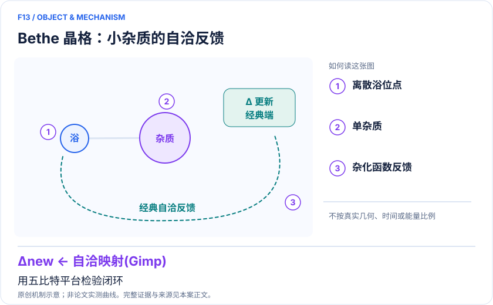
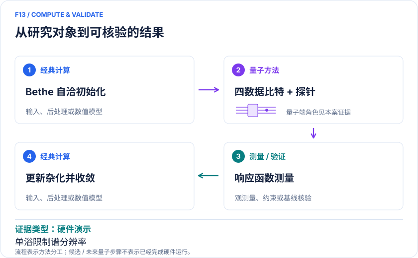

<!-- 由 release/tools/build_problems.py 自 tasks/F13-bethe-self-consistent-siam/README.md 与 tasks/catalog.json 生成，勿手改 -->

# F13 · Bethe 晶格自洽 SIAM：五比特 NMR 验证 DMFT 反馈闭环

> 开放题 · 材料模型与动力学 · 强关联嵌入与自洽
> 难度：前沿（[分级说明](../../../starters/README.md#难度分级)） · 背景：凝聚态与动力学

## 题面

| 环节 | 内容 |
|---|---|
| 研究体系 | 半填充、无限配位 Bethe 晶格 Hubbard 模型的一杂质一浴近似 |
| 可观测量 | 局域格林函数、谱函数、自洽混成 V |
| 经典基线 | 相同二站杂质 ED、经典二站DMFT与增加浴数的求解 |
| 量子方法的角色 | 五比特 NMR 中四数据比特表示自旋轨道，一探针比特辅助测量响应。 |
| 研发决策 | 验证带噪声的杂质响应能否稳定驱动自洽，而不是只求解固定 Hamiltonian。 |

## 基准输入

本题尚未指定基准输入。请在「模型对应」中写明所用结构、参数或数据的来源与哈希；如能找到权威的公开输入，欢迎在 issue 中提出，采纳后写入后续版本。

## 什么算解

一份解法满足以下五点即可提交审核。负结果同样接受，只要过程可复现、结论有依据。

1. **模型对应**：说明所用模型或数据如何对应「半填充、无限配位 Bethe 晶格 Hubbard 模型的一杂质一浴近似」，列出简化与近似。
2. **可观测量**：报告「局域格林函数、谱函数、自洽混成 V」，附单位与不确定度。
3. **经典对照**：在同一模型或数据上，与「相同二站杂质 ED、经典二站DMFT与增加浴数的求解」中至少一种方法比较。
4. **可复现**：提供代码、环境、随机种子、输入来源与哈希，以及计算资源和成本；用到 QPU 时注明设备与 shots。
5. **研发决策**：说明结果能否支撑「验证带噪声的杂质响应能否稳定驱动自洽，而不是只求解固定 Hamiltonian。」，以及还缺什么证据。

本题的细化标准欢迎在 issue 中讨论；被采纳的讨论结论会写入后续版本。

## 现有参照

本题暂无本项目的数值执行记录，下面只有文献整理。

### 原案例说明

### F13｜Bethe 晶格自洽 SIAM：五比特 NMR 验证 DMFT 反馈闭环

<!-- VISUALS:START -->
#### 可视化导读

**图 1 · Bethe 晶格：小杂质的自洽反馈。** 用五比特平台检验闭环。局域格林函数、谱函数、自洽混成 V。图形为依据本案文献重绘的概念关系，不表示实际原子坐标、实测曲线或数值比例。

**图 2 · 计算与验证路径。** 五比特 NMR 中四数据比特表示自旋轨道，一探针比特辅助测量响应。。**证据边界：** 不是有限维真实晶体；单浴强烈限制谱分辨率和临界参数；NMR平台不能直接外推通用QPU资源。

图解依据：[R1 · Self-Consistent Determination of Single-Impurity Anderson Model Using Hybrid Quantum-Classical Approach on a Spin Quantum Simulator](https://arxiv.org/html/2410.07808v1)；[R2 · Hybrid Quantum-Classical Approach to Correlated Materials](https://doi.org/10.1103/PhysRevX.6.031045)。解释性连线与图形布局由本库整理，未复制论文原图。

[机制图 SVG](mechanism.svg) · [流程图 SVG](workflow.svg) · 机制图 PNG（本地证据，未随题库发布） · 流程图 PNG（本地证据，未随题库发布） · 图解说明 JSON（本地证据，未随题库发布）
<!-- VISUALS:END -->

> 文献核查截至 2026-10-04。优先级：近期验证（编辑判断）；证据：硬件演示。本档案是文献研究和试点设计，未运行复现实验。

#### 研发价值与具体决策

DMFT 的难点不止是求出某个杂质基态：噪声响应会改变环境，而新环境又改变下一轮量子输入。该研究适合回答“反馈是否在噪声下可控”。对实际材料团队，它是检验求解器接口和收敛诊断的最小训练案例。材料发现价值仍取决于以后扩展的轨道、浴与真实晶体输入。

#### 体系与数学目标

目标是半填充 Bethe 晶格的局域关联，采用一个杂质轨道和一个浴轨道、浴能量固定为粒子—空穴对称值。Hamiltonian 包含局域 U 与杂质—浴混成 V；四个自旋轨道编码到四个数据比特。量子测量格林函数后，经典侧根据自洽关系更新 V。第五比特是探针，不能计为新增电子轨道。[R1]

#### 流程与论文结果

Nie 等在 NMR 自旋模拟器实现态准备、探针辅助响应测量与经典反馈。文中展示 U=0、1、2（论文归一化单位）三组计算并观察谱随相互作用变化。作者把有限浴下的相变结果定位为初步证据；附录给出迭代伪代码，并讨论实验误差下后几轮平均。这不等同高精度确定真实材料莫特临界点。[R1]

Bauer 等早期框架解释为何可将量子杂质求解器接入经典材料计算。其未来逻辑资源讨论不能转写为2024硬件已达到的能力。[R2]

#### 基线、资源与边界

最强直接对照是同一二站 Hamiltonian 的 ED 和完全经典自洽，不需要先与昂贵大材料模拟比较。对相变解释还要增加浴数，检查离散峰是否随拟合变化。需区分固定点残差、参数随机波动与物理多稳态；仅最后几轮相近可能只是噪声饱和。NMR集合读出、可控耦合及伪纯态制备的成本结构与超导单次读出不同，不应按五比特数量宣称跨平台可扩展。

#### 建议复现与验收

建议输入：原U、V初始化、频率/时间网格、态制备与探针算符、更新规则、终止阈值。先纯ED重建闭环，再加入可控噪声和有限采样，最后才接硬件。验收包括谱权重、因果性、自洽残差及多初值一致性；物理变化必须大于浴离散和噪声偏差。停止条件为响应非物理、改变混合参数即改变结论、缺乏原始测量数据却声称实验重现。本次仅做文献核查，未运行上述试点。

#### 下一步判断

优先产出稳定且可替换的GF—自洽接口。若单浴无法分辨目标能标，升级浴空间并给出代价；不要用增加迭代次数弥补模型本身缺失的自由度。

#### docs 来源

- 量子计算在材料计算与药物研发中的具体案例库.html：原案例M04 / arXiv:2410.07808

文档用于定位问题与初始引文；证据等级依据本次原始来源核查。

#### 参考文献与访问深度

- **[R1]** [Self-Consistent Determination of Single-Impurity Anderson Model Using Hybrid Quantum-Classical Approach on a Spin Quantum Simulator](https://arxiv.org/html/2410.07808v1)，2024；预印本；访问：`full_text`。支持：五比特NMR、单浴Bethe自洽、U=0/1/2与附录算法；PRL133,140602。
- **[R2]** [Hybrid Quantum-Classical Approach to Correlated Materials](https://doi.org/10.1103/PhysRevX.6.031045)，2016；期刊论文；访问：`abstract`。支持：量子杂质求解器与经典自洽的理论框架，不是R1独立复现。

## 如何提交

按 [CONTRIBUTING.md](../../../CONTRIBUTING.md) 把解法放在 `solutions/F13/<你的名字>-<短名>/`，格式见 [解法模板](../../../solutions/_template/SOLUTION.md)。被采纳的解法会按 [沉淀规则](../../../skills/README.md) 提炼为可复用的 skill。
