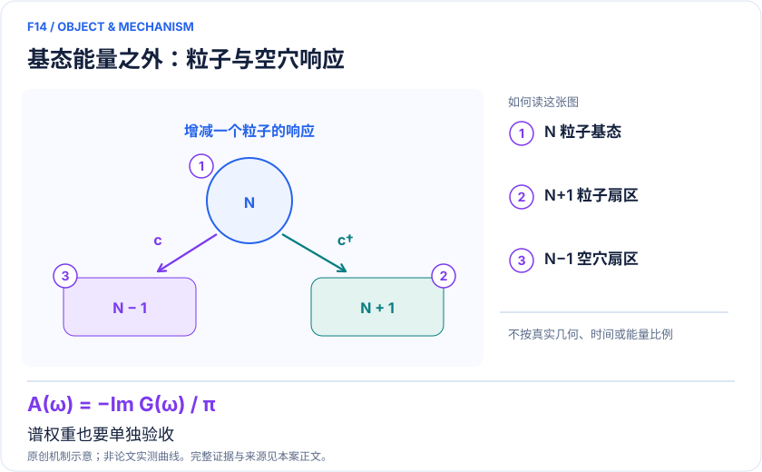
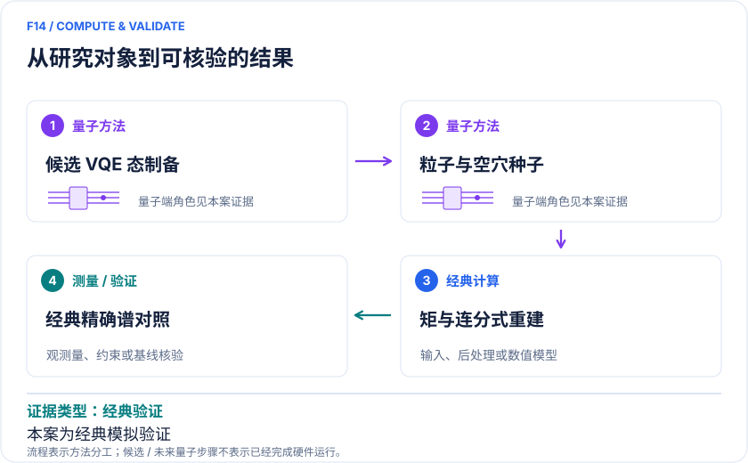

<!-- 由 release/tools/build_problems.py 自 tasks/F14-vqe-siam-density-states/README.md 与 tasks/catalog.json 生成，勿手改 -->

# F14 · 粒子—空穴对称 SIAM 的 VQE 态密度：能量与响应双重验收

> 开放题 · 材料模型与动力学 · 量子杂质求解与谱学
> 难度：前沿（[分级说明](../../../starters/README.md#难度分级)） · 背景：凝聚态与动力学

## 题面

| 环节 | 内容 |
|---|---|
| 研究体系 | 粒子—空穴对称单杂质Anderson模型，离散浴1/3/5/7轨道 |
| 可观测量 | 基态能、格林函数、DOS、高阶Hamiltonian矩 |
| 经典基线 | ED、经典Lanczos、同ansatz理想值与强杂质求解器 |
| 量子方法的角色 | 候选量子电路准备基态与粒子/空穴响应种子；经典优化、矩处理和连分式重建谱。 |
| 研发决策 | 判断浅态准备是否足以给出可信DOS，以及额外矩校正的测量代价是否值得。 |

## 基准输入

本题尚未指定基准输入。请在「模型对应」中写明所用结构、参数或数据的来源与哈希；如能找到权威的公开输入，欢迎在 issue 中提出，采纳后写入后续版本。

## 什么算解

一份解法满足以下五点即可提交审核。负结果同样接受，只要过程可复现、结论有依据。

1. **模型对应**：说明所用模型或数据如何对应「粒子—空穴对称单杂质Anderson模型，离散浴1/3/5/7轨道」，列出简化与近似。
2. **可观测量**：报告「基态能、格林函数、DOS、高阶Hamiltonian矩」，附单位与不确定度。
3. **经典对照**：在同一模型或数据上，与「ED、经典Lanczos、同ansatz理想值与强杂质求解器」中至少一种方法比较。
4. **可复现**：提供代码、环境、随机种子、输入来源与哈希，以及计算资源和成本；用到 QPU 时注明设备与 shots。
5. **研发决策**：说明结果能否支撑「判断浅态准备是否足以给出可信DOS，以及额外矩校正的测量代价是否值得。」，以及还缺什么证据。

本题的细化标准欢迎在 issue 中讨论；被采纳的讨论结论会写入后续版本。

## 现有参照

本题暂无本项目的数值执行记录，下面只有文献整理。

### 原案例说明

### F14｜粒子—空穴对称 SIAM 的 VQE 态密度：能量与响应双重验收

<!-- VISUALS:START -->
#### 可视化导读

**图 1 · 基态能量之外：粒子与空穴响应。** 谱权重也要单独验收。基态能、格林函数、DOS、高阶Hamiltonian矩。图形为依据本案文献重绘的概念关系，不表示实际原子坐标、实测曲线或数值比例。

**图 2 · 计算与验证路径。** 候选量子电路准备基态与粒子/空穴响应种子；经典优化、矩处理和连分式重建谱。。**证据边界：** 没有实机运行或端到端量子优势；基态误差小也不保证谱权重可靠。

图解依据：[R1 · Quantum solver for single-impurity Anderson models with particle-hole symmetry](https://arxiv.org/html/2601.10594v2)；[R2 · Self-Consistent Determination of Single-Impurity Anderson Model Using Hybrid Quantum-Classical Approach on a Spin Quantum Simulator](https://arxiv.org/html/2410.07808v1)。解释性连线与图形布局由本库整理，未复制论文原图。

[机制图 SVG](mechanism.svg) · [流程图 SVG](workflow.svg) · 机制图 PNG（本地证据，未随题库发布） · 流程图 PNG（本地证据，未随题库发布） · 图解说明 JSON（本地证据，未随题库发布）
<!-- VISUALS:END -->

> 文献核查截至 2026-10-04。优先级：近期验证（编辑判断）；证据：经典验证。本档案是文献研究和试点设计，未运行复现实验。

#### 价值与决策对象

材料谱学常需要一个可接入嵌入方法的杂质DOS，而不是单个最低能量。本例把两类验收绑在一起：浅VQE能否准备有用状态，以及由该状态提取的粒子添加/移除响应是否保真。它适合作为算法试点；现阶段没有证据支持生产级材料谱计算加速。

#### 体系与目标量

一个相关杂质耦合离散无相互作用浴，利用粒子—空穴对称性约束参数与态制备。若浴数为Nb，自旋轨道数是2(Nb+1)，与浴数不同。目标 A(ω)=−ImG(ω+iη)/π；其中展宽η既影响可分辨峰，也影响误差观感。所有对照必须使用同一η和归一化。[R1]

#### 工作流和真实证据

Karabin 等2026工作在经典模拟器中优化浅ansatz，并用参数变换构造粒子/空穴激发种子，再通过矩和连分式求GF；还引入量子计算矩（QCM）改进能量估计。论文比较多种优化器和采样噪声，包含1、3、5、7浴研究，但最大规模使用更少的初始化与重复。受限ansatz仍存在误差，高阶矩测量成本迅速增长。因此“浅”不能直接推出“便宜”或“谱准确”。[R1]

#### 与相邻案例的差别

F13/R2以极小单浴NMR系统证明自洽反馈可以实验实现；本例着重多浴态准备与响应重建的经典数值评估，两者回答不同问题。F11则从真实材料有效模型出发。不能把三个工作的最佳数字拼成一个已经实机运行的多浴、真实晶体、自洽全流程。[R2]

#### 强经典比较和资源

ED可为本例规模提供能量与整谱基线；逐步增大规模才需要DMRG或其他动态求解器。应同时报告变分能量误差、峰位误差、谱权重距离、优化失败率和不同初始化分布。资源账包含所有矩对应的Pauli测量、协方差、shots分配及经典优化轮数；不能只列制备电路层数。建议将“理想ansatz表达误差”“优化误差”和“采样误差”分列。

#### 建议复现、验收与停止

输入公开bath参数、U、初态、ansatz、优化器设置、随机种子、矩阶数与η。从三浴ED起步：先优化无噪声态，检查添加/移除谱与和规则，再逐级加入有限shots及矩校正。验收为能量和谱两个指标都达预设容差，且校正收益超过增加的统计不确定度。若高阶矩方差使总成本不可接受，或能量改善却破坏谱权重，则停止升级并报告失败区域。本次没有执行该数值复现。

#### 下一步判断

此例优先级来自输入规模可控和真值易得。通过小模型双指标验收后，再考虑DMFT反馈和硬件噪声；外推到不具备粒子—空穴对称性的真实材料前需要重新设计和验证。

#### docs 来源

- 量子计算在材料计算与药物研发中的具体案例库.html：原案例M05 / arXiv:2601.10594

文档用于定位问题与初始引文；证据等级依据本次原始来源核查。

#### 参考文献与访问深度

- **[R1]** [Quantum solver for single-impurity Anderson models with particle-hole symmetry](https://arxiv.org/html/2601.10594v2)，2026；预印本；访问：`full_text`。支持：经典模拟VQE、1/3/5/7浴、连分式GF、量子计算矩与采样成本；已关联PRResearch8,033066。
- **[R2]** [Self-Consistent Determination of Single-Impurity Anderson Model Using Hybrid Quantum-Classical Approach on a Spin Quantum Simulator](https://arxiv.org/html/2410.07808v1)，2024；预印本；访问：`full_text`。支持：独立的单浴硬件自洽对照，不能当作本VQE求解器实机证明。

## 如何提交

按 [CONTRIBUTING.md](../../../CONTRIBUTING.md) 把解法放在 `solutions/F14/<你的名字>-<短名>/`，格式见 [解法模板](../../../solutions/_template/SOLUTION.md)。被采纳的解法会按 [沉淀规则](../../../skills/README.md) 提炼为可复用的 skill。
