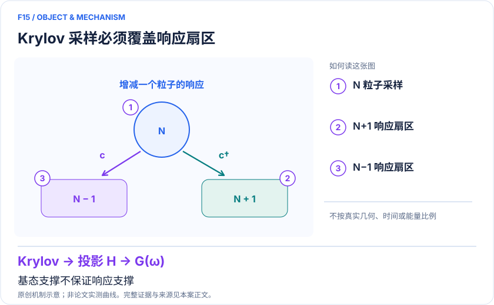
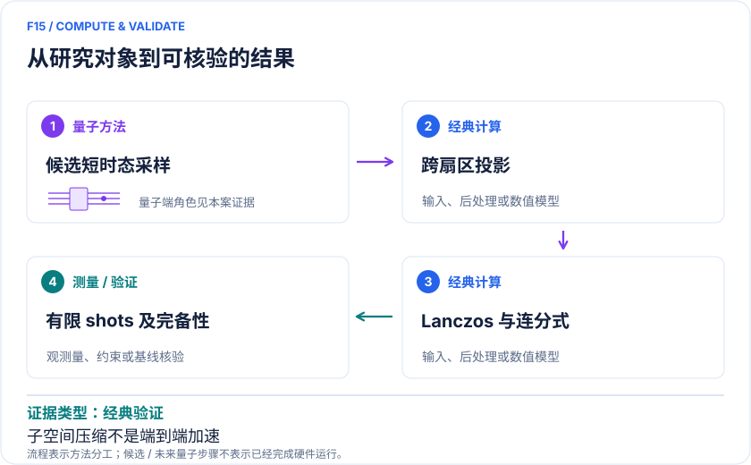

<!-- 由 release/tools/build_problems.py 自 tasks/F15-skqd-impurity-greens-functions/README.md 与 tasks/catalog.json 生成，勿手改 -->

# F15 · SKQD 杂质格林函数：从基态采样子空间扩展到粒子响应

> 开放题 · 材料模型与动力学 · 量子子空间与动态响应

## 题面

| 环节 | 内容 |
|---|---|
| 研究体系 | 由已收敛经典DMFT取得离散浴的粒子—空穴对称SIAM链 |
| 可观测量 | 添加/移除GF、DOS极点与残量、子空间采样收敛 |
| 经典基线 | 同Hamiltonian ED/Lanczos、HF与bare轨道基、精确幅度oracle |
| 量子方法的角色 | 量子候选步骤是短时Krylov态制备与采样；投影、跨扇区重叠和连分式重建在经典端。 |
| 研发决策 | 判断量子样本筛出的紧凑基是否保留谱权重，避免把基态能量收敛当作响应完整。 |

## 什么算解

一份解法满足以下五点即可提交审核。负结果同样接受，只要过程可复现、结论有依据。

1. **模型对应**：说明所用模型或数据如何对应「由已收敛经典DMFT取得离散浴的粒子—空穴对称SIAM链」，列出简化与近似。
2. **可观测量**：报告「添加/移除GF、DOS极点与残量、子空间采样收敛」，附单位与不确定度。
3. **经典对照**：在同一模型或数据上，与「同Hamiltonian ED/Lanczos、HF与bare轨道基、精确幅度oracle」中至少一种方法比较。
4. **可复现**：提供代码、环境、随机种子、输入来源与哈希，以及计算资源和成本；用到 QPU 时注明设备与 shots。
5. **研发决策**：说明结果能否支撑「判断量子样本筛出的紧凑基是否保留谱权重，避免把基态能量收敛当作响应完整。」，以及还缺什么证据。

本题的细化标准欢迎在 issue 中讨论；被采纳的讨论结论会写入后续版本。

## 现有参照

本项目已有数值执行记录（经典计算机上的计算与模拟），供对照与复用，不代表最优解。

- 原应用目标：未完成（incomplete）
- 最新研究报告：[REFERENCE.md](REFERENCE.md)
- 其余证据指针见 evidence.json（本地证据，未随题库发布）

### 原案例说明

### F15｜SKQD 杂质格林函数：从基态采样子空间扩展到粒子响应

<!-- VISUALS:START -->
#### 可视化导读

**图 1 · Krylov 采样必须覆盖响应扇区。** 基态支撑不保证响应支撑。添加/移除GF、DOS极点与残量、子空间采样收敛。图形为依据本案文献重绘的概念关系，不表示实际原子坐标、实测曲线或数值比例。

**图 2 · 计算与验证路径。** 量子候选步骤是短时Krylov态制备与采样；投影、跨扇区重叠和连分式重建在经典端。。**证据边界：** 仅三个系统尺寸，有限shots与响应扇区完备性限制；不能由压缩比宣称端到端加速。

图解依据：[R1 · Green's Functions from Sample-based Krylov Quantum Diagonalization: An Impurity Solver for Dynamical Mean-Field Theory](https://arxiv.org/html/2609.09147v1)；[R2 · Quantum-Centric Algorithm for Sample-Based Krylov Diagonalization](https://arxiv.org/abs/2501.09702)。解释性连线与图形布局由本库整理，未复制论文原图。

[机制图 SVG](mechanism.svg) · [流程图 SVG](workflow.svg) · 机制图 PNG（本地证据，未随题库发布） · 流程图 PNG（本地证据，未随题库发布） · 图解说明 JSON（本地证据，未随题库发布）
<!-- VISUALS:END -->

> 文献核查截至 2026-10-04。优先级：重点储备（编辑判断）；证据：经典验证。本档案是文献研究和试点设计，未运行复现实验。

#### 研发价值与风险点

嵌入材料计算需要动态响应；只有高精度基态能量仍可能遗漏加入或移除电子后重要的激发态。本例的价值是把样本选基从能量任务推向GF任务，同时暴露响应不完整的风险。未来能否产生实际收益，取决于量子采样比强经典选基多获得了什么重要态，而不只取决于选出多少态。

#### 体系和数学任务

Patel等使用粒子—空穴对称SIAM链，浴参数来自已经收敛的经典DMFT。文中L表示总轨道位点；L=12是一个杂质加十一个浴，每个位点包含两自旋自由度。GF涉及c†|Ψ₀〉与c|Ψ₀〉所张成的N+1、N−1响应空间，与N电子基态空间不同。[R1]

#### 算法及文献结果

候选QPU制备短时演化Krylov态并测计算基样本；经典侧据样本建立投影Hamiltonian，在各粒子扇区对角化或Lanczos递推，经连分式得到极点和权重。跨扇区重叠由经典表示计算，避免额外量子重叠电路。作者用经典模拟评估L=8、10、12，并比较有限采样与精确幅度oracle；轨道基选择影响压缩效率。最大实例出现明显子空间缩减，但论文明确只有有限尺寸研究，尚不能证实可扩展优势。[R1]

#### 前驱与证据不能拼接

2025年Yu等SKQD前驱报告Heron与Frontier联合计算更大的杂质基态，并在稀疏性等假设下给出收敛分析。[R2] 这些硬件结果属于基态任务；2026格林函数扩展是经典数值研究。R1并未在量子噪声下完成DMFT自洽循环，因此不能称为“已实现全流程量子DMFT”。

#### 经典比较与资源

必须保持同bath、相同粒子扇区、展宽和频率网格，比较ED/Lanczos、经典选态、HF基与bare基。精确幅度oracle只能帮助分离采样误差，不是可免费使用的真实输入。资源包括Krylov时间/深度、shots、配置恢复、基空间大小、矩阵元构造及经典内存；一个小投影空间不自动保证总成本较小。尤其要检查卫星峰、尾部谱权重和占据数和规则。

#### 建议试点及验收

从最小L=8和公开参数起步，先用ED固定真值，再分别用有限shots、oracle和不使用量子样本的经典选基生成子空间。输出能量、峰位、积分权重、漏峰率、shots—误差曲线和总时间。验收需要响应指标对随机seed和基空间扩张稳定，量子样本收益独立于oracle成立。停止条件为基态已收敛而谱仍不稳、后处理超预算、bath拟合改变物理结论。本次只完成文献研究，未开展复现。

#### 下一步判断

先做响应完备性与强经典选基对照，再考虑将新bath反馈到下一轮。只有在这一闭环和新增噪声预算都验证后，才有理由评估真实材料迁移。

#### docs 来源

- 量子计算在材料计算与药物研发中的具体案例库.html：原案例M06 / arXiv:2609.09147
- quantum_applications_roadmap_2021-2026.md：S13 SKQD前驱

文档用于定位问题与初始引文；证据等级依据本次原始来源核查。

#### 参考文献与访问深度

- **[R1]** [Green's Functions from Sample-based Krylov Quantum Diagonalization: An Impurity Solver for Dynamical Mean-Field Theory](https://arxiv.org/html/2609.09147v1)，2026；预印本；访问：`full_text`。支持：L8/10/12、N±1扇区、有限shots与oracle、经典模拟及未来闭环界限。
- **[R2]** [Quantum-Centric Algorithm for Sample-Based Krylov Diagonalization](https://arxiv.org/abs/2501.09702)，2025；预印本；访问：`abstract`。支持：SKQD前驱的条件性收敛与大杂质基态实机演示；并非2026GF工作的实机证据。

## 如何提交

按 [CONTRIBUTING.md](../../../CONTRIBUTING.md) 把解法放在 `solutions/F15/<你的名字>-<短名>/`，格式见 [解法模板](../../../solutions/_template/SOLUTION.md)。被采纳的解法会按 [沉淀规则](../../../skills/README.md) 提炼为可复用的 skill。
