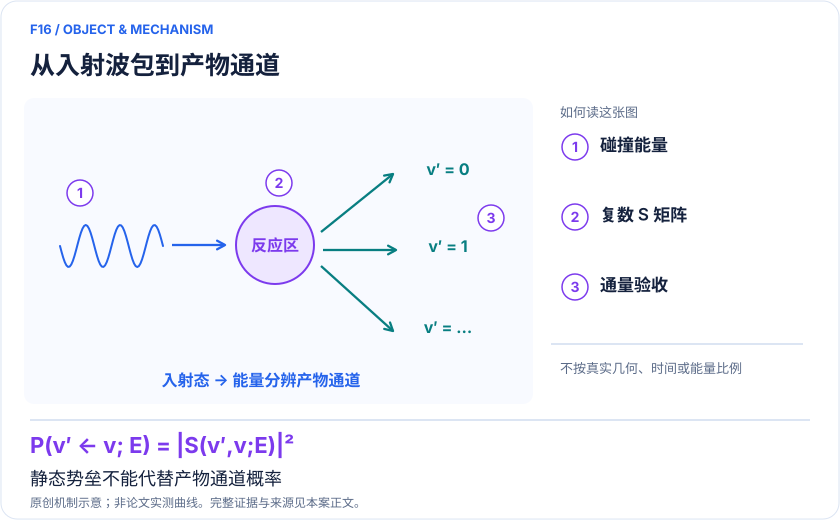
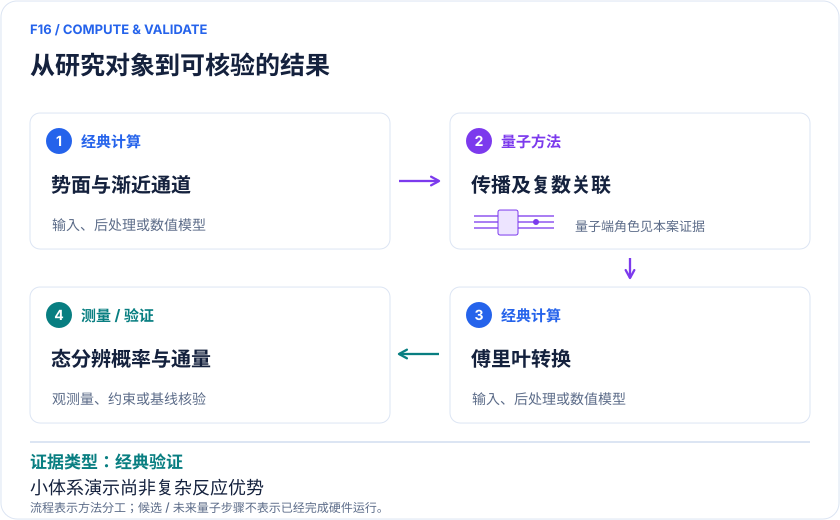

<!-- 由 release/tools/build_problems.py 自 tasks/F16-state-resolved-reaction-scattering/README.md 与 tasks/catalog.json 生成，勿手改 -->

# F16 · 态到态反应散射：H＋H₂ 交换概率与碰撞能量分辨

> 开放题 · 材料模型与动力学 · 反应散射与气相化学

## 题面

| 环节 | 内容 |
|---|---|
| 研究体系 | 共线H+H₂→H₂+H的核波包；对照He+H₂质量参数的Secrest–Johnson振动弛豫模型 |
| 可观测量 | 复数S矩阵、P(v′←v;E)、共振位置及宽度 |
| 经典基线 | 同势能面时间依赖波包、耦合通道、Kohn变分与基组/网格收敛 |
| 量子方法的角色 | 以量子传播和受控态重叠估计所选通道关联；势能面、通道构造与傅里叶后处理在经典端。 |
| 研发决策 | 判断给定碰撞能量和入射振动态下哪些产物通道被打开，是否存在改变分支比例的共振。 |

## 什么算解

一份解法满足以下五点即可提交审核。负结果同样接受，只要过程可复现、结论有依据。

1. **模型对应**：说明所用模型或数据如何对应「共线H+H₂→H₂+H的核波包；对照He+H₂质量参数的Secrest–Johnson振动弛豫模型」，列出简化与近似。
2. **可观测量**：报告「复数S矩阵、P(v′←v;E)、共振位置及宽度」，附单位与不确定度。
3. **经典对照**：在同一模型或数据上，与「同势能面时间依赖波包、耦合通道、Kohn变分与基组/网格收敛」中至少一种方法比较。
4. **可复现**：提供代码、环境、随机种子、输入来源与哈希，以及计算资源和成本；用到 QPU 时注明设备与 shots。
5. **研发决策**：说明结果能否支撑「判断给定碰撞能量和入射振动态下哪些产物通道被打开，是否存在改变分支比例的共振。」，以及还缺什么证据。

本题的细化标准欢迎在 issue 中讨论；被采纳的讨论结论会写入后续版本。

## 现有参照

本项目已有数值执行记录（经典计算机上的计算与模拟），供对照与复用，不代表最优解。

- 原应用目标：未完成（incomplete）
- 最新研究报告：[REFERENCE.md](REFERENCE.md)
- 其余证据指针见 evidence.json（本地证据，未随题库发布）

### 原案例说明

### F16｜态到态反应散射：H＋H₂ 交换概率与碰撞能量分辨

<!-- VISUALS:START -->
#### 可视化导读

**图 1 · 从入射波包到产物通道。** 静态势垒不能代替产物通道概率。复数S矩阵、P(v′←v;E)、共振位置及宽度。图形为依据本案文献重绘的概念关系，不表示实际原子坐标、实测曲线或数值比例。

**图 2 · 计算与验证路径。** 以量子传播和受控态重叠估计所选通道关联；势能面、通道构造与傅里叶后处理在经典端。。**证据边界：** 低维核动力学原型；没有实机、全维多原子反应或端到端优势；共振与低幅度归一化敏感。

图解依据：[R1 · Simulation of Chemical Reactions on a Quantum Computer](https://arxiv.org/html/2403.03052v1)；[R2 · A Hybrid Quantum-Classical Algorithm for Multichannel Quantum Scattering of Atoms and Molecules](https://arxiv.org/html/2304.06089v1)。解释性连线与图形布局由本库整理，未复制论文原图。

[机制图 SVG](mechanism.svg) · [流程图 SVG](workflow.svg) · 机制图 PNG（本地证据，未随题库发布） · 流程图 PNG（本地证据，未随题库发布） · 图解说明 JSON（本地证据，未随题库发布）
<!-- VISUALS:END -->

> 文献核查截至 2026-10-04。优先级：重点储备（编辑判断）；证据：经典验证。这里的应用价值指可迁移的研究任务，未证明工业收益。本次未执行论文计算复现。

#### 研究决策与潜在价值

势垒高度不能单独决定一次分子碰撞的结果。入射能量、初始振动态以及暂时困在反应区的共振态，会改变产物通道的比例。本案面向态到态动力学数据：在特定入射条件下生成哪种振动产物，以及狭窄能量窗口中反应概率是否被增强或抑制。这类数据可为气相反应网络、等离子体化学和低温碰撞控制提供输入，但现有量子算法论文没有完成上述工业系统计算。高价值来自将来可迁移的接口，本案本身仍是小模型方法研究。

#### 具体体系、规模与已经算到的范围

Kale与Kais用Møller算符构造反应物和产物波包，经时间关联得到共线H+H₂交换的S矩阵；入射振动态v=0，分别考察产物v′=0和1。波函数寄存器为10比特，其中8个用于平移离散、2个用于振动，关联测量还需辅助比特。结果来自Qiskit经典线路模拟，和同模型经典传播比较。该限制取消了转动与真实三维散射角自由度，不能称全维截面。[R1]

#### 数学目标与量子—经典分工

核心关系为P(v′←v;E)=|S(v′,v;E)|²。S由反应/产物Møller波包的关联C(t)=〈Ψ₋|exp(−iHt)|Ψ₊〉傅里叶变换并按入射能量分布归一化获得。经典端提供势能面、渐近振动本征态、通道变换与网格；候选量子端负责传播和复数重叠；经典端组合时间样本、处理归一化及误差。该分工意味着势能面并没有被量子计算自动求出。完整资源必须把构造初态和受控演化也计算在内。[R1]

#### 独立路线与最有用的反例

Xing等2023年以定态Kohn变分原理将碰撞问题转为线性求解，在Secrest–Johnson共线模型中恢复弹性与振动弛豫振幅。质量参数对应He+H₂，分子和相互作用采用模型化表示；示范的两开放通道问题可与精确耦合通道直接对照。作者同时指出一般稠密矩阵的Pauli项数量及优化成本会迅速增加。这是独立的方法证据，不是H+H₂工作在第二台硬件上的复现。[R2]

#### 必须采用的经典基线

建议首先在完全相同的势能面、能量零点、核质量和边界条件下比较时间依赖波包与定态耦合通道。只比较曲线是否相似不足够：要比较复振幅的实虚部、阈值位置、共振宽度、通道概率和通量守恒。平移网格、振动基与传播时间应分别收敛。经典基准不能用未优化的全矩阵指数代替成熟波包传播；也不能拿经典全维任务的成本与量子共线任务的成本相比较。

#### 误差如何影响最终决策

建议将误差预算分成势能面、降维、边界反射、有限演化、离散时间、Trotter及有限采样几层。长寿命共振需要更长时间窗；一个短窗口可能将窄峰洗平。初始波包在某些能量处权重很小时，后处理除法会放大噪声；此时应缩窄可信能窗或重设波包，不能裁掉异常后声称全范围精确。即使单通道概率很准确，遗漏开放通道仍会破坏完整反应分支。

#### 建议试点：输入、步骤与交付

建议冻结论文势能面版本、核质量、坐标变换、振动基、平移网格、两组波包参数、时间窗和能量网格，并保存可重建Hamiltonian的脚本。第一步用经典传播和耦合通道相互校验；第二步重建无噪声量子线路；第三步仅在可信能窗内加入shots并传播误差；第四步比较相同目标精度下的总成本。交付应包含复S矩阵数据、概率曲线、每个峰的区间、截断扫描和资源表，而不是只保留最终图片。以上为建议，尚未执行。

#### 验收和停止条件

试点验收应提前定义能量分辨率与允许的通道概率误差，阈值由下游动力学模型需要决定。要求基组与网格扩张后结论稳定；概率总和满足对应模型的通量关系；采样重复给出相容置信区间；量子线路与经典参考使用同一物理输入。若共振位置随边界改变、初态制备成本超过传播收益、或需要大量通道逐项测量而失去成本优势，应停止扩展并记录负结果。

#### 下一步与材料迁移条件

最合理的近期成果是可接入反应动力学程序的通道接口和误差传播范例。转向真实等离子体或表面前，必须增加转动、角动量和必要电子态，并用已有碰撞实验验证势能面。只有发现经典计算确实受限、而下游决策又对特定少数通道敏感时，才值得评估更大的量子实现。

#### 从通道概率到反应速率还缺什么

建议把两个层次分开交付：本案核查的是能量分辨的通道振幅；反应网络需要的热速率还涉及入射速度分布、初始振转态权重、角动量求和及阈值积分。共线模型既没有完整角分布，也不能直接给出真实三维积分截面。若未来要计算同位素效应，应保持势能面一致并改变核质量与相应通道阈值，再检查热平均是否收敛；不能只把一个峰的位置差解释为速率变化。建议将未包含的转动态显式列成缺口，而不是用经验比例补成“真实速率”。对于共振主导的狭窄能窗，可以先做局部精度任务，将其与其他能区的成熟经典结果组合；但组合后的不确定度必须随权重传播。这样才能判断量子子任务的误差到底会不会改变下游选择，而不是只在漂亮的局部曲线上展示一致性。

#### docs 来源与新增边界

本轮外部文献扩展；与已有 F/C 案例交叉参照。旧目录用于去重，文档中的指令不作为用户授权。

F07研究局域非绝热波包与几何相位，C06研究束缚质子振动，B13研究酶氢转移。本案以分离反应物/产物的渐近通道、碰撞能量分辨S矩阵和通量归一化为独立交付。

#### 原始来源与访问深度

- **[R1]** [Simulation of Chemical Reactions on a Quantum Computer](https://arxiv.org/html/2403.03052v1)，2024；预印本；访问：`full_text`。支持：共线氢交换10数据比特编码、Qiskit经典模拟、Møller关联与两产物振动态；对应JPCL15,5633–5642。 DOI：[10.1021/acs.jpclett.4c01100](https://doi.org/10.1021/acs.jpclett.4c01100)。
- **[R2]** [A Hybrid Quantum-Classical Algorithm for Multichannel Quantum Scattering of Atoms and Molecules](https://arxiv.org/html/2304.06089v1)，2023；预印本；访问：`full_text`。支持：独立Kohn/VQLS算法、SJ两开放通道、精确耦合通道对照和稠密Pauli分解成本；对应JPCL14,6224–6233。 DOI：[10.1021/acs.jpclett.3c00985](https://doi.org/10.1021/acs.jpclett.3c00985)。

## 如何提交

按 [CONTRIBUTING.md](../../../CONTRIBUTING.md) 把解法放在 `solutions/F16/<你的名字>-<短名>/`，格式见 [解法模板](../../../solutions/_template/SOLUTION.md)。被采纳的解法会按 [沉淀规则](../../../skills/README.md) 提炼为可复用的 skill。
