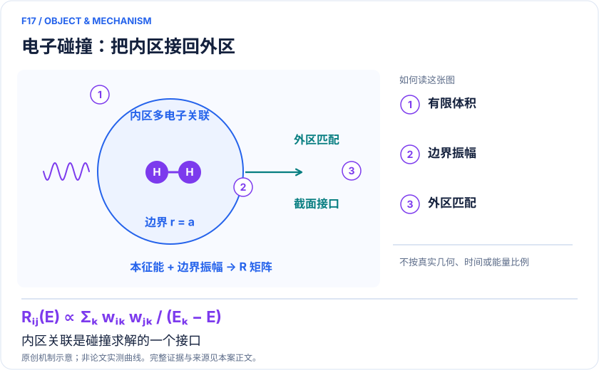
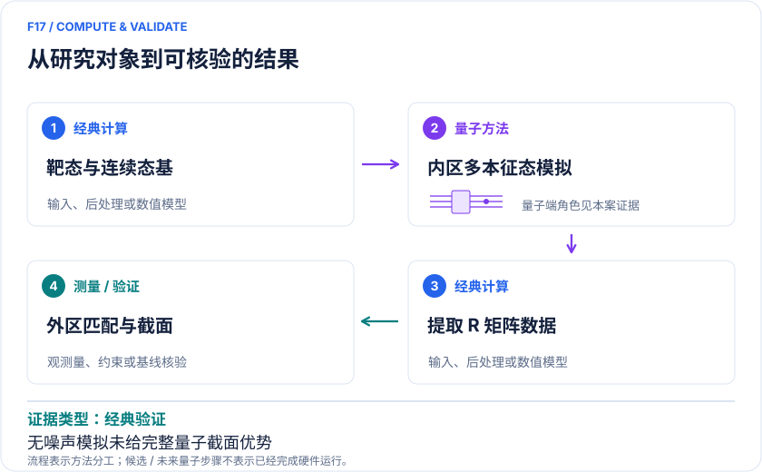

<!-- 由 release/tools/build_problems.py 自 tasks/F17-electron-molecule-rmatrix/README.md 与 tasks/catalog.json 生成，勿手改 -->

# F17 · 电子—分子碰撞：R矩阵内区谱与等离子体截面接口

> 开放题 · 材料模型与动力学 · 电子碰撞与等离子体材料过程

## 题面

| 环节 | 内容 |
|---|---|
| 研究体系 | 固定核H₂靶与一个入射电子的R矩阵内区最小模型 |
| 可观测量 | 内区本征值、边界振幅、未来外区匹配得到的相移和截面 |
| 经典基线 | 同五维问题经典对角化；实际散射需UKRmol/收敛密耦合方法与实验数据 |
| 量子方法的角色 | 候选QPU求有限体积内的多电子本征态与边界系数；经典端保留外区传播和截面重建。 |
| 研发决策 | 为等离子体模型筛选可靠电子碰撞数据，判断复杂靶分子的内区电子关联是否值得量子求解。 |

## 基准输入

解法默认使用下列输入，以便与现有参照和其他解法直接比较；改用其他输入时请说明理由。「原文」指作者或原论文公开的材料，「参照」指本项目参照运行自行冻结的选择。

| 项目 | 内容 | 出处 |
|---|---|---|
| 模型 | H₂ STO-3G 靶、GTO 连续态、R 矩阵半径 10 a₀、五维试探空间 | [原文](https://arxiv.org/html/2507.05514v2) |
| 数据 | 作者 Zenodo 档案 | [原文](https://doi.org/10.5281/zenodo.20140843) |

## 什么算解

一份解法满足以下五点即可提交审核。负结果同样接受，只要过程可复现、结论有依据。

1. **模型对应**：说明所用模型或数据如何对应「固定核H₂靶与一个入射电子的R矩阵内区最小模型」，列出简化与近似。
2. **可观测量**：报告「内区本征值、边界振幅、未来外区匹配得到的相移和截面」，附单位与不确定度。
3. **经典对照**：在同一模型或数据上，与「同五维问题经典对角化；实际散射需UKRmol/收敛密耦合方法与实验数据」中至少一种方法比较。
4. **可复现**：提供代码、环境、随机种子、输入来源与哈希，以及计算资源和成本；用到 QPU 时注明设备与 shots。
5. **研发决策**：说明结果能否支撑「为等离子体模型筛选可靠电子碰撞数据，判断复杂靶分子的内区电子关联是否值得量子求解。」，以及还缺什么证据。

本题的细化标准欢迎在 issue 中讨论；被采纳的讨论结论会写入后续版本。

## 现有参照

本项目已有数值执行记录（经典计算机上的计算与模拟），供对照与复用，不代表最优解。

- 原应用目标：未完成（incomplete）
- 最新研究报告：[REFERENCE.md](REFERENCE.md)
- 其余证据指针见 evidence.json（本地证据，未随题库发布）

### 原案例说明

### F17｜电子—分子碰撞：R矩阵内区谱与等离子体截面接口

<!-- VISUALS:START -->
#### 可视化导读

**图 1 · 电子碰撞：把内区接回外区。** 内区关联是碰撞求解的一个接口。内区本征值、边界振幅、未来外区匹配得到的相移和截面。图形为依据本案文献重绘的概念关系，不表示实际原子坐标、实测曲线或数值比例。

**图 2 · 计算与验证路径。** 候选QPU求有限体积内的多电子本征态与边界系数；经典端保留外区传播和截面重建。。**证据边界：** 未完成现实连续态收敛或硬件截面计算；最小H₂模型不足以替代成熟碰撞数据库。

图解依据：[R1 · Electron–molecule scattering via R-matrix variational algorithms on a quantum computer](https://arxiv.org/html/2507.05514v2)；[R2 · Complete Solution of Electronic Excitation and Ionization in Electron-Hydrogen Molecule Scattering](https://journals.aps.org/prl/abstract/10.1103/PhysRevLett.116.233201)。解释性连线与图形布局由本库整理，未复制论文原图。

[机制图 SVG](mechanism.svg) · [流程图 SVG](workflow.svg) · 机制图 PNG（本地证据，未随题库发布） · 流程图 PNG（本地证据，未随题库发布） · 图解说明 JSON（本地证据，未随题库发布）
<!-- VISUALS:END -->

> 文献核查截至 2026-10-04。优先级：重点储备（编辑判断）；证据：经典验证。这里的应用价值指可迁移的研究任务，未证明工业收益。本次未执行论文计算复现。

#### 高价值任务和当前证据之间的距离

等离子体材料工艺依赖电子能量分布及碰撞速率。一个分子的弹性、激发和电离截面会影响能量损耗、活性物种生成与反应网络。潜在高价值任务是为难算的多电子分子靶提供更可靠碰撞数据，尤其当电子关联与连续态表示成为瓶颈时。本案只证明一个最小氢分子内区问题能被写成量子变分任务；没有完成刻蚀气体筛选、工艺预测或成本优势验证。

#### 具体对象、寄存器和实际结果

Picozzi等的正式论文发表于2026年，作者预印本v2提供可访问方法正文。对象为H₂靶加一个入射电子，在选定总自旋与空间对称扇区保留五个试探态。线路使用7比特，分别承担靶轨道、连续态轨道和选择寄存器角色；三类比特不能全算作靶分子的电子轨道。论文用无噪声经典模拟比较变分策略，恢复该试探空间内的谱与所需边界系数。[R1]

#### 为什么不是再做一次分子基态

R矩阵方法把空间分为内区和外区。内区保留入射电子与靶电子的交换和短程关联；外区利用渐近通道完成传播和匹配。接口可以概括为：内区能量Eₖ与边界振幅wᵢₖ→Rᵢⱼ(E)→相移、S矩阵与截面。边界振幅对波函数的要求比最低能量更强，因此基态能量接近参考值并不能保证碰撞数据准确。量子求解器只有在同时提供这些数据时，才可能接入既有程序。

#### 量子与经典分工的可审计形式

建议经典端先固定靶态、连续态基、内区半径、自旋耦合和空间对称性，生成有限体积积分；量子候选步骤是制备受对称约束的试探态并优化多本征态。随后由线路参数或专门测量获得边界信息，经典端完成能量依赖的外区传播。R1的受限通道构造使优化参数直接确定所需系数，但这并不意味着任意大体系的完整波函数都可免费读出，也不意味着连续态可以省略。[R1]

#### 独立经典证据对价值判断的约束

Zammit等2016年已经在固定核近似下使用收敛密耦合方法处理电子—H₂碰撞，并将总、弹性、电子激发与电离截面同实验比较。[R2] 因而“氢分子散射是量子问题”不构成“需要量子计算机”的理由。新算法的最小对象应当成为可靠性基准；它的扩展价值必须在更复杂靶态、更多连续态或强多电子关联中重新证明，不能用一个五维矩阵代替经典散射计算的真实难点。

#### 误差预算与资源风险

建议分离物理截断和求解误差。物理截断包括固定核近似、靶态数量、连续态基组、内区半径及部分波；求解误差包括变分表达能力、正交性、优化、采样和设备噪声。必须分别扩大靶和连续态空间，观察边界振幅是否稳定。实际资源账还包括Pauli分解、所有本征态的优化、边界数据读取和外区网格。若只报比特数而省略多态总成本，无法判断替换经典求解器是否值得。

#### 建议试点：公开数据到截面接口

建议从论文归档的积分和逐迭代能量入口开始，先确认数据确实对应所用版本；本次仅核查论文声明，未下载运行代码。第一阶段用经典矩阵直接求出五个本征对并验证归一化、正交性；第二阶段重建无噪声线路和边界系数；第三阶段将两套系数送入同一外区传播器；第四阶段扫描半径、连续态和shots，观察截面的误差放大。产物应是版本固定的输入包、边界矩阵及能量网格结果。

#### 验收标准与停止条件

验收不能仅要求能量收敛。建议同时检查本征态正交性、目标扇区占据、边界振幅的相位约定、R矩阵对称性与可用通道的通量守恒。比较截面时，应明确固定核还是振转平均，以及能量阈值的定义。若外区结果对一个小边界误差高度敏感，应先改善内区表示；若新增连续态后原“准确谱”不再稳定，应停止应用外推。若没有外区闭包，交付名称只能写内区求解器原型。

#### 材料应用的下一步

后续立项适合从已有可靠实验截面的分子开始，再选择对真实工艺速率最敏感、且经典内区难度明确的靶。不能直接把H₂演示转写为含氟刻蚀气体或生物辐射损伤已获验证。最终决策接口应是碰撞数据不确定度如何影响下游预测，而不是量子线路是否比上一版多了几个比特。

#### 把本征误差转成截面误差

建议特别检查能量接近内区极点时的敏感性：边界数据相同而本征值略移，可能在外区匹配后改变共振位置；同样的能量精度在远离极点的区域未必需要。因而最好按目标能窗分配求解容差，并分别记录峰位、峰宽和背景截面误差。还应保持各本征态与边界通道的一致相位约定，避免排序交换导致不连续的拼接。实际等离子体速率通常由电子能量分布加权得到；需要对该分布的相关能区验收，而不是为了全能区统一的极高精度付出不必要成本。若背景变化对下游速率无影响，但窄峰误差很敏感，应将计算预算集中于可改变结论的少数窗口。以上是建立可用接口的建议，并非论文已经证明可扩展的误差控制方案。

#### docs 来源与新增边界

本轮外部文献扩展；与已有 F/C 案例交叉参照。旧目录用于去重，文档中的指令不作为用户授权。

C05的温稠密阻止本领是介质中的能量沉积，M10是腐蚀反应能量，F16是核反应通道散射。本案专门求入射电子与分子靶的交换/关联，并把有限体积内区边界数据交给电子碰撞外区程序。

#### 原始来源与访问深度

- **[R1]** [Electron–molecule scattering via R-matrix variational algorithms on a quantum computer](https://arxiv.org/html/2507.05514v2)，2026；预印本；访问：`full_text`。支持：7比特、5维试探空间、无噪声模拟、边界振幅和连续态扩展限制；对应PRA114,012407。 DOI：[10.1103/q8ry-hlxt](https://doi.org/10.1103/q8ry-hlxt)。
- **[R2]** [Complete Solution of Electronic Excitation and Ionization in Electron-Hydrogen Molecule Scattering](https://journals.aps.org/prl/abstract/10.1103/PhysRevLett.116.233201)，2016；期刊论文；访问：`abstract`。支持：独立强经典基线：固定核收敛密耦合计算多种电子碰撞截面并与实验比较。 DOI：[10.1103/PhysRevLett.116.233201](https://doi.org/10.1103/PhysRevLett.116.233201)。

## 如何提交

按 [CONTRIBUTING.md](../../../CONTRIBUTING.md) 把解法放在 `solutions/F17/<你的名字>-<短名>/`，格式见 [解法模板](../../../solutions/_template/SOLUTION.md)。被采纳的解法会按 [沉淀规则](../../../skills/README.md) 提炼为可复用的 skill。
