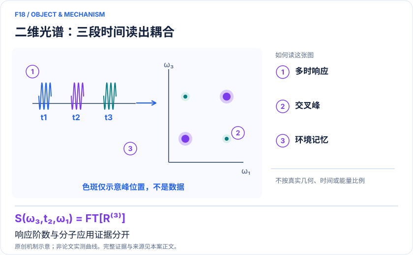
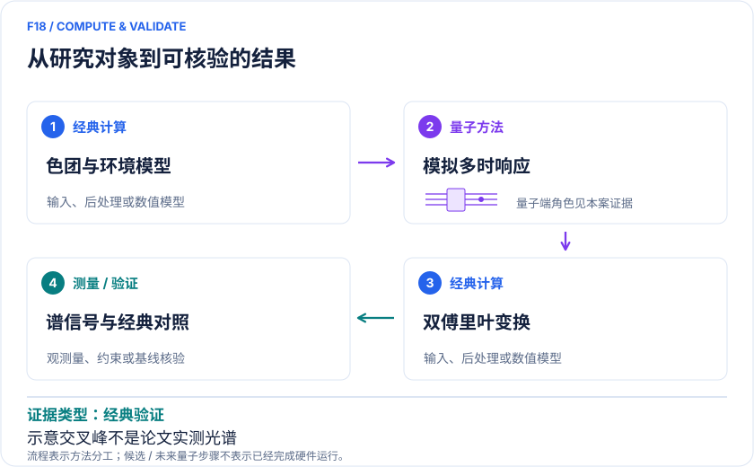

<!-- 由 release/tools/build_problems.py 自 tasks/F18-nonlinear-multidimensional-spectroscopy/README.md 与 tasks/catalog.json 生成，勿手改 -->

# F18 · 非线性二维光谱：用多时响应区分耦合、记忆与人口转移

> 开放题 · 材料模型与动力学 · 多维光谱与光功能材料
> 难度：进阶（[分级说明](../../../starters/README.md#难度分级)） · 背景：凝聚态与动力学

## 题面

| 环节 | 内容 |
|---|---|
| 研究体系 | 两个色团激子模型及有限记忆赝模环境；独立XXZ硬件响应作为方法旁证 |
| 可观测量 | 三阶R(t₃,t₂,t₁)、二维谱交叉峰、等待时间依赖、谱扩散 |
| 经典基线 | 同Hamiltonian主方程/HEOM；有结构振电模型的MCTDH；编译一致的无噪声线路 |
| 量子方法的角色 | 量子候选电路实现多次光场作用、环境辅助演化与多时关联；经典端合并路径并生成频率谱。 |
| 研发决策 | 判断二维谱交叉峰和线形变化源于直接耦合、共同环境还是人口转移，以选择有效材料动力学模型。 |

## 基准输入

原文输入没有完全公开。下表是参照运行实际使用的替代输入，解法可以沿用以便直接比较；取得原文输入或改用其他输入时请说明理由。「原文」指作者或原论文公开的材料，「参照」指本项目参照运行自行冻结的选择。

| 项目 | 内容 | 出处 |
|---|---|---|
| 参数 | ε₁=1.55、ε₂=1.46、J=−0.01、Γ=0.05908、Ω=0.1 eV，ω₀=0，g=√(ΓΩ/2) | [原文](https://arxiv.org/html/2409.05548v1) |

**尚未公开或需注意：**原文二维非线性谱的逐点收敛数据未公开。

## 什么算解

一份解法满足以下五点即可提交审核。负结果同样接受，只要过程可复现、结论有依据。

1. **模型对应**：说明所用模型或数据如何对应「两个色团激子模型及有限记忆赝模环境；独立XXZ硬件响应作为方法旁证」，列出简化与近似。
2. **可观测量**：报告「三阶R(t₃,t₂,t₁)、二维谱交叉峰、等待时间依赖、谱扩散」，附单位与不确定度。
3. **经典对照**：在同一模型或数据上，与「同Hamiltonian主方程/HEOM；有结构振电模型的MCTDH；编译一致的无噪声线路」中至少一种方法比较。
4. **可复现**：提供代码、环境、随机种子、输入来源与哈希，以及计算资源和成本；用到 QPU 时注明设备与 shots。
5. **研发决策**：说明结果能否支撑「判断二维谱交叉峰和线形变化源于直接耦合、共同环境还是人口转移，以选择有效材料动力学模型。」，以及还缺什么证据。

本题的细化标准欢迎在 issue 中讨论；被采纳的讨论结论会写入后续版本。

## 现有参照

本项目已有数值执行记录（经典计算机上的计算与模拟），供对照与复用，不代表最优解。

- 原应用目标：状态未记录
- 最新研究报告：[REFERENCE.md](REFERENCE.md)
- 其余证据指针见 evidence.json（本地证据，未随题库发布）

### 原案例说明

### F18｜非线性二维光谱：用多时响应区分耦合、记忆与人口转移

<!-- VISUALS:START -->
#### 可视化导读

**图 1 · 二维光谱：三段时间读出耦合。** 响应阶数与分子应用证据分开。三阶R(t₃,t₂,t₁)、二维谱交叉峰、等待时间依赖、谱扩散。图形为依据本案文献重绘的概念关系，不表示实际原子坐标、实测曲线或数值比例。

**图 2 · 计算与验证路径。** 量子候选电路实现多次光场作用、环境辅助演化与多时关联；经典端合并路径并生成频率谱。。**证据边界：** 没有实机完整分子二维谱或量子优势；模型交叉峰非唯一机理证据；耗散截断和路径数量影响成本。

图解依据：[R1 · Simulating Non-Markovian Dynamics in Multidimensional Electronic Spectroscopy via Quantum Algorithm](https://arxiv.org/html/2409.05548v1)；[R2 · A unified framework for efficient quantum simulation of nonlinear spectroscopy](https://arxiv.org/html/2604.16164v1)；[R3 · Nonlinear Molecular Electronic Spectroscopy via MCTDH Quantum Dynamics: From Exact to Approximate Expressions](https://mukamel.ps.uci.edu/publications/pdfs/1040.pdf)；[R4 · Nonlinear Spectroscopy via Generalized Quantum Phase Estimation](https://quantum-journal.org/papers/q-2025-08-07-1822/)。解释性连线与图形布局由本库整理，未复制论文原图。

[机制图 SVG](mechanism.svg) · [流程图 SVG](workflow.svg) · 机制图 PNG（本地证据，未随题库发布） · 流程图 PNG（本地证据，未随题库发布） · 图解说明 JSON（本地证据，未随题库发布）
<!-- VISUALS:END -->

> 文献核查截至 2026-10-04。优先级：重点储备（编辑判断）；证据：经典验证。这里的应用价值指可迁移的研究任务，未证明工业收益。本次未执行论文计算复现。

#### 应用决策：为什么人口曲线不够

一条激发态人口曲线可能被多个不同模型拟合。二维电子谱通过改变脉冲之间的等待时间，同时观察激发频率和探测频率之间的联系，能够约束不同跃迁是否耦合、环境是否保留记忆，以及哪些信号路径参与。潜在价值是帮助选择有机光功能材料或色团聚集体的有效动力学模型，而不是仅把已知人口曲线重新画成光谱。现有证据仍以模型与算法为主，未证明量子设备改善实际材料筛选。

#### 对象与实际量子规模

Gallina等2024研究采用激子二聚体，将有限记忆环境嵌入截断赝模，并用碰撞模型实现剩余耗散。一个示例包含两个系统比特、两个赝模比特，以及响应测量和可重置碰撞辅助各一个，共六个比特。论文明确线路在经典高性能计算机的Qiskit Aer上运行，因为所需深度超出现阶段噪声承受范围。它展示的是同模型光谱算法验证，并非六比特实机的分子测量。[R1]

#### 数学目标、工作流及可观察信号

目标是三阶响应R(t₃,t₂,t₁)，对t₁和t₃作双傅里叶变换得到固定等待时间t₂下的二维谱。量子候选流程为初态准备、光场作用、环境演化、后续光场作用及辅助测量；经典端按偶极权重和符号合并不同响应路径。与只算吸收谱不同，漂白、受激发射和激发态吸收等贡献可能相互抵消。因此拟合单个峰高或只保留最强路径，未必保持正确的机理判断。

#### 硬件前沿必须单独解释

Xiong等2026预印本用广义参数移位将高阶响应写为有限泵浦强度下的测量组合，在IBM设备的十二比特XXZ子链演示四阶和五阶响应。文中同时展示原始数据与经验指数包络修正后的结果；二者不能混淆。其直接/共同模式耦合的二维光谱模型讨论，为交叉峰归因提供另一个例子，但不等于在硬件上完成了R1的耗散分子二聚体谱。两篇工作的最佳指标不能拼接成一个已实现的系统。[R2]

#### 强经典参照与容错路线

Segatta等以芘的亮态到暗态非绝热过程为对象，通过MCTDH计算线性和非线性响应，并比较更便宜的近似。它说明成熟经典量子动力学能够处理有结构的振电Hamiltonian，不能把完整Hilbert空间维数当作唯一经典成本。[R3] Loaiza等2025年提出广义相位估计非线性谱算法，属于另一种资源条件下的方法路线；其复杂度结论不能直接替代近期设备的采样和校准账单。[R4]

#### 证据边界与最容易误判之处

建议将交叉峰视为对候选模型的约束，不能单凭它断言能量已经在两个色团间转移。共同环境也可能建立相关；有限脉冲宽度、频谱覆盖和响应路径干涉还会改变峰形。环境谱密度及赝模截断是物理输入，不能靠多加shots弥补。误差缓解如使用拟合包络，应在预留时间点或独立数据上验证，避免把待证明的振荡形状带入校正。

#### 建议可复现试点与输入

建议从公开二聚体模型开始，固定站点能、耦合、偶极方向、环境谱密度、温度、赝模截断、脉冲近似、三段时间网格及傅里叶窗。第一步以直接主方程或合适的HEOM给出参考；第二步重建无噪声线路并检查路径求和；第三步扫描赝模层级和时间步；第四步引入有限shots，输出多等待时间谱图与置信区间。若以后替换成具体分子，需重新建立电子结构、振动及溶剂输入闭包。

#### 验收应以辨识能力为中心

建议预注册两个可区分的候选模型，例如直接耦合与共同环境耦合，在相同谱分辨率、信号强度和采样预算下比较。验收包括线性谱一致性、完整二维谱距离、峰位与交叉峰符号、等待时间的相关衰减以及截断收敛；不能仅比较颜色图目测相近。要求模型差异大于数值和采样误差，再谈实验参数反演。上述试点未在本次调研运行。

#### 停止条件、资源与下一步

若路径数量和三维时间网格使采样成本超过强经典方法，或经验校正改变了交叉峰归因，应停止升级。资源必须计入辅助重置、所有响应路径、泵浦移位、谱网格和后处理，不能只报单条线路深度。下一步应优先找出哪一类多色团、多模或非高斯环境确实使经典响应计算困难，再评估量子路线；当前适合建设谱学接口和误差基准，不宜承诺生产加速。

#### 区分模型可辨识与参数可辨识

建议先用合成数据测试反演是否唯一：改变直接耦合、环境记忆时间或非均匀展宽，可能产生相近的二维图像。若多个参数组同时满足谱图误差，应保留多解并设计额外等待时间或偏振条件，而不是强行输出一个最优参数。实验比较还应固定脉冲频谱覆盖与探测窗口，否则缺失的交叉峰可能只是仪器未激发相应跃迁。对于量子资源规划，应优先验证哪些观测点真正能排除候选机制，再决定是否需要完整频率网格。局部谱点节省成本的同时必须说明丢失的信息，不能把少数响应值的演示写成整个二维谱已可高效求得。

#### docs 来源与新增边界

本轮外部文献扩展；与已有 F/C 案例交叉参照。旧目录用于去重，文档中的指令不作为用户授权。

B14/F08主要交付转移人口及速率，F10主要为一维振电子谱，M14侧重光伏振电动力学。本案独立交付多次光场作用产生的高阶多时响应和二维谱；光谱路径、交叉峰归因与等待时间是新增验收对象。

#### 原始来源与访问深度

- **[R1]** [Simulating Non-Markovian Dynamics in Multidimensional Electronic Spectroscopy via Quantum Algorithm](https://arxiv.org/html/2409.05548v1)，2024；预印本；访问：`full_text`。支持：激子二聚体、赝模碰撞模型、6比特寄存器与Qiskit Aer模拟；JCTC20,10588–10601。 DOI：[10.1021/acs.jctc.4c01204](https://doi.org/10.1021/acs.jctc.4c01204)。
- **[R2]** [A unified framework for efficient quantum simulation of nonlinear spectroscopy](https://arxiv.org/html/2604.16164v1)，2026；预印本；访问：`full_text`。支持：IBM12比特XXZ四/五阶响应、经验包络后处理；直接/间接耦合二维谱模型示范需与硬件部分区分。 DOI：[10.48550/arXiv.2604.16164](https://doi.org/10.48550/arXiv.2604.16164)。
- **[R3]** [Nonlinear Molecular Electronic Spectroscopy via MCTDH Quantum Dynamics: From Exact to Approximate Expressions](https://mukamel.ps.uci.edu/publications/pdfs/1040.pdf)，2023；期刊论文；访问：`full_text`。支持：独立经典基线：芘S₂→S₁振电模型、MCTDH三阶响应与近似线形比较。 DOI：[10.1021/acs.jctc.2c01059](https://doi.org/10.1021/acs.jctc.2c01059)。
- **[R4]** [Nonlinear Spectroscopy via Generalized Quantum Phase Estimation](https://quantum-journal.org/papers/q-2025-08-07-1822/)，2025；期刊论文；访问：`abstract`。支持：独立容错算法路线将相位估计推广到非线性响应，不能当作近端硬件效果。 DOI：[10.22331/q-2025-08-07-1822](https://doi.org/10.22331/q-2025-08-07-1822)。

## 如何提交

按 [CONTRIBUTING.md](../../../CONTRIBUTING.md) 把解法放在 `solutions/F18/<你的名字>-<短名>/`，格式见 [解法模板](../../../solutions/_template/SOLUTION.md)。被采纳的解法会按 [沉淀规则](../../../skills/README.md) 提炼为可复用的 skill。
