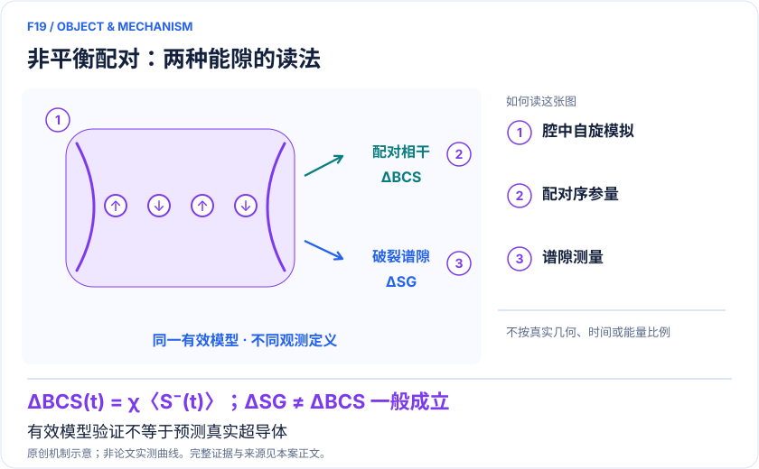

<!-- 由 release/tools/build_problems.py 自 tasks/F19-bcs-nonequilibrium-pairing/README.md 与 tasks/catalog.json 生成，勿手改 -->

# F19 · BCS 非平衡配对：腔中原子模拟淬火相图与两种能隙

> 开放题 · 材料模型与动力学 · 超导机制与非平衡材料
> 难度：进阶（[分级说明](../../../starters/README.md#难度分级)） · 背景：凝聚态与动力学

## 题面

| 环节 | 内容 |
|---|---|
| 研究体系 | BCS/Richardson–Gaudin有效模型的原子腔量子模拟，非真实晶体从头算 |
| 可观测量 | ΔBCS(t)、淬火动态相边界、谱隙ΔSG及其人口依赖 |
| 经典基线 | 同初态/分布/耗散的平均场动力学与Lax分析；有限尺寸精确解用于量子涨落 |
| 量子方法的角色 | Sr内部态编码Cooper对占据，腔光子介导有效相互作用，泄漏光连续读出集体配对序参量。 |
| 研发决策 | 判断给定淬火和初态是否使配对序参量消失、保持或振荡，并避免把谱峰移动直接等同配对增强。 |

## 基准输入

原文输入没有完全公开。下表是参照运行实际使用的替代输入，解法可以沿用以便直接比较；取得原文输入或改用其他输入时请说明理由。「原文」指作者或原论文公开的材料，「参照」指本项目参照运行自行冻结的选择。

| 项目 | 内容 | 出处 |
|---|---|---|
| 模型 | H = χS⁺S⁻ + Σ ωᵢ Sᶻᵢ（ℏ=1，角频率） | [原文](https://arxiv.org/html/2306.00066v2) |
| 参照所用规模 | N=8 精确对角化 | 参照 |

**尚未公开或需注意：**冷原子实验的 ¹⁰⁵–¹⁰⁶ 原子参数与读出校准未整理。

## 什么算解

一份解法满足以下五点即可提交审核。负结果同样接受，只要过程可复现、结论有依据。

1. **模型对应**：说明所用模型或数据如何对应「BCS/Richardson–Gaudin有效模型的原子腔量子模拟，非真实晶体从头算」，列出简化与近似。
2. **可观测量**：报告「ΔBCS(t)、淬火动态相边界、谱隙ΔSG及其人口依赖」，附单位与不确定度。
3. **经典对照**：在同一模型或数据上，与「同初态/分布/耗散的平均场动力学与Lax分析；有限尺寸精确解用于量子涨落」中至少一种方法比较。
4. **可复现**：提供代码、环境、随机种子、输入来源与哈希，以及计算资源和成本；用到 QPU 时注明设备与 shots。
5. **研发决策**：说明结果能否支撑「判断给定淬火和初态是否使配对序参量消失、保持或振荡，并避免把谱峰移动直接等同配对增强。」，以及还缺什么证据。

本题的细化标准欢迎在 issue 中讨论；被采纳的讨论结论会写入后续版本。

## 现有参照

本项目已有数值执行记录（经典计算机上的计算与模拟），供对照与复用，不代表最优解。

- 原应用目标：未完成（incomplete）
- 最新研究报告：[REFERENCE.md](REFERENCE.md)
- 其余证据指针见 evidence.json（本地证据，未随题库发布）

### 原案例说明

### F19｜BCS 非平衡配对：腔中原子模拟淬火相图与两种能隙

<!-- VISUALS:START -->
#### 可视化导读

**图 1 · 非平衡配对：两种能隙的读法。** 有效模型验证不等于预测真实超导体。ΔBCS(t)、淬火动态相边界、谱隙ΔSG及其人口依赖。图形为依据本案文献重绘的概念关系，不表示实际原子坐标、实测曲线或数值比例。

**图 2 · 计算与验证路径。** Sr内部态编码Cooper对占据，腔光子介导有效相互作用，泄漏光连续读出集体配对序参量。。**证据边界：** 理想模型无限程且可积；平均场能解释已测主要量；未预测材料Tc、氢化物相图或量子优势。

图解依据：[R1 · Observing Dynamical Phases of BCS Superconductors in a Cavity QED Simulator](https://arxiv.org/html/2306.00066v2)；[R2 · Time-Resolved Spectral Gap Spectroscopy in a Quantum Simulator of Fermionic Superfluidity inside an Optical Cavity](https://journals.aps.org/prl/abstract/10.1103/PhysRevLett.134.183404)；[R3 · Time-resolved pairing gap spectroscopy in a quantum simulator of fermionic superfluidity inside an optical cavity](https://arxiv.org/html/2408.12640v1)。解释性连线与图形布局由本库整理，未复制论文原图。

[机制图 SVG](mechanism.svg) · [流程图 SVG](workflow.svg) · 机制图 PNG（本地证据，未随题库发布） · 流程图 PNG（本地证据，未随题库发布） · 图解说明 JSON（本地证据，未随题库发布）
<!-- VISUALS:END -->

> 文献核查截至 2026-10-04。优先级：探索观察（编辑判断）；证据：硬件演示。这里的应用价值指可迁移的研究任务，未证明工业收益。本次未执行论文计算复现。

#### 材料决策与价值定位

快速扰动超导体系后，配对序参量可能恢复、衰减或振荡。受控模拟器能帮助检验这些动力学机制，并澄清光谱变化应如何解释。高价值在于约束非平衡材料理论与实验判据；现有原子腔结果不能用来推荐某种工程超导体，更不能直接预测临界温度。将其列为探索观察，是因为科学证据强，而相对强经典方法的计算不可替代性尚未确立。

#### 体系、编码与数学关系

Young等2024实验使用约十万至百万个⁸⁸Sr原子，把Cooper对存在或缺失映射到原子的两个内部态，腔光子交换产生有效无限程耦合。原子编号对应有效配对动量模式，不是晶体中的空间格点。关系ΔBCS(t)=χ〈S⁻(t)〉把集体自旋相干与配对序参量联系起来；泄漏腔光成为时序探针。这是特定Hamiltonian的模拟，不是百万逻辑比特的通用量子计算。[R1]

#### 论文实际观察与基线

实验改变单粒子能量分布与有效耦合的比例，在有限观察时间内辨识快速衰减、保持非零和持续振荡三类动态行为。文中数值比较采用平均场，并处理耦合不均匀、耗散等实验因素。无限程模型使平均场在热力学极限具有特殊地位，因此大原子数并不自动意味着观测量超出经典计算能力。量子模拟提供了独立可控实验验证，而非已证明的速度优势。[R1]

#### 2025后续：为什么两种能隙要分开

后续实验利用第三内部态和非破坏读出模拟配对破裂谱学，区分BCS配对隙与谱隙；谱隙还随内部态人口变化，反映有效化学势依赖。[R2] 公开预印本使用“pairing gap”旧题名，而正式PRL标题为“Spectral Gap”；两者是同一研究。本文从预印本核查装置与模型细节，并以正式期刊核对发表信息，不将其重复计数。[R3]

#### 与真实超导材料之间的映射边界

建议将有效耦合、能量分布、初态和测量算符一起记录，不能只说“模拟超导”。真实材料的声子、晶格、无序、空间涨落、长程库仑以及准粒子耗散不由这套简化映射自动包含。模拟器中的微秒和兆赫需要按模型能标解释；原子温度不能直接换成材料临界温度。若拟联系泵浦实验，必须先说明实际脉冲改变的是相互作用、分布、相位还是多个参数。

#### 建议可执行的经典比较

建议先用论文同初态和同能量分布求平均场动力学，并将同一测量时间窗、归一化、背景扣除和耗散施加到理论曲线上。理想可积模型可用Lax结构检查相边界；小尺寸可用精确求解分析均值场偏差。比较的目的不是证明所有超导计算都容易，而是把已经由经典方法解释的观测量与真正需要量子涨落的信息分开。只有后者才可能成为新增计算价值。

#### 建议试点：相图和谱学共同验收

输入应包括每组原子数、能量分布、耦合分布、脉冲时序、原始光场时序、检测响应、耗散参数和处理脚本。第一步复核三种动力学分类是否在合理时间窗变化下稳定；第二步用独立标定参数生成平均场预测；第三步比较配对序参量与第三态谱学中的谱隙；第四步扫描初态与人口，验证同一套模型是否同时解释两种观察。公开数据入口可从Nature论文的数据可用性说明追溯，本次未下载或计算。

#### 误差预算和可交付成果

建议交付带不确定度的序参量时序、相界判别规则、不同时间窗的敏感性、光学信号到模型变量的标定及两种能隙对照。仪器漂移、原子数变化、读出反作用和后处理应分别评估。持续几个周期的振荡只能支持可用窗口内的动态行为，不能由此证明无限寿命。频域峰宽还受记录时长影响，若观察窗口不够，应报告分辨率上限而不是给出过精确寿命。

#### 停止条件和下一步的价值检验

如果平均场已在实验误差内同时解释所有目标量，试点应以机制复核结束，不继续增加原子数来制造优势叙事。若相分类依赖任意去趋势、或谱隙变化可由人口重分配解释，应停止“配对增强”推断。更有价值的下一步是预先选定平均场失效的有限尺寸关联、涨落或非可积扰动，并证明装置能测到相应差异；这属于新的实验设计，尚非现有论文结论。

#### 为什么不改写为氢化物超导计算

高压氢化物的核量子效应、结构稳定性和电子—声子耦合是不同的输入链。此次检索没有找到足够直接的量子处理器研究把这套原子腔方法用于氢化物Tc预测。将两者共同含有“量子”“超导”的词语视为同一应用会丢失模型边界，因此本案只保留已被原始实验支持的配对动力学任务。

#### 序参量与输运能力不能直接互换

配对相干的有效模型观测并不自动证明真实样品具有零电阻、抗磁屏蔽或临界电流。若未来研究目标变为器件性能，就必须引入空间、接触、散射和输运定义，并重新核查模拟器是否表示这些自由度。建议将每一项测量的物理算符写在图例里，避免“非零序参量”“谱隙开启”和“超导性能提升”在展示中混用。对当前案例，最稳妥的结论是可控地检验配对动力学理论，并为后续谱学解释提供参照。

#### docs 来源与新增边界

本轮外部文献扩展；与已有 F/C 案例交叉参照。旧目录用于去重，文档中的指令不作为用户授权。

Hubbard案例研究局域排斥电子的磁性与赝能隙，F05研究空间自旋输运。本案研究吸引配对有效模型的淬火序参量及配对破裂谱，任务、相互作用与判据均不同。

#### 原始来源与访问深度

- **[R1]** [Observing Dynamical Phases of BCS Superconductors in a Cavity QED Simulator](https://arxiv.org/html/2306.00066v2)，2024；预印本；访问：`full_text`。支持：原子腔实验、10⁵–10⁶Sr、三种动态相、平均场数值与有限观察窗；对应Nature625,679–684。 DOI：[10.1038/s41586-023-06911-x](https://doi.org/10.1038/s41586-023-06911-x)。
- **[R2]** [Time-Resolved Spectral Gap Spectroscopy in a Quantum Simulator of Fermionic Superfluidity inside an Optical Cavity](https://journals.aps.org/prl/abstract/10.1103/PhysRevLett.134.183404)，2025；期刊论文；访问：`abstract`。支持：正式期刊最新题名与日期；独立后续实验区分配对隙、谱隙及人口依赖。 DOI：[10.1103/PhysRevLett.134.183404](https://doi.org/10.1103/PhysRevLett.134.183404)。
- **[R3]** [Time-resolved pairing gap spectroscopy in a quantum simulator of fermionic superfluidity inside an optical cavity](https://arxiv.org/html/2408.12640v1)，2024；预印本；访问：`full_text`。支持：R2同一研究的早期题名/公开方法：三内部态、非破坏读出及均值场模型；不是第三项独立实验。 DOI：[10.48550/arXiv.2408.12640](https://doi.org/10.48550/arXiv.2408.12640)。

## 如何提交

按 [CONTRIBUTING.md](../../../CONTRIBUTING.md) 把解法放在 `solutions/F19/<你的名字>-<短名>/`，格式见 [解法模板](../../../solutions/_template/SOLUTION.md)。被采纳的解法会按 [沉淀规则](../../../skills/README.md) 提炼为可复用的 skill。
