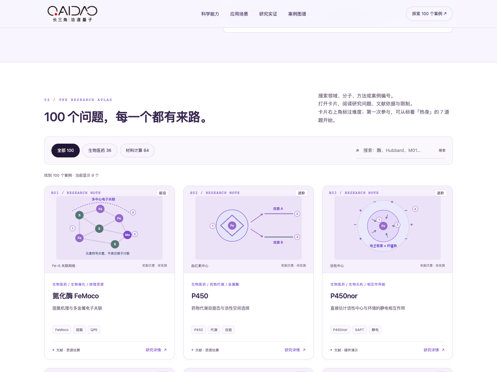

# 洽道量子 · 科学能力图文展示

[](index.html)

- [展示页](index.html)：包含 100 个案例、机制图、领域筛选、搜索和可展开详情；每张卡片标注难度，详情里给出入门轨道与提交入口。机制图放在同目录的 `visuals/`，下载时须连同该目录一起保存；除外部文献链接外可离线使用。
- 完整离线展示包（`对外展示包.zip`）：包含单文件版网页与 100 案例清单，同时保留 2026-10-12 的原 84 案例演示版、PDF、文案和封面。它含 PDF 等数据文件且超过 1MB，不放入仓库，另行分发。
- [文件校验值](manifest.json)：记录展示页、预览图与每张机制图的 SHA-256。

本页沿用“紫晶银雾”配色和原 QAIDAO 标识。图示为教学／概念示意，非实测数据。案例目录更新于 2026-10-28，执行统计沿用 2026-10-14 的展示快照；M01 实例来自 R151 报告，晓梦接入内容为规划。案例收录与组件记录均不代表原应用已完成。

维护者在本地工作目录完成改动和浏览器检查后，运行：

```sh
python3 -I release/tools/sync_showcase.py
python3 -I release/tools/sync_showcase.py --check
```

该命令仅同步明确列出的发布文件，不复制研究原始目录、内部材料或本机验证环境。源码与本机浏览器检查仍位于被 Git 忽略的 `showcase-2026-10/source/`；同步时把源页面内嵌的 SVG 机制图拆到 `visuals/`（文件名取内容哈希前 16 位），使每个入库文件不超过 1MB；其余样式、脚本和展示数据仍在 HTML 内。
